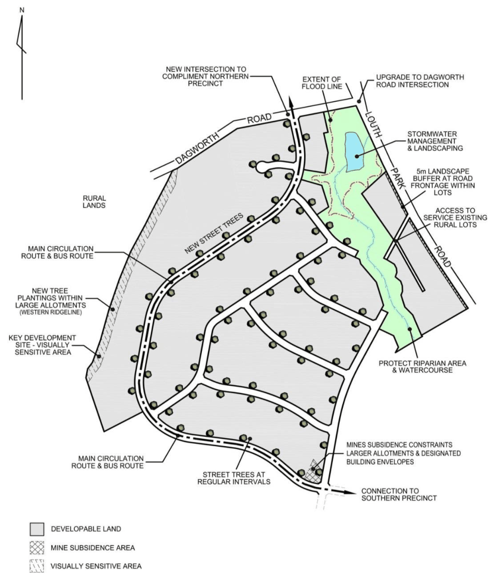

#### 10.4.14.14. Archaeological Heritage

#### Objectives

O.480 Heritage items, buildings with heritage significance and conservation areas are protected.

| PRESCRIPTIVE CONTROLS AND ACCEPTABLE SOLUTIONS Staff, contractors and construction and maintenance people involved in the development the site are to be made aware of statutory requirements pertaining to archaeological and artefacts. will be impacted by construction works a Section 90 permit under the National Wildlife Act 1974 (CTD-salvage) is required prior to any works. be impacted by construction works a Section 90 permit under the National Act 1974 (collect) is required prior to any works. be impacted by any construction works a Section 87 (test excavation) works. |  |
|---|---|
| PC.1 • O.480 of sites |  |
| PC.2 | If site LP1 Parks and |
| • O.480 |  |
| PC.3 | If site LP2 will Parks and Wildlife |
| • O.480 |  |
| PC.4 | If PAD’s 1, 2 or 3 will is required prior to any |
| • O.480 |  |

### Development Requirements – Central Precinct

No specific requirements have been made for the following matters within the Central Precinct of the Louth Park Urban Release Area as they are already adequately addressed by other relevant provisions within the Maitland Local Environmental Plan 2011 and the Maitland Development Control Plan 2026:

• Passive and Active Recreation Areas

• Residential Densities

• Neighbourhood Commercial and Retail Uses

• Provision of Public Facilities and Services

> [Picture on page 226: a picture, saved as a picture (images/ch-10-00-special-precincts-locality-plans-and-urban-release-page-226-9.gif, 150 dpi).]

#### Figure 10-110: Central Precinct and Road Hierarchy

#### Objectives

O.481 To provide for the timely and efficient release of urban land making provision for necessary

infrastructure and sequencing.

#### PRESCRIPTIVE CONTROLS AND ACCEPTABLE SOLUTIONS

Where development is for the purpose of subdivision that is intended to be constructed in stages, a staging plan for construction is to be provided.

#### PC.1

• O.481
