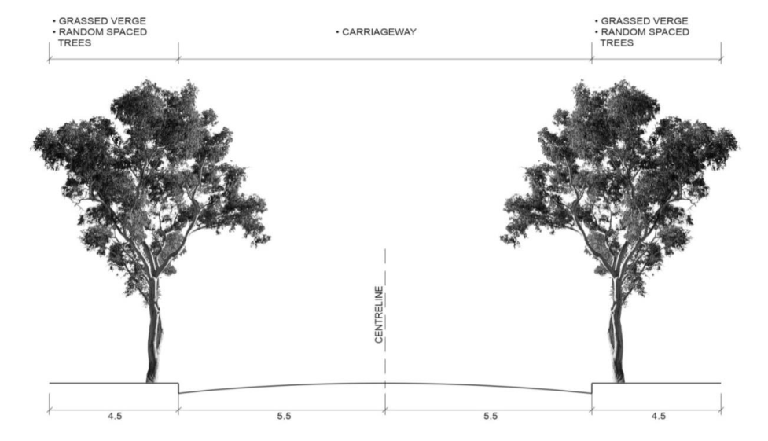

#### 10.4.14.16. Transport Movement Hierarchy

#### Objectives

O.482 To achieve a simple and safe movement system for private vehicles, public transport, pedestrians

and cyclists.

O.483 To provide walkable neighbourhoods with convenient access to neighbourhood shops, community

facilities and other services, with less dependence on cars for travel

O.484 To provide for access generally by way of an interconnected network of streets and paths which

facilitate safe, efficient and pleasant walking, cycling and driving.

O.485 To facilitate new development which supports the efficiency of public transport systems, and

provides safe, direct access to the system for residents.

| PRESCRIPTIVE CONTROLS AND ACCEPTABLE SOLUTIONS |  |
|---|---|
| PC.1 | Road layout and street design will be consistent with the adopted Central Precinct and Road Hierarchy Plan provided in Figure 10-110 and following detailed survey and subdivision planning. Road design and widths in this precinct are to satisfy the aims and objectives of Council’s MoES, but importantly provide for attractive streets. |
| • O.482 |  |
| • O.484 |  |
| • O.485 |  |
| PC.2 | The main circulation route must include a landscaped entry and planted median adjacent to the Dagworth Road intersection. |
| • O.483 |  |
| • O.485 |  |
| PC.3 | The main circulation road is to have street tree plantings at regular intervals along its full length. Figure 10-111 provides a typical road section. |
| • O.483 |  |
| PC.4 | No new lots are to have direct vehicular access to Louth Park Road, except where traffic safety can be demonstrated, and existing dwelling houses are to be redeveloped in a coordinated and orderly manner. |
| • O.482 |  |
| • O.483 |  |
| • O.485 |  |

> [Picture on page 228: a picture, saved as a picture (images/ch-10-00-special-precincts-locality-plans-and-urban-release-page-228-1.gif, 150 dpi).]

#### Figure 10-111: Road Section for Main Circulation Route
