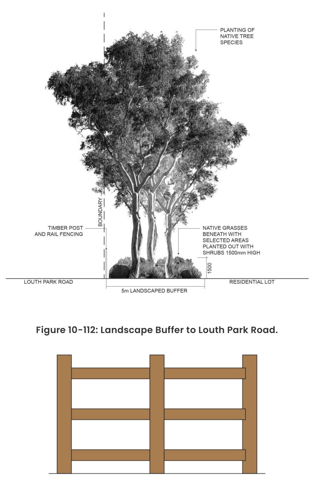

#### 10.4.14.17. Overall Landscaping Strategy

#### Objectives

O.486 To soften the visual impact of all built elements, creating attractive and consistent streetscapes

when viewed by passing traffic and pedestrians.

O.487 To ensure key environmental areas such as waterways, vegetation, land resources, and areas of

cultural significance and scenic value are protected.

O.488 To provide landscaping appropriate to the nature and scale of development that enhances the local

character and streetscape, supports retention and regeneration of ecological corridors and provides visual interest and a suitable backdrop to the built form.

O.489 To ensure the landscaping and visual qualities of the area are maintained.

| PRESCRIPTIVE CONTROLS AND ACCEPTABLE SOLUTIONS Landscaping will be required on any new allotment immediately adjacent to Louth Park Road, consisting of a 5m wide buffer. landscaping buffer is to be practical, integrated with any vehicular access, safe sight and traffic safety in general. Such buffer landscaping will be within allotments in perpetuity by way of a protective restriction as to user on title or diagram in Figure 10-112 shows a typical cross-section of the buffer. are not affected by proposed new roads, infrastructure or buildings are possible within riparian corridors, flood liable lands, road reserves mature trees within and adjacent to the Louth Park Road and should additionally be retained to enhance the natural landscape should be integrated with landscape plans and include, where Endangered Ecological Communities (EEC). |  |
|---|---|
| PC.1 • O.486 • O.487 This • O.488 distances • O.489 and maintained covenant. The |  |
| AS.1 Existing trees that • O.486 to be retained where • O.487 and open space. Existing • O.489 Dagworth Road reserves character of the area. |  |
| AS.2 | Any re-vegetation proposals possible, areas supporting |
| • O.486 |  |
| • O.488 |  |
| • O.489 |  |

| PRESCRIPTIVE CONTROLS AND ACCEPTABLE SOLUTIONS |  |
|---|---|
| PC.2 | Landscaping plans will include appropriate street tree plantings at regular intervals within the precinct, particularly along the main circulation road. Similarly, landscaping is to be provided at key intersections on Louth Park Road and Dagworth Road. |
| • O.486 |  |
| • O.488 |  |
| • O.489 |  |
| PC.3 | The precinct is to have consistent post and rail timber fencing treatments to Louth Park Road and Dagworth Road frontages where fencing is needed for safety, security or visual enhancement. |
| • O.486 |  |
| • O.488 |  |
| • O.489 |  |
| PC.4 • O.486 • O.488 • O.489 | Any individual allotment boundary fencing within the precinct shall be timber post and rail style, or similar open style rural fence and such requirements will be reinforced and protected via mechanisms such as restrictions as to user on titles and covenants. Figure 10-113 provides a reference fencing design. If necessary for pets, safety or security, fencing may be modified to include the installation of wire or galvanised mesh. |
| PC.5 • O.486 • O.488 • O.489 | A Visual and Scenic Impact Assessment is to accompany Development Applications for subdivision development within the precinct and shall include proposed ameliorative measures such as new tree plantings and retention of existing mature trees within and adjacent to ridgeline areas and mid slopes to provide a vegetated skyline in accordance with the Precinct Plan. |
| PC.6 | No new dwellings, garages or outbuildings are to be located within 15m of Louth Park Road. |
| • O.486 |  |
| • O.489 |  |
| PC.7 | A 5m landscape buffer is to be provided along any boundary adjoining Louth Park Road. |
| • O.486 |  |
| • O.488 |  |
| PC.8 | Building envelopes are to be positioned to retain existing vegetation and hollow bearing trees where practicable. |
| • O.487 |  |
| • O.489 |  |
| PC.9 | Where impacts are proposed on areas of biodiversity value, demonstration on how the proposal will meet the “improve or maintain” threshold will be required with the development application. |
| • O.487 |  |
| • O.488 |  |

> [Picture on page 230: a picture, saved as a picture (images/ch-10-00-special-precincts-locality-plans-and-urban-release-page-230-1.gif, 150 dpi).]

#### Figure 10-112: Landscape Buffer to Louth Park Road.

#### Figure 10-113: Typical Timber Boundary Fencing or Similar.

#### Objectives

O.490 To provide for an integrated and sustainable approach to the design and provision of open space

and urban water management.

O.491 To protect and enhance the water quality, water quantity and habitat value of downstream

waterways and environment.

O.492 To prevent erosion and run-off during site preparation, construction and the ongoing use of the land

to minimise cumulative impact on receiving waterways.

| PRESCRIPTIVE CONTROLS AND ACCEPTABLE SOLUTIONS |  |
|---|---|
| PC.1 • O.490 | Applications for subdivision involving new or upgraded roads are to include a Stormwater Management Plan (SWMP) for the precinct consistent with the principles for Water Sensitive Urban Design (WSUD). |
| PC.2 | The number and location of WSUD elements are to be determined by modelling to develop the SWMP for the site and be integrated with the overall design. |
| • O.490 |  |
| • O.492 |  |
| PC.3 | Long term maintenance costs are to be identified in the design of the WSUD elements and are to be submitted to Council for consideration prior to acceptance of the SWMP. |
| • O.490 |  |
| • O.492 |  |
| AS.1 • O.490 • O.492 | Swales may be acceptable where it can be demonstrated that they will meet Council’s performance and maintenance objectives and facilitate safe and effective movement of pedestrians and vehicles. Flow control measures are to be used where grades in swales exceed 4%. |
| AS.2 • O.492 | Wherever possible, existing natural drainage gullies should form part of a stormwater and runoff drainage system incorporating detention basins and/ or wetlands to alleviate stormwater peak and retain pollutants. |
| AS.3 | Slopes surrounding wetlands should be gentle and offer convenient tractor-mowing access. |
| • O.492 |  |
| AS.4 | Gullies intended to be left in their natural state should be assessed, and if necessary enhanced to offset the need for maintenance. |
| • O.492 |  |
| PC.4 • O.491 | Any proposed alteration/modification to existing dams are to be supported by a Flora and Fauna Assessment by a suitably qualified consultant targeting the Green and Golden Bell Frog. The target search is to be conducted during the appropriate months for this species. |
