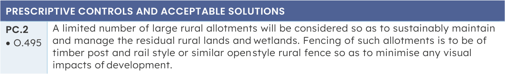

#### 10.4.14.20. Key Development Sites

#### Objectives

O.495 Detailed urban design controls are provided for significant development sites.

#### Ridgelines and Slopes

| PRESCRIPTIVE CONTROLS AND ACCEPTABLE SOLUTIONS |  |
|---|---|
| PC.1 • O.495 | A Visual and Scenic Impact Assessment is required to help inform the subdivision design and layout and include landscaping measures to protect the prominent skyline. This must include, but is not exclusive to, the following: a. The development is to retain existing vegetation to screen and break up visual impacts, b. The area along the western ridgeline shall include larger allotments of a minimum 4000m², so as to provide adequate land area to include new buildings, generous setbacks and appropriate new tree plantings, c. Roof lines of dwellings are not to protrude above the ridgeline, and d. Dwellings associated with lots adjoining the ridgeline are to be single story design. |

#### Residual Rural Lands

> [Picture on page 233: a picture, saved as a picture (images/ch-10-00-special-precincts-locality-plans-and-urban-release-page-233-2.gif, 150 dpi).]
> Words printed on the picture (title and legend, copied from the PDF):
> • O.495
> impacts of development.

#### PRESCRIPTIVE CONTROLS AND ACCEPTABLE SOLUTIONS PC.2

A limited number of large rural allotments will be considered so as to sustainably maintain and manage the residual rural lands and wetlands. Fencing of such allotments is to be of timber post and rail style or similar open style rural fence so as to minimise any visual
