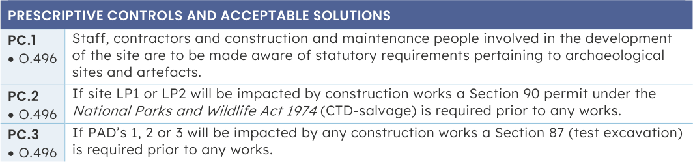
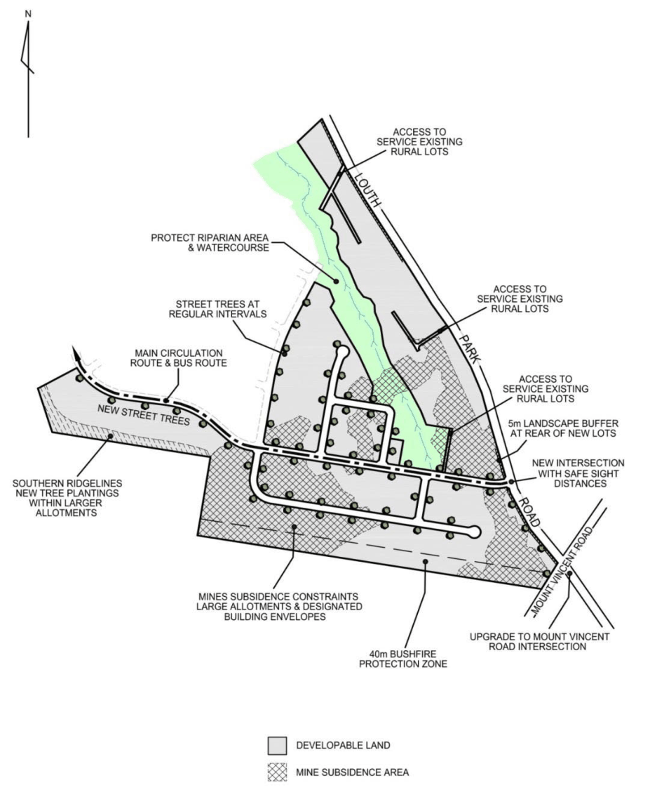

#### 10.4.14.21. Archaeological Heritage

#### Objectives

O.496 Heritage items, buildings with heritage significance and conservation Areas are protected.

> [Picture on page 233: a picture, saved as a picture (images/ch-10-00-special-precincts-locality-plans-and-urban-release-page-233-11.gif, 150 dpi).]
> Words printed on the picture (title and legend, copied from the PDF):
> • O.496
> • O.496
> • O.496

#### PRESCRIPTIVE CONTROLS AND ACCEPTABLE SOLUTIONS PC.1

Staff, contractors and construction and maintenance people involved in the development of the site are to be made aware of statutory requirements pertaining to archaeological sites and artefacts. If site LP1 or LP2 will be impacted by construction works a Section 90 permit under the National Parks and Wildlife Act 1974 (CTD-salvage) is required prior to any works.

#### PC.2

If PAD’s 1, 2 or 3 will be impacted by any construction works a Section 87 (test excavation) is required prior to any works.

#### PC.3

### Development Requirements – Southern Precinct

No specific requirements have been made for the following matters within the Southern Precinct of the Louth Park Urban Release Area as they are already adequately addressed by other relevant provisions within the Maitland Local Environmental Plan 2011 and the Maitland Development Control Plan 2026:

• Passive and Active Recreation Areas

• Residential Densities

• Neighbourhood Commercial and Retail Uses

• Provision of Public Facilities and Services

> [Picture on page 234: a picture, saved as a picture (images/ch-10-00-special-precincts-locality-plans-and-urban-release-page-234-9.gif, 150 dpi).]

#### Figure 10-114: Southern Precinct and Road Hierarchy

#### Objectives

O.497 To provide for the timely and efficient release of urban land making provision for necessary

infrastructure and sequencing.

#### PRESCRIPTIVE CONTROLS AND ACCEPTABLE SOLUTIONS

Where development is for the purpose of subdivision that is intended to be constructed in stages, a staging plan for construction is to be provided.

#### PC.1

• O.497
