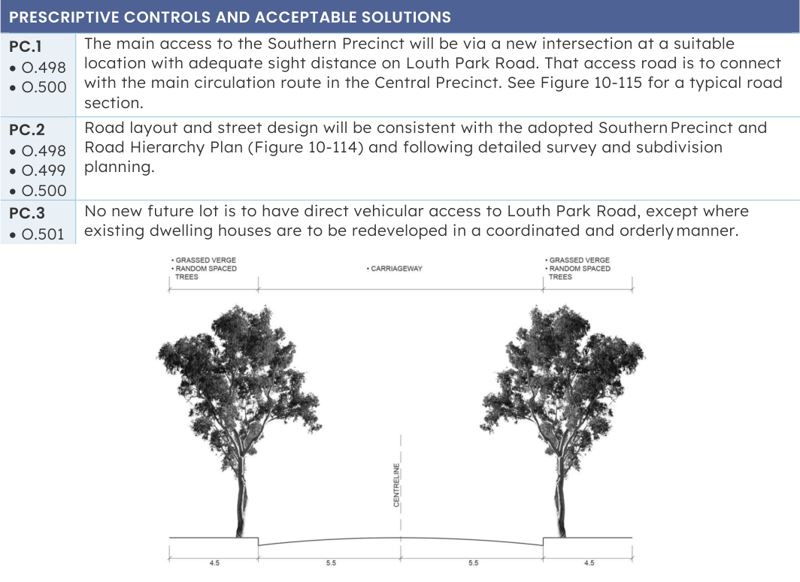
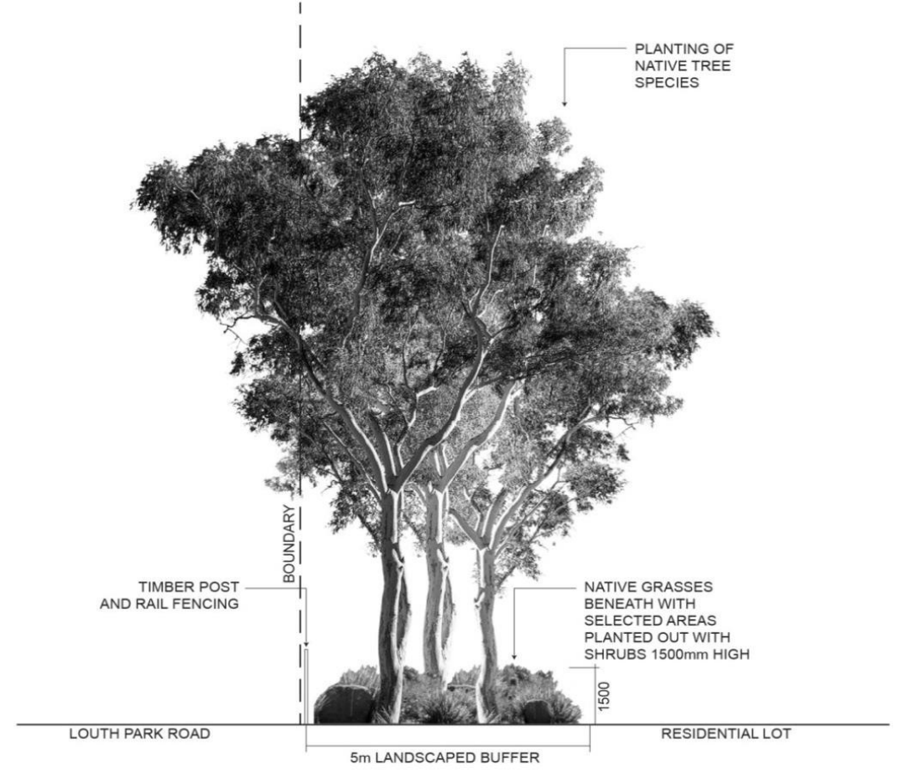
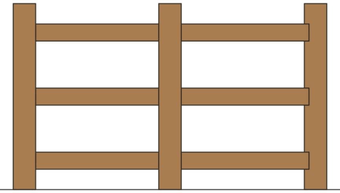

#### 10.4.14.23. Transport Movement Hierarchy

#### Objectives

O.498 To achieve a simple and safe movement system for private vehicles, public transport, pedestrians

and cyclists.

O.499 To provide walkable neighbourhoods with convenient access to neighbourhood shops, community

facilities and other services, with less dependence on cars for travel

O.500 To provide for access generally by way of an interconnected network of streets and paths which

facilitate safe, efficient and pleasant walking, cycling and driving.

O.501 To facilitate new development which supports the efficiency of public transport systems, and

provides safe, direct access to the system for residents.

> [Picture on page 235: a picture, saved as a picture (images/ch-10-00-special-precincts-locality-plans-and-urban-release-page-235-19.gif, 150 dpi).]
> Words printed on the picture (title and legend, copied from the PDF):
> • O.498
> • O.500
> planning.
> • O.498
> • O.499
> • O.500
> • O.501

#### PRESCRIPTIVE CONTROLS AND ACCEPTABLE SOLUTIONS PC.1

The main access to the Southern Precinct will be via a new intersection at a suitable location with adequate sight distance on Louth Park Road. That access road is to connect with the main circulation route in the Central Precinct. See Figure 10-115 for a typical road section. Road layout and street design will be consistent with the adopted Southern Precinct and Road Hierarchy Plan (Figure 10-114) and following detailed survey and subdivision

#### PC.2

No new future lot is to have direct vehicular access to Louth Park Road, except where existing dwelling houses are to be redeveloped in a coordinated and orderly manner.

#### PC.3

#### Figure 10-115: Main Circulation Route Cross-Section

#### Objectives

O.502 To soften the visual impact of all built elements, creating attractive and consistent streetscapes

when viewed by passing traffic and pedestrians.

O.503 To ensure key environmental areas such as waterways, vegetation, land resources, and areas of

cultural significance and scenic value are protected.

O.504 To provide landscaping appropriate to the nature and scale of development that enhances the local

character and streetscape, supports retention and regeneration of ecological corridors and provides visual interest and a suitable backdrop to the built form.

O.505 To ensure the landscaping and visual qualities of the area are maintained.

| PRESCRIPTIVE CONTROLS AND ACCEPTABLE SOLUTIONS |  |
|---|---|
| PC.1 • O.502 | Detailed landscaping plans will be submitted with all development applications for subdivision. |
| PC.2 • O.502 | New landscaping will be required on residential allotments immediately adjacent to Louth Park Road, being a 5m wide buffer to soften the visual impact of all built elements, creating attractive and consistent streetscapes when viewed by passing traffic, pedestrians and properties to the northeast. This landscaping buffer is to: a. be within allotments and maintained in perpetuity by way of a protective restriction as to user on title or covenant, and b. include native ground covers and shrubs to a maximum height of 1500mm. Figure 10-116 shows a typical cross section of the buffer. |
| PC.3 • O.503 • O.505 | Existing trees that are not affected by proposed new roads, infrastructure or buildings are to be retained where possible within riparian corridors, flood liable lands, road reserves and open space. |
| AS.1 | Existing mature trees within and adjacent to the Louth Park Road and Mount Vincent Road reserves should also be retained to enhance the natural landscape character of the area. |
| • O.503 |  |
| • O.505 |  |
| AS.2 | Any re-vegetation proposals should be integrated with landscape plans and include, where possible, those areas supporting Endangered Ecological Communities (EEC). |
| • O.503 |  |
| • O.504 |  |
| PC.4 | Landscaping plans will include appropriate street tree plantings at regular intervals within the precinct, particularly along the main circulation road. |
| • O.503 |  |
| • O.504 |  |
| PC.5 • O.504 • O.505 | The precinct is to have consistent post and rail timber fencing treatments to Louth Park Road and any Mount Vincent Road frontages where fencing is needed for safety, security or visual enhancement. |
| PC.6 • O.504 • O.505 | Any individual allotment boundary fencing within the precinct is to be of timber post and rail style or similar open style rural fence and such requirements will be reinforced and protected via mechanisms such as restrictions as to user on titles and covenants. Please refer to Figure 10-117 of typical fencing detail. If necessary for pets, safety or security, fencing may be modified to include the installation of wire or galvanised mesh. |
| PC.7 • O.504 • O.505 | Given the surrounding rural landscape and the adjoining rural allotments, a Visual and Scenic Impact Assessment is to accompany development applications for subdivision development within the precinct and shall include proposed ameliorative measures such as new tree plantings and retention of existing mature trees within and adjacent to ridgeline areas and mid slopes to provide a vegetated skyline in accordance with the Precinct Plan. |

| PRESCRIPTIVE CONTROLS AND ACCEPTABLE SOLUTIONS |  |
|---|---|
| PC.8 • O.505 | Design plans for proposed allotments adjoining the ridgeline are to include the location of building envelopes and cross-sections showing finished rooflines in regard to the ridgeline and appropriate treatment where necessary. |
| PC.9 | No new dwellings, garages or outbuildings are to be located within 15m of Louth Park Road or 50m of Mount Vincent Road. |
| • O.502 |  |
| • O.504 |  |
| • O.505 |  |
| PC.10 • O.504 | Building envelopes are to be positioned to retain existing vegetation and hollow bearing trees where practicable. |
| PC.11 • O.504 | Where impacts are proposed on areas of biodiversity value, demonstration on how the proposal will meet the “improve or maintain” threshold will be required with the development application. |

> [Picture on page 237: a picture, saved as a picture (images/ch-10-00-special-precincts-locality-plans-and-urban-release-page-237-2.gif, 150 dpi).]

#### Figure 10-116: Landscape Buffer to Louth Park Road

> [Picture on page 238: a picture, saved as a picture (images/ch-10-00-special-precincts-locality-plans-and-urban-release-page-238-1.gif, 150 dpi).]

#### Figure 10-117: Typical Timber Boundary Fencing or Similar
