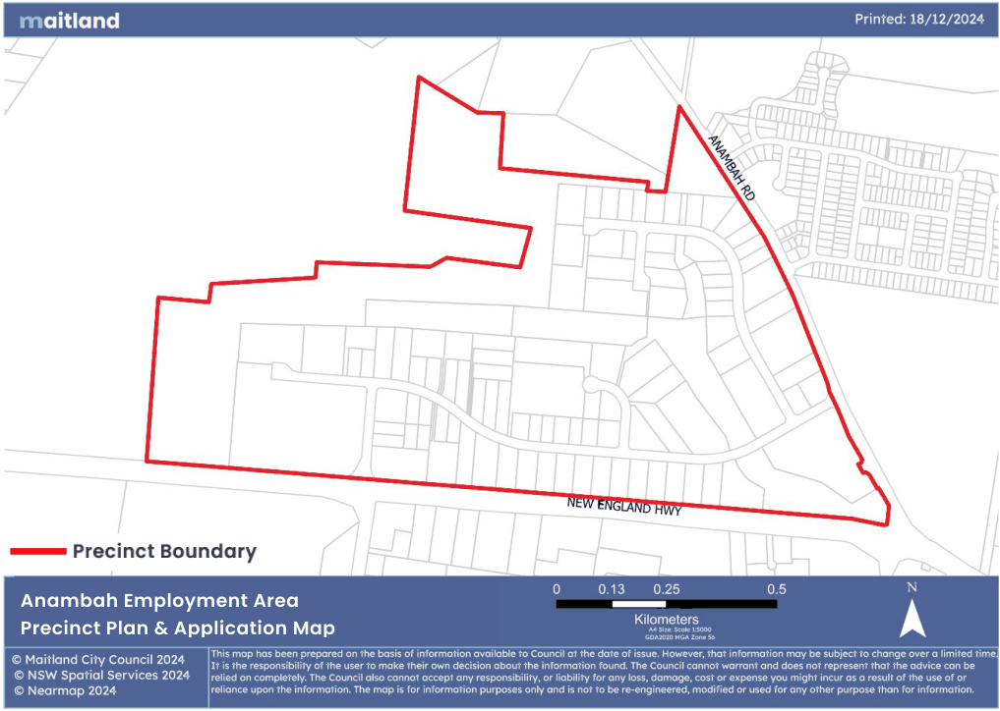

#### 10.4.15. Anambah Employment Area

The Anambah Employment Area Urban Release Area is made up of one precinct, which utilises the general provisions of this section.

> [Picture on page 241: a picture, saved as a picture (images/ch-10-00-special-precincts-locality-plans-and-urban-release-page-241-4.gif, 150 dpi).]
> Words printed on the picture (title and legend, copied from the PDF):
> Anambah Employment Area
> Precinct Plan & Application Map

#### Figure 10-118: Anambah Employment Area Precinct Plan & Application Map

The Anambah Employment Area lies along the northern side of the New England Highway at its junction with Anambah Road as identified in Figure 10-118. The land use zones over the site provide for a mix of industrial and business development. Co- location of complementary businesses to service industry, such as research and technology-based businesses should result in a high amenity centre. The site also includes the introduction of an environmental management area which will require ongoing maintenance and management to protect identified threatened species and endangered ecological communities. The proximity of the site to the Maitland Airport necessitates specific height and noise control criteria. Specific landscape and visual amenity controls are also included to ensure that the appearance of the development when viewed from both the New England Highway and Anambah Road is satisfactory.

No specific requirements have been made for the following matters within the General Provisions for the Anambah Employment Area as they are already adequately addressed by other relevant provisions within the Maitland Local Environmental Plan 2011 and the Maitland Development Control Plan 2026:

• Passive and Active Areas

• Residential Densities

• Neighbourhood Commercial and Retail Uses

• Provision of Public Facilities and Services
