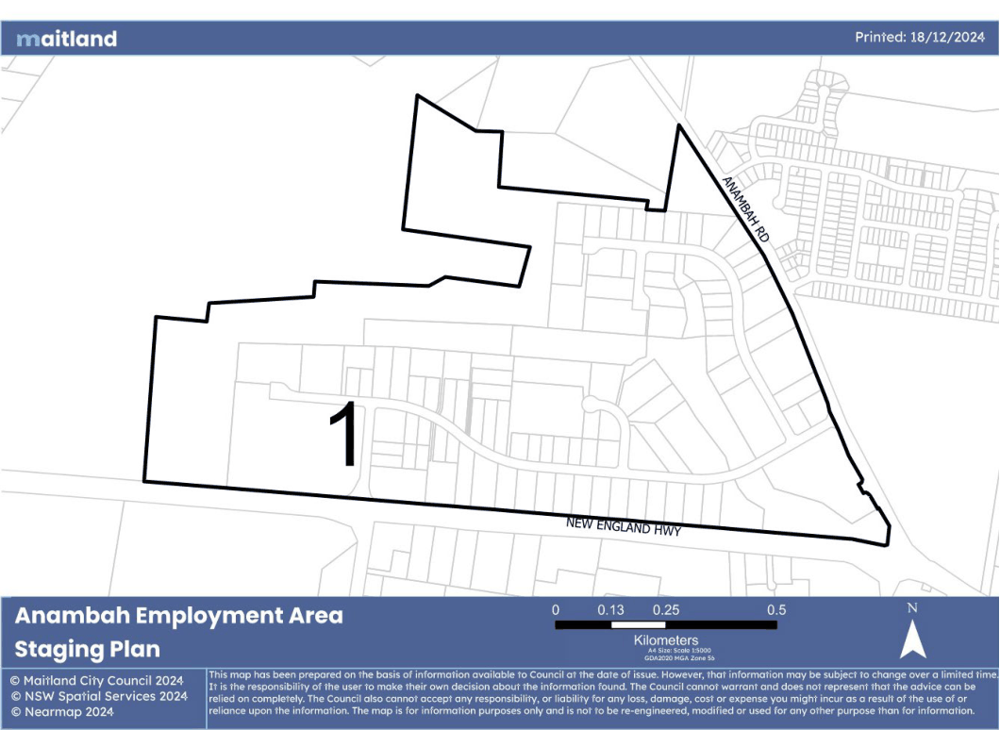
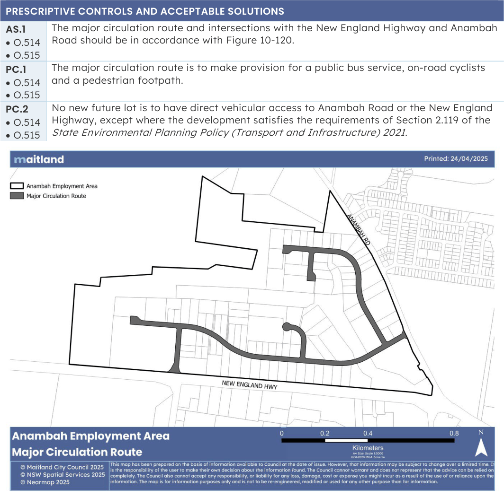
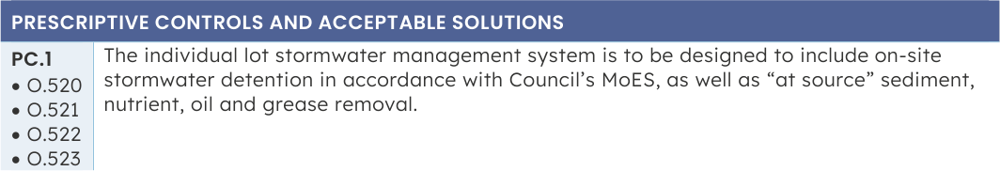

#### 10.4.15.1. Staging Plan

#### Objectives

O.513  To provide for the timely and efficient release of urban land making provision for necessary

infrastructure and sequencing.

#### PRESCRIPTIVE CONTROLS AND ACCEPTABLE SOLUTIONS

Staging of the urban release area should be generally in accordance with Figure 10-119.

#### AS.1

• O.513

> [Picture on page 242: a picture, saved as a picture (images/ch-10-00-special-precincts-locality-plans-and-urban-release-page-242-17.gif, 150 dpi).]

#### Figure 10-119: Anambah Employment Area Staging Plan

#### Objectives

O.514 To achieve a simple and safe movement system for private vehicles, public transport, pedestrians

and cyclists.

O.515 To provide for access generally by way of an interconnected network of streets and paths which

facilitate safe, efficient and pleasant walking, cycling and driving.

> [Picture on page 243: a picture, saved as a picture (images/ch-10-00-special-precincts-locality-plans-and-urban-release-page-243-6.gif, 150 dpi).]
> Words printed on the picture (title and legend, copied from the PDF):
> • O.514
> • O.515
> and a pedestrian footpath.
> • O.514
> • O.515
> • O.514
> • O.515

#### PRESCRIPTIVE CONTROLS AND ACCEPTABLE SOLUTIONS

The major circulation route and intersections with the New England Highway and Anambah Road should be in accordance with Figure 10-120.

#### AS.1

The major circulation route is to make provision for a public bus service, on-road cyclists

#### PC.1

No new future lot is to have direct vehicular access to Anambah Road or the New England Highway, except where the development satisfies the requirements of Section 2.119 of the State Environmental Planning Policy (Transport and Infrastructure) 2021.

#### PC.2

#### Figure 10-120: Major Circulation Routes and Intersections

#### Objectives

O.516 To soften the visual impact of all built elements, creating attractive and consistent streetscapes

when viewed by passing traffic and pedestrians.

O.517 To ensure key environmental areas such as waterways, vegetation, land resources, and areas of

cultural significance and scenic value are protected.

O.518 To provide landscaping appropriate to the nature and scale of development that enhances the local

character and streetscape, supports retention and regeneration of ecological corridors and provides visual interest and a suitable backdrop to the built form.

O.519 To protect significant vegetation and habitat adjoining the Anambah Employment Area, especially

for Squirrel Gliders, Grey-Crowned Babblers and threatened bat species.

| PRESCRIPTIVE CONTROLS AND ACCEPTABLE SOLUTIONS |  |
|---|---|
| PC.1 | Provision is to be made for a 10m wide landscaped area adjoining the New England Highway and Anambah Road. The landscape strip is to be incorporated into the development lots. |
| • O.516 |  |
| • O.517 |  |
| • O.518 |  |
| PC.2 • O.516 • O.517 • O.518 | A landscaping strategy is to be submitted with the first development application to subdivide land adjoining the New England Highway or Anambah Road, to identify a theme for the landscaping strips that will create a pleasant and consistent visual appearance for the Anambah Employment Area. The landscaping strategy is to include information about the fencing treatment for land fronting the New England Highway and Anambah Road. |
| PC.3 | All subsequent development applications are to be consistent with the approved landscaping strategy. |
| • O.516 |  |
| • O.517 |  |
| • O.518 |  |
| PC.4 | Native and low maintenance plant species are to be used in the landscaping and must be installed as part of the subdivision works. |
| • O.516 |  |
| • O.517 |  |
| • O.518 |  |
| PC.5 | A vegetation management plan is to be submitted with any development application on land in Zone C3 Environmental Management that intends to clear vegetation. |
| • O.517 |  |
| • O.519 |  |
| PC.6 | Development on land in Zone C3 Environmental Management must be consistent with the recommendations and objectives of the vegetation management plan. |
| • O.517 |  |
| • O.519 |  |
| PC.7 • O.517 • O.519 | A vegetation management plan is to include timing of clearing and re-vegetation processes, area and type of vegetation removal, re-vegetation, and program for monitoring of vegetation management to achieve: • No net loss of vegetation (on an area basis) for the development of the Anambah Employment Area, • Year-round flowering resources for Squirrel Gliders, • Habitat for Grey-crowned Babblers, • Bat nesting boxes and salvaged hollows, • Use of endemic plant species. |

#### Objectives

O.520 To provide for an integrated and sustainable approach to the design and provision of open space

and urban water management.

O.521 To protect and enhance the water quality, water quantity and habitat value of downstream

waterways and environment.

O.522 To prevent erosion and run-off during site preparation, construction and the ongoing use of the land

to minimise cumulative impact on receiving waterways.

O.523 To protect the function of nutrient control ponds and ensure consistency for stormwater

management in the Anambah Employment Area.

> [Picture on page 245: a picture, saved as a picture (images/ch-10-00-special-precincts-locality-plans-and-urban-release-page-245-10.gif, 150 dpi).]
> Words printed on the picture (title and legend, copied from the PDF):
> • O.520
> • O.521
> • O.522
> • O.523

#### PRESCRIPTIVE CONTROLS AND ACCEPTABLE SOLUTIONS

The individual lot stormwater management system is to be designed to include on-site stormwater detention in accordance with Council’s MoES, as well as “at source” sediment, nutrient, oil and grease removal.

#### PC.1
