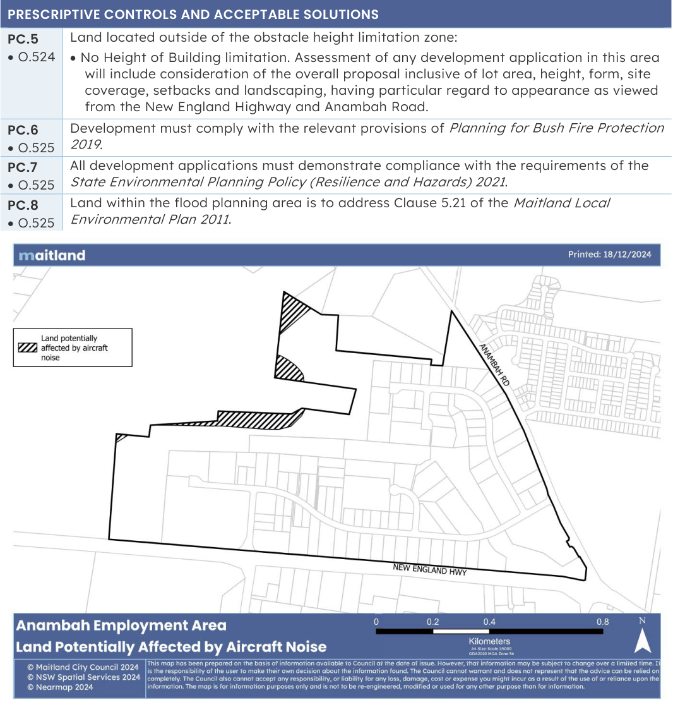
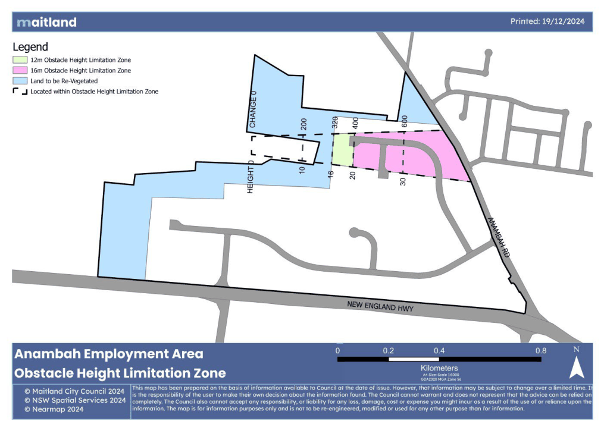

#### 10.4.15.5. Amelioration of Natural and Environmental Hazards

#### Objectives

O.524 To ensure buildings, structures and uses are compatible with the ongoing operation of the adjoining

aircraft facility.

O.525 Amelioration of natural and environmental hazards, including bushfire, flooding and site

contamination and, in relation to natural hazards, the safe occupation of, and the evacuation from, any land so affected is achieved.

| PRESCRIPTIVE CONTROLS AND ACCEPTABLE SOLUTIONS |  |
|---|---|
| AS.1 | Any building, structure or landscaping should not be erected or installed to a height above the obstacle height limitation surface for the aircraft facility. |
| • O.524 |  |
| PC.1 | Proposed uses and building design must give consideration to exposure to aircraft noise for land within the hatched area on Figure 10-121. |
| • O.524 |  |
| PC.2 • O.524 | Buildings within this area are to be designed in accordance with the requirements of Australian Standard AS021 – Acoustics – Aircraft Noise Intrusion – Building Siting and Design. |
| PC.3 • O.524 | Land located within the obstacle height limitation zone up to the 400m chainage line, within the eastern take-off/approach path to Runway 08/26 (as indicated on Figure 10- 122): • Height of Buildings is a maximum of 12m. |
| PC.4 • O.524 | Land located within the obstacle height limitation zone beyond the 400m chainage line, within the eastern take-off/approach path to Runway 08/26 (as indicated on Figure 10- 122): • Height of Buildings is a maximum of 16m. Assessment of any development application in this area will include consideration of the overall proposal inclusive of lot area, height, form, site coverage, setbacks and landscaping, having particular regard to appearance as viewed from the New England Highway and Anambah Road. |

> [Picture on page 246: a picture, saved as a picture (images/ch-10-00-special-precincts-locality-plans-and-urban-release-page-246-1.gif, 150 dpi).]
> Words printed on the picture (title and legend, copied from the PDF):
> • O.525
> • O.525
> Environmental Plan 2011.
> • O.525

#### PRESCRIPTIVE CONTROLS AND ACCEPTABLE SOLUTIONS

Land located outside of the obstacle height limitation zone:

#### PC.5

• O.524 • No Height of Building limitation. Assessment of any development application in this area

will include consideration of the overall proposal inclusive of lot area, height, form, site coverage, setbacks and landscaping, having particular regard to appearance as viewed from the New England Highway and Anambah Road. Development must comply with the relevant provisions of Planning for Bush Fire Protection 2019.

#### PC.6

All development applications must demonstrate compliance with the requirements of the State Environmental Planning Policy (Resilience and Hazards) 2021.

#### PC.7

Land within the flood planning area is to address Clause 5.21 of the Maitland Local

#### PC.8

#### Figure 10-121: Land potentially affected by aircraft noise (ANEC-20)

> [Picture on page 247: a picture, saved as a picture (images/ch-10-00-special-precincts-locality-plans-and-urban-release-page-247-1.gif, 150 dpi).]

#### Figure 10-122: Obstacle Height Limitation Zone
