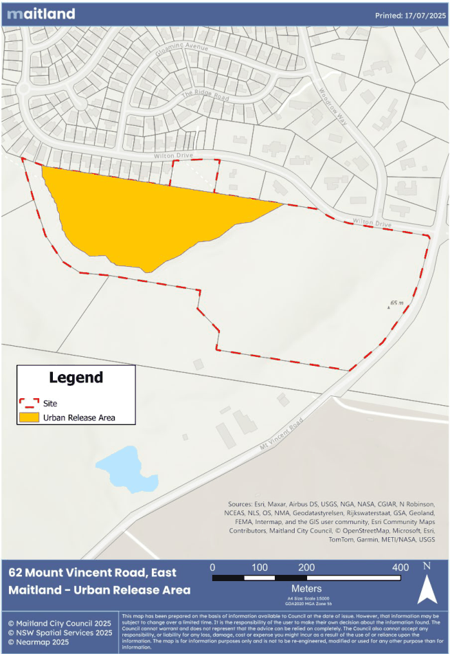
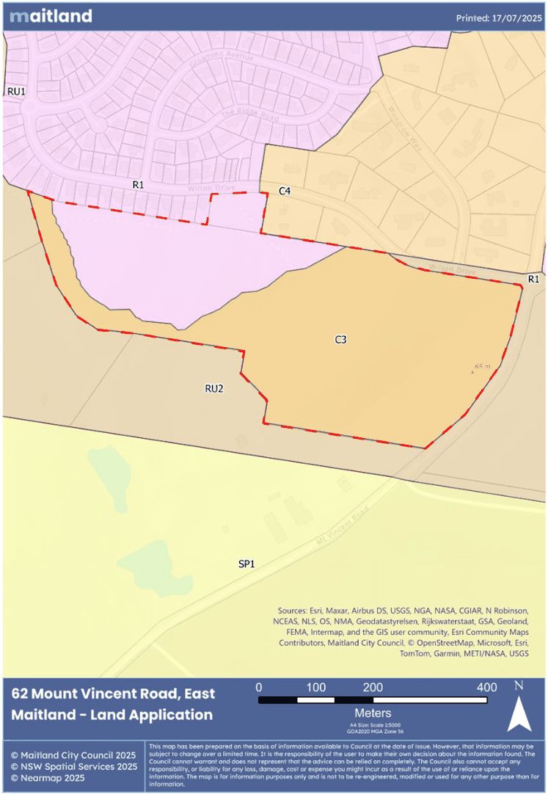

#### 10.4.16. Mount Vincent Urban Release Area

> [Picture on page 249: a picture, saved as a picture (images/ch-10-00-special-precincts-locality-plans-and-urban-release-page-249-2.gif, 150 dpi).]

#### Figure 10-123: Mount Vincent URA Precinct Plan

The subject of this DCP is the land currently known as Mount Vincent Road Urban Release Area (Mount Vincent Road URA) and its adjoining lands that formed part of the Planning Proposal for rezoning of land at East Maitland. The Mount Vincent Road URA is bound by Wilton Drive and existing residential homes to the north, rural lands to the south and west, and Mount Vincent Road to the east. The site is 2.5km from the East Maitland Strategic Centre and 3.3km from Lawes Street Shops that form the East Maitland local centre.

The Mount Vincent Road URA will be a modern neighbourhood incorporating urban design principles aligned with Council’s strategic objectives. It will serve as an extension to the existing suburban context of the southern areas of East Maitland, interfacing with the transition to Maitland’s rural environment. The natural and artificial water flows existing onsite will be reconfigured to meet modern standards, with additional stormwater infrastructure constructed to service the neighbourhood.

Development of the Mount Vincent Road URA will be complemented by a high-quality public domain, which will include new interconnected streets, pedestrian pathways, an active transport link, and a public parkland. The area will also see significant landscaping and bolstering of its biodiversity, with a mixture of trees and vegetation being provided as part of the active transport network and within the

C3 Environmental Management zone. Street tree plantings will additionally offer greening and shading of the residential environment.

#### Land Application

This DCP chapter applies to the land as marked on the Land Application Map in Figure 10-124 below. The URA and associated lands have been demarcated separately.

> [Picture on page 250: a picture, saved as a picture (images/ch-10-00-special-precincts-locality-plans-and-urban-release-page-250-10.gif, 150 dpi).]

#### Figure 10-124: Mount Vincent URA Land Application Map
