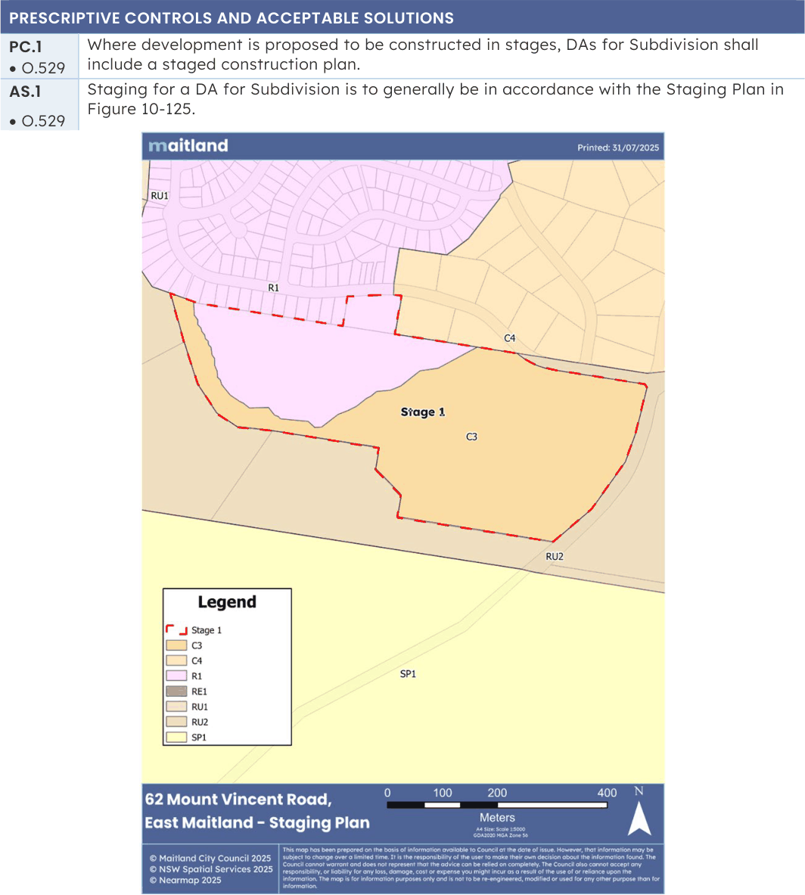
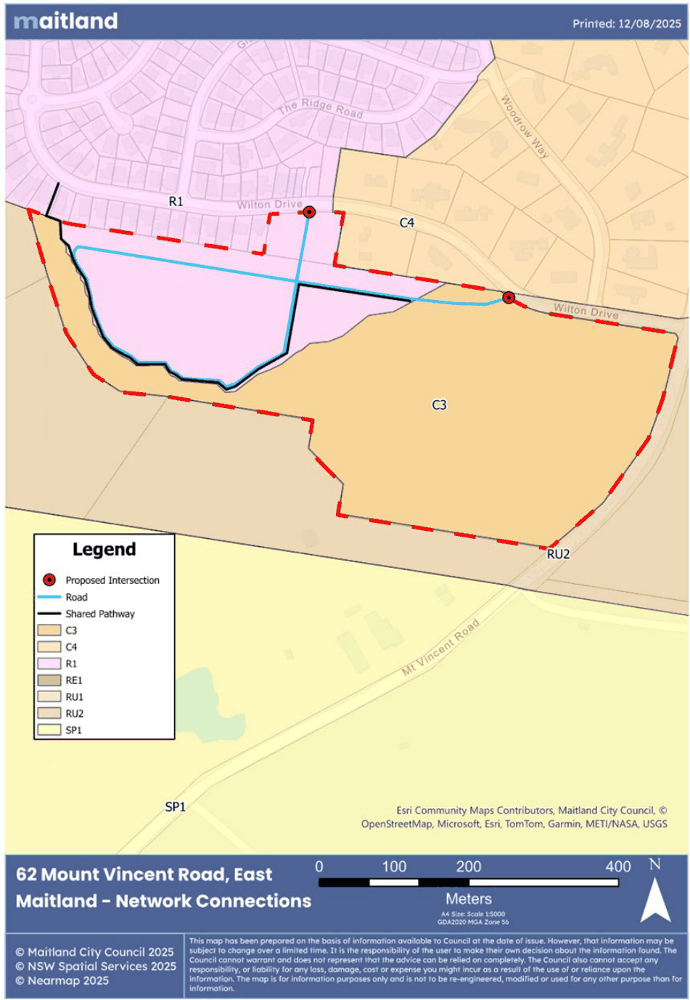
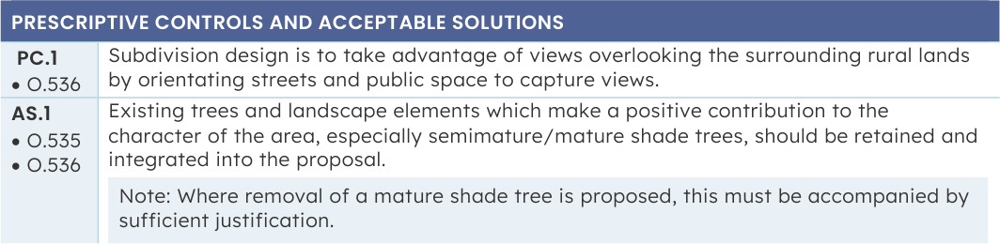

#### 10.4.16.1. Staging Plan

#### Objectives

O.529 To provide for the timely and efficient release of urban land, making provision for necessary

infrastructure and sequencing.

> [Picture on page 251: a picture, saved as a picture (images/ch-10-00-special-precincts-locality-plans-and-urban-release-page-251-5.gif, 150 dpi).]
> Words printed on the picture (title and legend, copied from the PDF):
> • O.529
> • O.529

Figure 10-125.

#### PRESCRIPTIVE CONTROLS AND ACCEPTABLE SOLUTIONS

Where development is proposed to be constructed in stages, DAs for Subdivision shall include a staged construction plan.

#### PC.1 AS.1

Staging for a DA for Subdivision is to generally be in accordance with the Staging Plan in

#### Figure 10-125: Mount Vincent URA Staging Plan

#### Objectives

O.530 To ensure effective and multi-modal transport access that is amenable to the local context.

O.531 To provide multiple accesses to any future subdivision to assist emergency services.

O.532 To create access generally through an interconnected network of streets and paths which facilitate

safe and amenable walking, cycling, and driving experiences.

O.533 To facilitate development that synergises with public bus service network and provides safe and

easy access to these systems.

O.534 To provide a clear hierarchy of roads and active transport within the local transport network.

| PRESCRIPTIVE CONTROLS AND ACCEPTABLE SOLUTIONS |  |
|---|---|
| AS.1 | Primary road hierarchy is to be generally consistent with the Area Plan in Figure 10-126, including two (2) access points back to Wilton Drive. |
| • O.530 |  |
| • O.531 |  |
| • O.532 |  |
| • O.533 |  |
| • O.534 |  |
| PC.1 | The perimeter road and the primary access road indicated in Figure 10-126 is to be in compliance with Maitland City Council Manual of Engineering Standards and bushfire requirements. |
| • O.530 |  |
| • O.531 |  |
| • O.533 |  |
| • O.534 |  |
| PC.2 | Any development application for subdivisions must ensure that road networks are fully constructed to ensure any future development can be connected into the existing network. |
| • O.530 |  |
| • O.531 |  |
| • O.532 |  |
| • O.533 |  |
| PC.3 | No new future lots are to have direct vehicular access to Mount Vincent Road. |
| • O.531 |  |
| • O.532 |  |
| • O.534 |  |
| AS.2 | Shared paths are to be provided in general accordance with the Area Plan provided on Figure 10-126. |
| • O.530 |  |
| • O.532 |  |
| • O.534 |  |
| PC.4 | The shared pathway throughout the site must connect back through to Wilton Drive on the northwestern side of the site as shown in Figure 10-126. |
| • O.530 |  |
| • O.532 |  |
| • O.533 |  |
| • O.534 |  |
| PC.5 | Preparation of a Traffic Impact Assessment is to be undertaken to determine capacity at the intersection of Wilton Drive / Mount Vincent Road. The right-turn storage capacity of the intersection is to be revised accordingly to accommodate the development. |
| • O.530 |  |
| • O.531 |  |
| • O.532 |  |

> [Picture on page 253: a picture, saved as a picture (images/ch-10-00-special-precincts-locality-plans-and-urban-release-page-253-1.gif, 150 dpi).]

#### Figure 10-126: Mount Vincent URA Network Connections

#### Objectives

O.535 To assist in the new residential precinct in achieving a 30% canopy cover, in alignment with Council’s

Environmental Sustainability Strategy 2030.

O.536 To continue activation of green space within new greenfield residential areas through the provision

of new active transport infrastructure, vegetation planting, and enhanced public domain.

> [Picture on page 254: a picture, saved as a picture (images/ch-10-00-special-precincts-locality-plans-and-urban-release-page-254-6.gif, 150 dpi).]
> Words printed on the picture (title and legend, copied from the PDF):
> • O.536
> integrated into the proposal.
> • O.535
> • O.536
> sufficient justification.

#### PRESCRIPTIVE CONTROLS AND ACCEPTABLE SOLUTIONS

Subdivision design is to take advantage of views overlooking the surrounding rural lands by orientating streets and public space to capture views.

#### PC.1

Existing trees and landscape elements which make a positive contribution to the character of the area, especially semimature/mature shade trees, should be retained and

#### AS.1

Note: Where removal of a mature shade tree is proposed, this must be accompanied by
