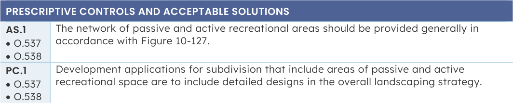
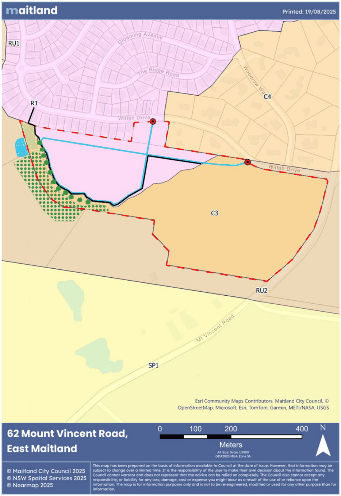

#### 10.4.16.4. Passive and Active Recreation Areas

#### Objectives

O.537 Neighbourhoods are conveniently located open space areas that offer a range of recreational

opportunities for residents, accessible within walking distance from each residence.

O.538 To provide a safe and appropriate level of pedestrian and cycleway access linking new development

with established urban areas, parks and public transport, including a mix of on-road and off-road cycle routes.

> [Picture on page 254: a picture, saved as a picture (images/ch-10-00-special-precincts-locality-plans-and-urban-release-page-254-22.gif, 150 dpi).]
> Words printed on the picture (title and legend, copied from the PDF):
> accordance with Figure 10-127.
> • O.537
> • O.538
> • O.537
> • O.538

#### PRESCRIPTIVE CONTROLS AND ACCEPTABLE SOLUTIONS

The network of passive and active recreational areas should be provided generally in

#### AS.1

Development applications for subdivision that include areas of passive and active recreational space are to include detailed designs in the overall landscaping strategy.

#### PC.1

> [Picture on page 255: a picture, saved as a picture (images/ch-10-00-special-precincts-locality-plans-and-urban-release-page-255-1.gif, 150 dpi).]

#### Figure 10-127: Mount Vincent URA Vegetation and Infrastructure Map
