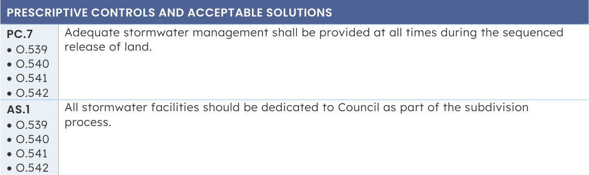

#### 10.4.16.5. Stormwater and Water Quality Management

#### Objectives

O.539 To manage stormwater flows in a manner that minimises the risk of flooding, erosion, and

environmental degradation through the appropriate placement of stormwater detention and water quality basins.

O.540 To ensure a Neutral OR Beneficial Effect on waterbodies extant on the subject land and the

waterway to the south of the area. To ensure that all development maintains or enhances water quality, hydrology, and ecological function, resulting in a Neutral or Beneficial Effect on existing waterbodies within the site and the waterway to the south.

O.541 To provide for an integrated and sustainable approach to the design and provision of open space

and urban water management by prioritising water-sensitive urban design (WSUD).

O.542 To ensure that there will be no detrimental impact on downstream waterways, wetland environments

or agricultural productivity as a result of new development.

O.543 To ensure stormwater detention and water quality basins are located in safe, accessible, and

environmentally appropriate areas, avoiding locations that create land use conflicts, require removal of significant vegetation, disrupt ecological corridors, or create long-term maintenance challenges.

| PRESCRIPTIVE CONTROLS AND ACCEPTABLE SOLUTIONS |  |
|---|---|
| PC.1 | Stormwater runoff will be controlled by the provision of a stormwater detention and water quality basins, which are to be located in the areas indicated in Figure 10-127. These basins must be designed to integrate with the natural drainage system and be located away from sensitive ecological areas and habitats to minimise environmental disturbance. |
| • O.539 |  |
| • O.540 |  |
| • O.541 |  |
| • O.542 |  |
| • O.543 |  |
| PC.2 | Stormwater and water quality facilities must be located adjacent to a road reserve to ensure casual surveillance, ease of maintenance, and safe access. The design must provide adequate setbacks, clear sightlines, and appropriate landscaping to balance security, functionality, and environmental integration. |
| • O.539 |  |
| • O.541 |  |
| • O.542 |  |
| • O.543 |  |
| PC.3 | To support the basins, Gross Pollutant Traps are to be an integral part of the stormwater network. This will be required as a part of stormwater treatment solutions at the DA for Subdivision phase. |
| • O.539 |  |
| • O.540 |  |
| • O.541 |  |
| • O.542 |  |
| PC.4 | A Stormwater and Water Quality Management Strategy, including MUSIC modelling, is to be submitted at the DA for Subdivision phase. The strategy must demonstrate how the development will meet water quality targets, manage stormwater runoff, and minimise the environmental impact of runoff on downstream ecosystems. |
| • O.539 |  |
| • O.540 |  |
| • O.541 |  |
| • O.542 |  |
| PC.5 | The natural drainage lines on the site must be utilised to the maximum extent possible as part of a stormwater and runoff drainage management system. The system must incorporate soil conservation measures, including detention basins, to alleviate stormwater peaks and retain sediments and pollutants. |
| • O.539 |  |
| • O.540 |  |
| • O.541 |  |
| • O.542 |  |
| • O.543 |  |
| PC.6 | Rainwater tanks will not be considered in the calculations for stormwater detention purposes. |
| • O.539 |  |
| • O.540 |  |
| • O.541 |  |
| • O.542 |  |

> [Picture on page 257: a picture, saved as a picture (images/ch-10-00-special-precincts-locality-plans-and-urban-release-page-257-1.gif, 150 dpi).]
> Words printed on the picture (title and legend, copied from the PDF):
> release of land.
> • O.539
> • O.540
> • O.541
> • O.542
> process.
> • O.539
> • O.540
> • O.541
> • O.542

#### PRESCRIPTIVE CONTROLS AND ACCEPTABLE SOLUTIONS

Adequate stormwater management shall be provided at all times during the sequenced

#### PC.7

All stormwater facilities should be dedicated to Council as part of the subdivision

#### AS.1

### Amelioration of Natural and Environmental Hazards

This section provides controls designed to guide the environmental assessment and management of the land to which this part applies. It provides clear guidance as to the rigour required for development applications while creating beneficial environmental outcomes for a future residential community. The key environmental constraints of the subject land are:

• Aboriginal Heritage

• Contamination

• Mine Subsidence

• Visual Impact and Local Interface

• Biodiversity

• Flooding

• Bushfire

• Acid Sulfate Soils

• Odour
