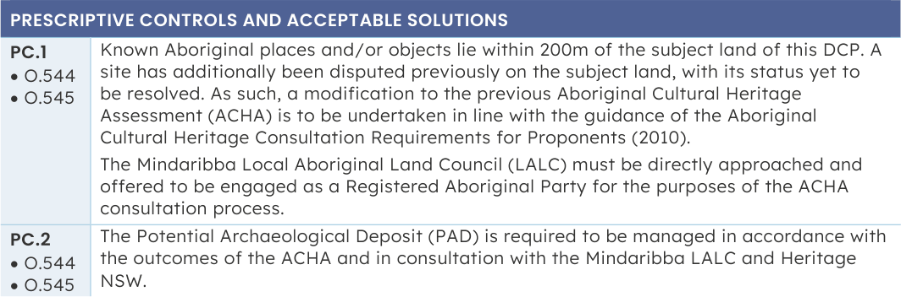

#### 10.4.16.6. Aboriginal Heritage

#### Objectives

O.544 To ensure proper consultation occurs with relevant Aboriginal stakeholders and heritage authorities

in line with the applicable guidance under the National Parks and Wildlife Act 1974 and the Aboriginal Cultural Heritage Consultation Requirements for Proponents (2010) (or any successive legislation or enforceable guidelines).

O.545 To conduct detailed and thorough assessment of the site, focusing on determining the nature of the

potential grinding groove site.

> [Picture on page 257: a picture, saved as a picture (images/ch-10-00-special-precincts-locality-plans-and-urban-release-page-257-29.gif, 150 dpi).]
> Words printed on the picture (title and legend, copied from the PDF):
> • O.544
> • O.545
> NSW.
> • O.544
> • O.545

#### PRESCRIPTIVE CONTROLS AND ACCEPTABLE SOLUTIONS PC.1

Known Aboriginal places and/or objects lie within 200m of the subject land of this DCP. A site has additionally been disputed previously on the subject land, with its status yet to be resolved. As such, a modification to the previous Aboriginal Cultural Heritage Assessment (ACHA) is to be undertaken in line with the guidance of the Aboriginal Cultural Heritage Consultation Requirements for Proponents (2010). The Mindaribba Local Aboriginal Land Council (LALC) must be directly approached and offered to be engaged as a Registered Aboriginal Party for the purposes of the ACHA consultation process. The Potential Archaeological Deposit (PAD) is required to be managed in accordance with the outcomes of the ACHA and in consultation with the Mindaribba LALC and Heritage

#### PC.2
