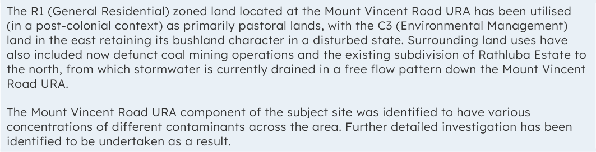

#### 10.4.16.7. Contamination

> [Picture on page 258: a picture, saved as a picture (images/ch-10-00-special-precincts-locality-plans-and-urban-release-page-258-2.gif, 150 dpi).]
> Words printed on the picture (title and legend, copied from the PDF):
> Road URA.

The R1 (General Residential) zoned land located at the Mount Vincent Road URA has been utilised (in a post-colonial context) as primarily pastoral lands, with the C3 (Environmental Management) land in the east retaining its bushland character in a disturbed state. Surrounding land uses have also included now defunct coal mining operations and the existing subdivision of Rathluba Estate to the north, from which stormwater is currently drained in a free flow pattern down the Mount Vincent

The Mount Vincent Road URA component of the subject site was identified to have various concentrations of different contaminants across the area. Further detailed investigation has been identified to be undertaken as a result.

#### Objectives

O.546 To limit impacts from historic contaminant generating agricultural and extractive industry activities

on the planned residential precinct.

O.547 To properly remediate the subject land for intensified land uses.

| PRESCRIPTIVE CONTROLS AND ACCEPTABLE SOLUTIONS |  |
|---|---|
| PC.1 • O.546 • O.547 | The proponent must provide information to state that the land is, or can be made, suitable for all the uses permissible under the approval. Information must follow the steps for contaminated land outlined in NSW EPA (2020) “Consultants Reporting on Contaminated Land, Contaminated Land Guidelines”, and be undertaken in accordance with the National Environment Protection (Assessment of Site Contamination) Measure (ASC NEPM, amended in 2013), Maitland City Council’s “Contaminated Land Policy – Land Use Planning” (current version 3.1, or any updates thereof), and any other relevant guidelines made or adopted by NSW EPA under Section 105 of the Contaminated Land Management Act 1997. Note: Based on previous studies on the site, additional sampling is required within the former gully area. A minimum of a Detailed Site Investigation will be required. |
