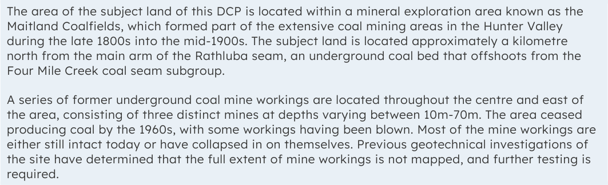
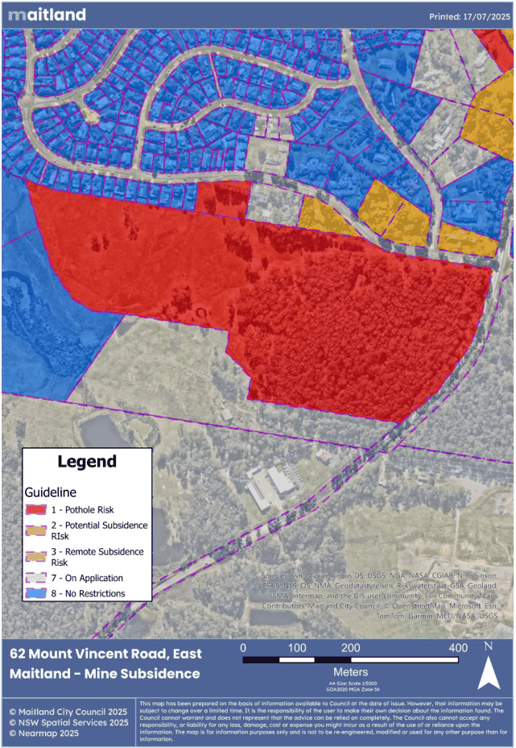

#### 10.4.16.8. Mine Subsidence

> [Picture on page 258: a picture, saved as a picture (images/ch-10-00-special-precincts-locality-plans-and-urban-release-page-258-17.gif, 150 dpi).]
> Words printed on the picture (title and legend, copied from the PDF):
> required.

The area of the subject land of this DCP is located within a mineral exploration area known as the Maitland Coalfields, which formed part of the extensive coal mining areas in the Hunter Valley during the late 1800s into the mid-1900s. The subject land is located approximately a kilometre north from the main arm of the Rathluba seam, an underground coal bed that offshoots from the Four Mile Creek coal seam subgroup.

A series of former underground coal mine workings are located throughout the centre and east of the area, consisting of three distinct mines at depths varying between 10m-70m. The area ceased producing coal by the 1960s, with some workings having been blown. Most of the mine workings are either still intact today or have collapsed in on themselves. Previous geotechnical investigations of the site have determined that the full extent of mine workings is not mapped, and further testing is

#### Objectives

O.548 To reduce possible impacts of mine subsidence and shallow mine workings on future development

and infrastructure within the Mt Vincent Road URA.

O.549 To ensure that potential mine subsidence and shallow mine working issues are adequately

addressed at the subdivision stage.

O.550 To ensure consultation occurs with Subsidence Advisory NSW and consideration in given to the

applicable Subsidence Advisory NSW Development Guidelines.

| PRESCRIPTIVE CONTROLS AND ACCEPTABLE SOLUTIONS |  |
|---|---|
| PC.1 | Areas of potential mine subsidence and potential shallow mine workings are illustrated on Figure 10-128. |
| • O.548 |  |
| • O.549 |  |
| PC.2 • O.548 • O.549 • O.550 | Prior to any Development Application for subdivision being lodged for the lands subject to the indicated areas of potential mine subsidence and/or potential shallow mine workings, the Applicant shall undertake a geotechnical investigation and report to determine whether the lands indicated will be suitable for the proposed land uses e.g. roads, services, dwellings, etc. |
| PC.3 | Areas where surface cover over mine workings is known to be less than 25m will require remediation due to pothole subsidence risks. Remediation measures will be determined by the geotechnical investigation and report under PC.2 and in consultation with NSW Subsidence Advisory. |
| • O.548 |  |
| • O.549 |  |
| • O.550 |  |

> [Picture on page 259: a picture, saved as a picture (images/ch-10-00-special-precincts-locality-plans-and-urban-release-page-259-4.gif, 150 dpi).]

#### Figure 10-128: Mount Vincent URA Mine Subsidence
