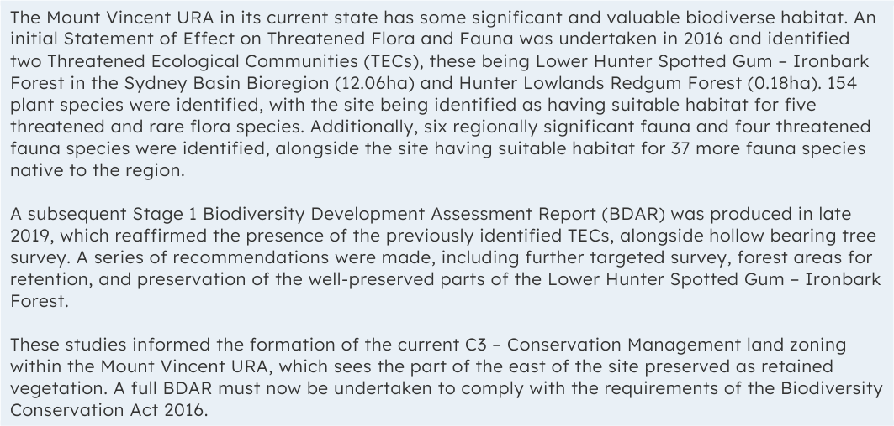
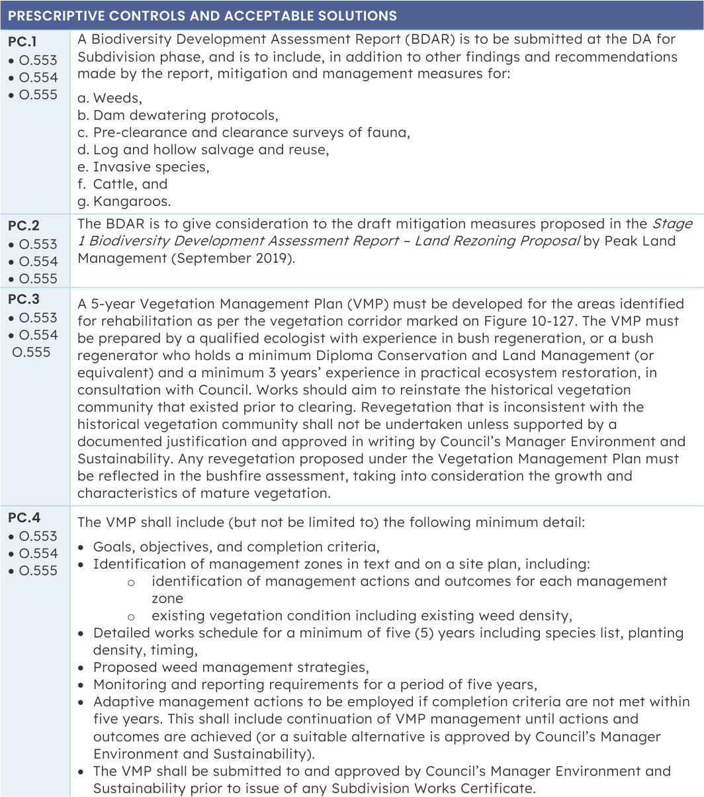
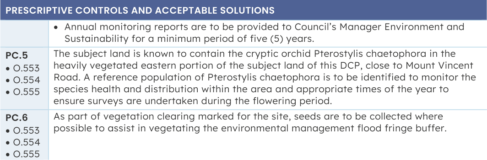

#### 10.4.16.10. Biodiversity

> [Picture on page 260: a picture, saved as a picture (images/ch-10-00-special-precincts-locality-plans-and-urban-release-page-260-8.gif, 150 dpi).]
> Words printed on the picture (title and legend, copied from the PDF):
> native to the region.
> Forest.
> Conservation Act 2016.

The Mount Vincent URA in its current state has some significant and valuable biodiverse habitat. An initial Statement of Effect on Threatened Flora and Fauna was undertaken in 2016 and identified two Threatened Ecological Communities (TECs), these being Lower Hunter Spotted Gum – Ironbark Forest in the Sydney Basin Bioregion (12.06ha) and Hunter Lowlands Redgum Forest (0.18ha). 154 plant species were identified, with the site being identified as having suitable habitat for five threatened and rare flora species. Additionally, six regionally significant fauna and four threatened fauna species were identified, alongside the site having suitable habitat for 37 more fauna species

A subsequent Stage 1 Biodiversity Development Assessment Report (BDAR) was produced in late 2019, which reaffirmed the presence of the previously identified TECs, alongside hollow bearing tree survey. A series of recommendations were made, including further targeted survey, forest areas for retention, and preservation of the well-preserved parts of the Lower Hunter Spotted Gum – Ironbark

These studies informed the formation of the current C3 – Conservation Management land zoning within the Mount Vincent URA, which sees the part of the east of the site preserved as retained vegetation. A full BDAR must now be undertaken to comply with the requirements of the Biodiversity

O.553 To enhance the quality and quantity of native vegetation communities present within the Mount

Vincent URA.

O.554 To protect native vegetation where feasible and conduct additional native plantings to encourage

biodiversity.

O.555 Limit impacts on existing natural environments through effective flora and fauna management.

> [Picture on page 261: a map, saved as a picture (images/ch-10-00-special-precincts-locality-plans-and-urban-release-page-261-6.gif, 150 dpi); the street names and other small labels are on the picture.]
> Words printed on the picture (title and legend, copied from the PDF):
> • O.555 a. Weeds,
> b. Dam dewatering protocols,
> e. Invasive species,
> f. Cattle, and
> Management (September 2019).
> Environment and Sustainability).

#### PRESCRIPTIVE CONTROLS AND ACCEPTABLE SOLUTIONS

A Biodiversity Development Assessment Report (BDAR) is to be submitted at the DA for Subdivision phase, and is to include, in addition to other findings and recommendations made by the report, mitigation and management measures for:

#### PC.1

c. Pre-clearance and clearance surveys of fauna,

d. Log and hollow salvage and reuse,

g. Kangaroos. The BDAR is to give consideration to the draft mitigation measures proposed in the Stage 1 Biodiversity Development Assessment Report – Land Rezoning Proposal by Peak Land

#### PC.2

#### PC.3

A 5-year Vegetation Management Plan (VMP) must be developed for the areas identified for rehabilitation as per the vegetation corridor marked on Figure 10-127. The VMP must be prepared by a qualified ecologist with experience in bush regeneration, or a bush regenerator who holds a minimum Diploma Conservation and Land Management (or equivalent) and a minimum 3 years’ experience in practical ecosystem restoration, in consultation with Council. Works should aim to reinstate the historical vegetation community that existed prior to clearing. Revegetation that is inconsistent with the historical vegetation community shall not be undertaken unless supported by a documented justification and approved in writing by Council’s Manager Environment and Sustainability. Any revegetation proposed under the Vegetation Management Plan must be reflected in the bushfire assessment, taking into consideration the growth and characteristics of mature vegetation. The VMP shall include (but not be limited to) the following minimum detail:

#### PC.4

• Goals, objectives, and completion criteria,

• Identification of management zones in text and on a site plan, including:

identification of management actions and outcomes for each management

existing vegetation condition including existing weed density,

• Detailed works schedule for a minimum of five (5) years including species list, planting

• Proposed weed management strategies,

• Monitoring and reporting requirements for a period of five years,

• Adaptive management actions to be employed if completion criteria are not met within

five years. This shall include continuation of VMP management until actions and outcomes are achieved (or a suitable alternative is approved by Council’s Manager

• The VMP shall be submitted to and approved by Council’s Manager Environment and

Sustainability prior to issue of any Subdivision Works Certificate.

> [Picture on page 262: a picture, saved as a picture (images/ch-10-00-special-precincts-locality-plans-and-urban-release-page-262-1.gif, 150 dpi).]
> Words printed on the picture (title and legend, copied from the PDF):
> • O.553
> • O.554
> • O.555
> • O.553
> • O.554
> • O.555

#### PRESCRIPTIVE CONTROLS AND ACCEPTABLE SOLUTIONS

• Annual monitoring reports are to be provided to Council’s Manager Environment and

Sustainability for a minimum period of five (5) years.

#### PC.5

The subject land is known to contain the cryptic orchid Pterostylis chaetophora in the heavily vegetated eastern portion of the subject land of this DCP, close to Mount Vincent Road. A reference population of Pterostylis chaetophora is to be identified to monitor the species health and distribution within the area and appropriate times of the year to ensure surveys are undertaken during the flowering period. As part of vegetation clearing marked for the site, seeds are to be collected where possible to assist in vegetating the environmental management flood fringe buffer.

#### PC.6
