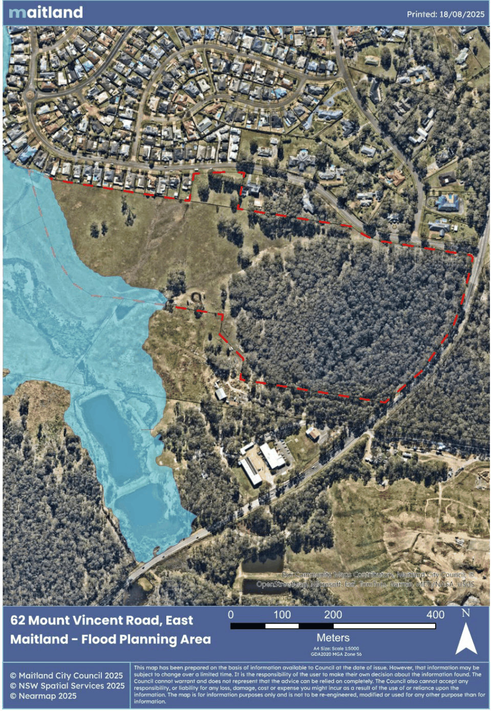

#### 10.4.16.11. Flooding

#### Objectives

O.556 To manage the risk to human life, damage to property and provision of essential services by

ensuring development on all areas of the site is appropriately sited and designed such that it is compatible with the flooding potential and hazard.

O.557 To ensure negligible flood impacts on adjoining property or infrastructure as a result of any

development or work on site for regional flooding and local catchment runoff events.

O.558 To regulate development that may reduce the ability of the floodplain to carry water and so increase

the flood hazard.

| PRESCRIPTIVE CONTROLS AND ACCEPTABLE SOLUTIONS |  |
|---|---|
| PC.1 | Any application for the subdivision of the site must demonstrate that the subdivision design incorporates measures to mitigate against potential extreme floodway hazard conditions. |
| • O.556 |  |
| • O.557 |  |
| • O.558 |  |
| AS.1 | Infrastructure including roads, pathways and/or cycleways within the flood extent should limit changes to natural topography as far as practicable to avoid changes to flood impacts. |
| • O.556 |  |
| • O.557 |  |
| • O.558 |  |
| PC.2 | No filling of Flood Prone land (see Figure 10-129) is to be undertaken without hydraulically equivalent compensatory cut and assessment of impacts. |
| • O.556 |  |
| • O.557 |  |
| • O.558 |  |
| PC.3 | Any future development within the subject land of the DCP is to take into consideration the most current versions of the NSW Government’s Flood Prone Land Policy and the principles of the Floodplain Risk Management Manual 2023. |
| • O.556 |  |
| • O.557 |  |
| • O.558 |  |

> [Picture on page 263: a picture, saved as a picture (images/ch-10-00-special-precincts-locality-plans-and-urban-release-page-263-1.gif, 150 dpi).]

#### Figure 10-129: Mount Vincent URA Flood Map
