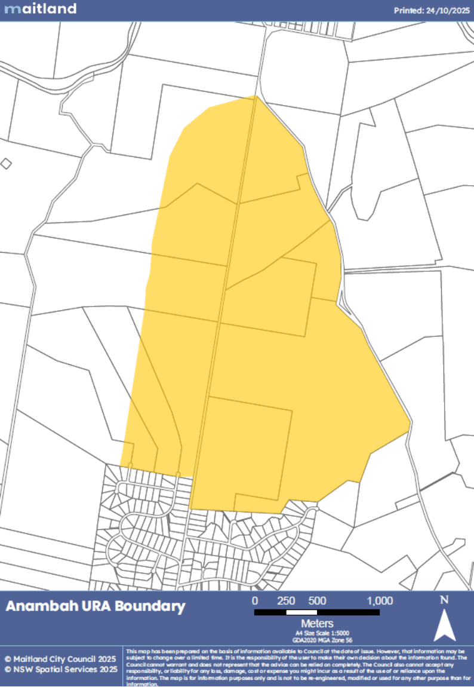
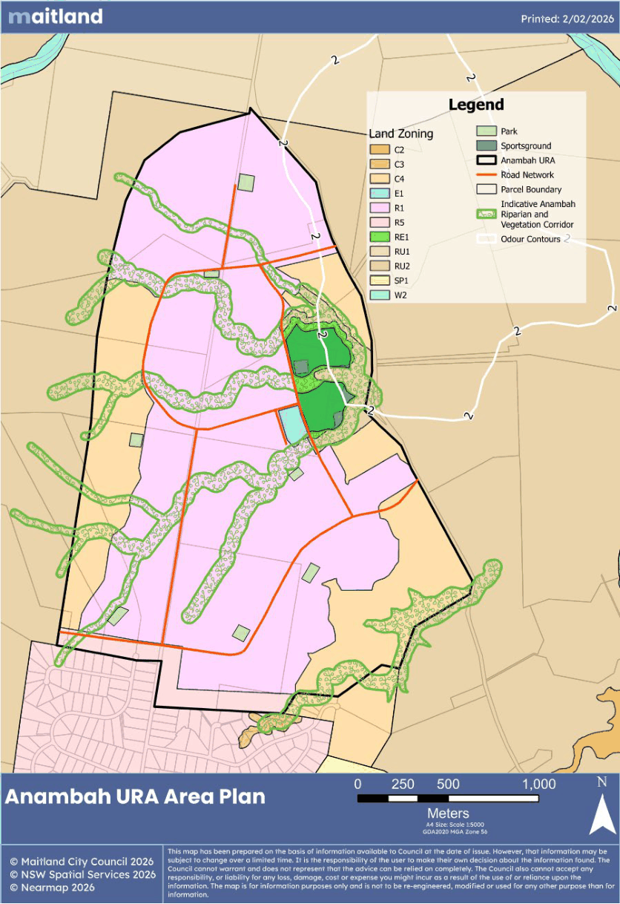
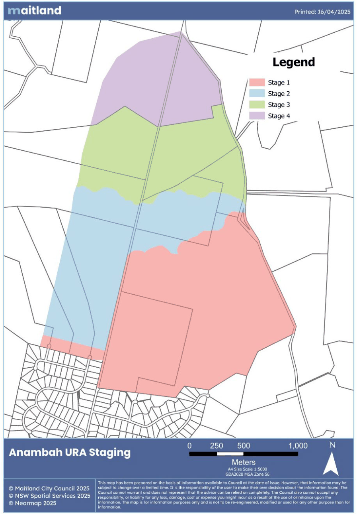

#### 10.4.17. Anambah Urban Release Area

> [Picture on page 266: a picture, saved as a picture (images/ch-10-00-special-precincts-locality-plans-and-urban-release-page-266-2.gif, 150 dpi).]

#### Figure 10-130: Anambah Urban Release Area

The Anambah Urban Release Area (AURA) (Figure 10-130) encompasses approximately 500 hectares of land and is anticipated to yield approximately 4,200 dwellings. The URA is located within the Anambah to Branxton Regionally Significant Growth Area as identified in the Hunter Regional Plan

2041\. Situated approximately 10 km north-west of Central Maitland and 3 km north-west of the Anambah Employment Area, the site is bound by rural land to the north, west and east. The area fronts Anambah Road along its eastern boundary, and the Windella rural residential estate to the south.

The URA will feature a mix of residential, commercial, and environmental living zones. Key elements include a commercial precinct, a proposed school site, playing fields, community facilities, parks, and public recreation areas along several riparian corridors. The development aims to create walkable neighbourhoods with convenient access to amenities, supported by a well-linked pedestrian and cycle network. Access to the URA will primarily be via a flood free Western Link Road, with secondary access from Anambah Road. The Western Road Link is required to be in place before the 1200 lot is released. Until this time, flood-free access must be provided to support development of the AURA, in accordance with the Flood Risk Management Manual 2023 and Clause 5.21 of the Maitland Local Environmental Plan (MLEP) 2011. Any connection to and/or use of River Road, outside the Anambah URA, is subject to additional Traffic Impact Assessment(s) to determine whether River Road and its intersection with the New England Highway can accommodate the increased traffic. Future exploration of movement opportunities along the River Road corridor may enhance connectivity within the region. This could include improvements to support pedestrian and cycle networks, subject to feasibility studies and infrastructure planning. Water and sewer services will require a level of augmentation and extension to service the release

area. The development and staging of precincts within the release area are linked to the provision of these services as development progresses. Another factor in the staging of the development is limitations with road infrastructure, and the construction of a planned flood free “western link” to the New England Highway via Wyndella Road in Lochinvar.

#### Anambah Precinct/Area Plan

The purpose of the Precinct/Area Plan is to give detailed guidance to people wishing to carry out development within the Anambah Urban Release Area. The Anambah Area Plan provides objectives, requirements and development standards for the area, not otherwise included in the broader MDCP

> [Picture on page 268: a picture, saved as a picture (images/ch-10-00-special-precincts-locality-plans-and-urban-release-page-268-5.gif, 150 dpi).]

2011.

#### Figure 10-131: Anambah Precinct/Area Plan

> [Picture on page 269: a picture, saved as a picture (images/ch-10-00-special-precincts-locality-plans-and-urban-release-page-269-1.gif, 150 dpi).]

#### Figure 10-132: Anambah URA Staging Plan

This Area Plan provides general development objectives and controls for the overall Anambah Urban Release Area (Anambah URA). The M DCP 2011 applies to the Anambah URA. Any development applications for the development of the area are required to address the provisions of the M 2011. No specific requirements have been made for the following matters within the General Provisions for the Anambah Urban Release Area as they are already adequately addressed by other relevant provisions within the MLEP 2011 and the MDCP 2011:

• Provision of Public Facilities and Services

• Neighbourhood Commercial and Retail Uses
