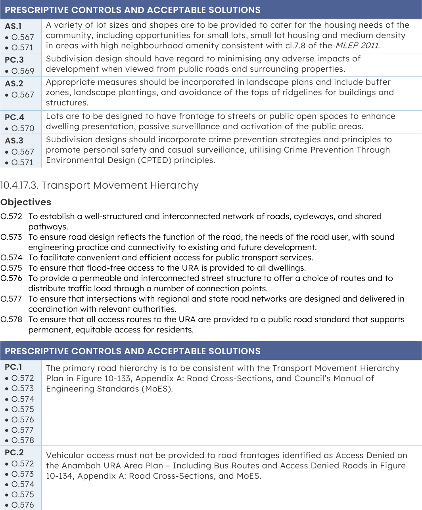

#### 10.4.17.2. Subdivision Design

#### Objectives

O.567 To ensure that subdivision provides a safe and positive character, enhances accessibility, minimises

visual impacts, compatible with the surrounding area, and promotes the principles of ecologically sustainable development.

O.568 To ensure that development respects the constraints of the site and provides for a range of lot sizes

and shapes appropriate to the community’s housing needs.

O.569 To create a series of residential neighbourhoods with a distinct landscape and built form character

to create a sense of identity.

O.570 To provide a range of public facilities in appropriate locations and in sequence with the land

development.

O.571 To allow view sharing and to ensure privacy between lots.

| PRESCRIPTIVE CONTROLS AND ACCEPTABLE SOLUTIONS |  |
|---|---|
| PC.1 • O.570 | Development Applications for subdivision must include Staging Plans. This is to include an analysis and statement as to the intentions and philosophy of the sequencing of stages to demonstrate expansion of infrastructure networks/corridors to adjoining development lots within a reasonable timeframe/lot yield. |
| PC.2 • O.568 | Sequencing is to include connection to lots within the precinct followed by lots in any adjoining precinct/s. Applications for subdivision are to clearly show proposed layouts, lot sizes, shapes and likely development densities. |

> [Picture on page 271: a picture, saved as a picture (images/ch-10-00-special-precincts-locality-plans-and-urban-release-page-271-1.gif, 150 dpi).]
> Words printed on the picture (title and legend, copied from the PDF):
> • O.567
> • O.571
> • O.569
> • O.567
> • O.570
> Environmental Design (CPTED) principles.
> • O.567
> • O.571

#### PRESCRIPTIVE CONTROLS AND ACCEPTABLE SOLUTIONS

A variety of lot sizes and shapes are to be provided to cater for the housing needs of the community, including opportunities for small lots, small lot housing and medium density in areas with high neighbourhood amenity consistent with cl.7.8 of the MLEP 2011.

#### AS.1

Subdivision design should have regard to minimising any adverse impacts of development when viewed from public roads and surrounding properties.

#### PC.3 AS.2

Appropriate measures should be incorporated in landscape plans and include buffer zones, landscape plantings, and avoidance of the tops of ridgelines for buildings and structures. Lots are to be designed to have frontage to streets or public open spaces to enhance dwelling presentation, passive surveillance and activation of the public areas.

#### PC.4

Subdivision designs should incorporate crime prevention strategies and principles to promote personal safety and casual surveillance, utilising Crime Prevention Through

#### AS.3
