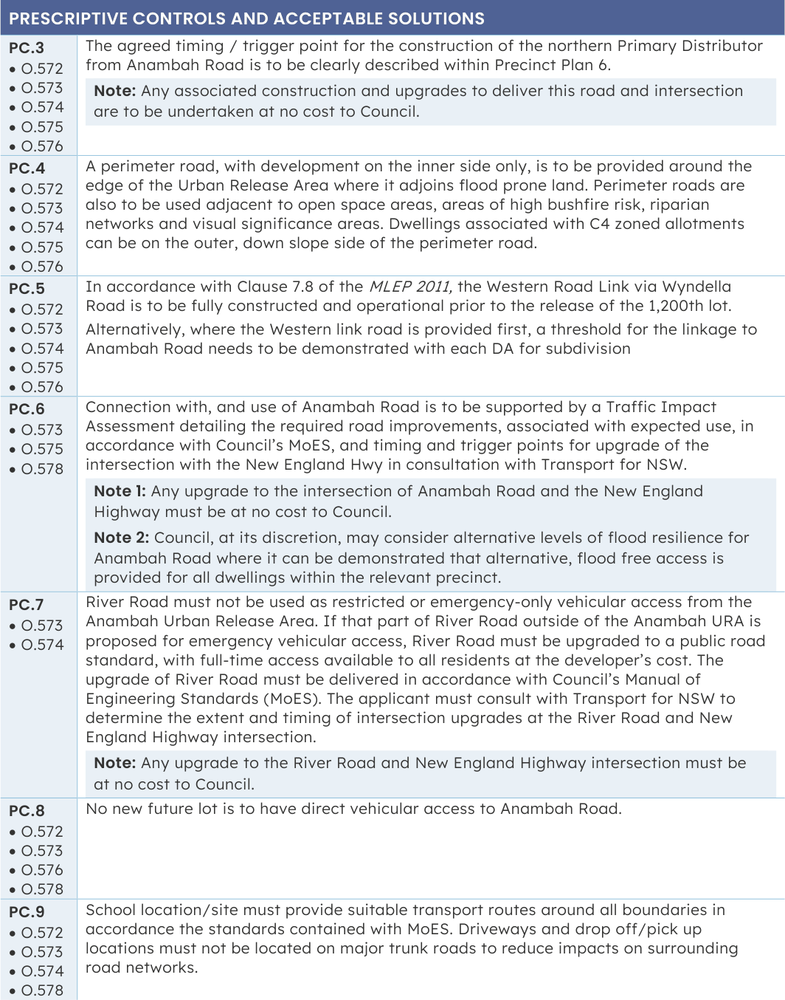
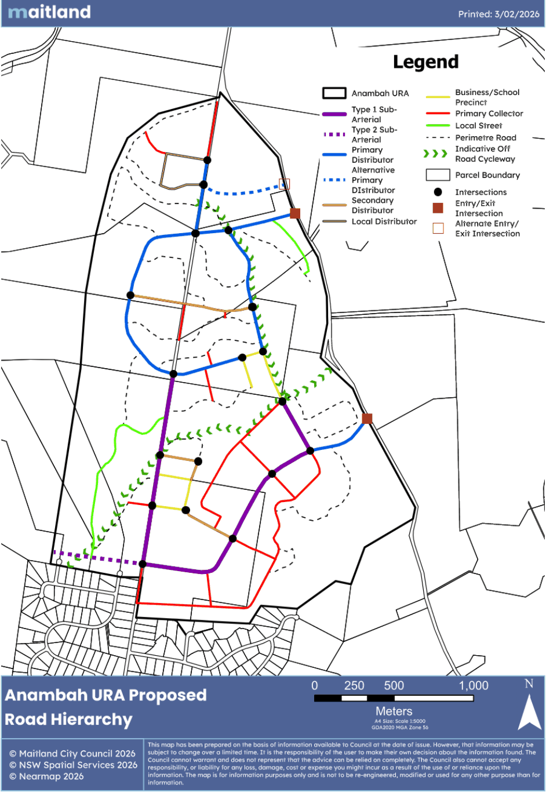
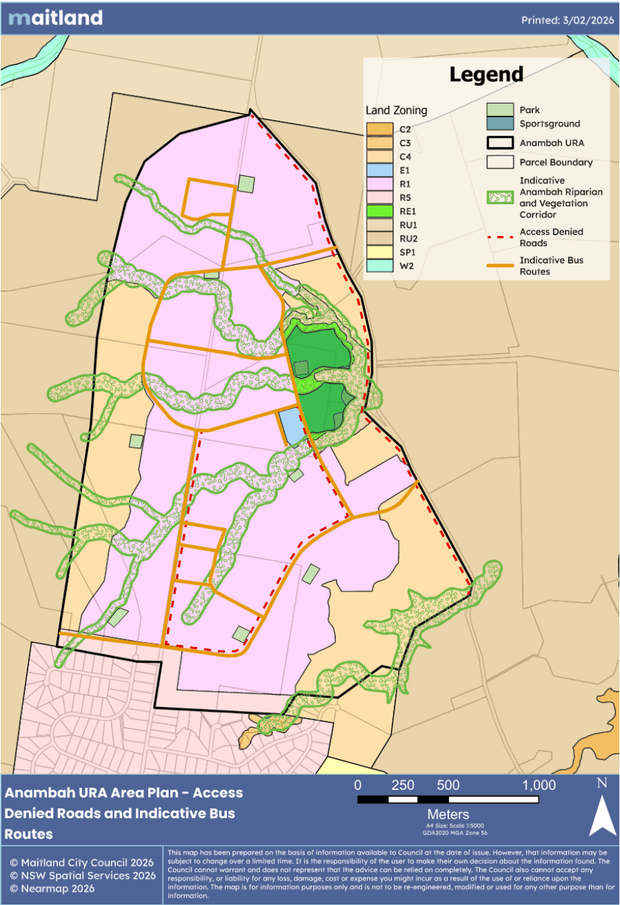

#### 10.4.17.3. Transport Movement Hierarchy

#### Objectives

O.572 To establish a well-structured and interconnected network of roads, cycleways, and shared

pathways.

O.573 To ensure road design reflects the function of the road, the needs of the road user, with sound

engineering practice and connectivity to existing and future development.

O.574 To facilitate convenient and efficient access for public transport services.

O.575 To ensure that flood-free access to the URA is provided to all dwellings.

O.576 To provide a permeable and interconnected street structure to offer a choice of routes and to

distribute traffic load through a number of connection points.

O.577 To ensure that intersections with regional and state road networks are designed and delivered in

coordination with relevant authorities.

O.578 To ensure that all access routes to the URA are provided to a public road standard that supports

permanent, equitable access for residents.

> Words printed on the picture (title and legend, copied from the PDF):
> Engineering Standards (MoES).

#### PRESCRIPTIVE CONTROLS AND ACCEPTABLE SOLUTIONS

The primary road hierarchy is to be consistent with the Transport Movement Hierarchy Plan in Figure 10-133, Appendix A: Road Cross-Sections, and Council’s Manual of

#### PC.1

Vehicular access must not be provided to road frontages identified as Access Denied on the Anambah URA Area Plan – Including Bus Routes and Access Denied Roads in Figure 10-134, Appendix A: Road Cross-Sections, and MoES.

#### PC.2

> [Picture on page 272: a map, saved as a picture (images/ch-10-00-special-precincts-locality-plans-and-urban-release-page-272-1.gif, 150 dpi); the street names and other small labels are on the picture.]
> Words printed on the picture (title and legend, copied from the PDF):
> England Highway intersection.

#### PRESCRIPTIVE CONTROLS AND ACCEPTABLE SOLUTIONS

The agreed timing / trigger point for the construction of the northern Primary Distributor from Anambah Road is to be clearly described within Precinct Plan 6. Note: Any associated construction and upgrades to deliver this road and intersection

are to be undertaken at no cost to Council.

#### PC.3

A perimeter road, with development on the inner side only, is to be provided around the edge of the Urban Release Area where it adjoins flood prone land. Perimeter roads are also to be used adjacent to open space areas, areas of high bushfire risk, riparian networks and visual significance areas. Dwellings associated with C4 zoned allotments can be on the outer, down slope side of the perimeter road.

#### PC.4

In accordance with Clause 7.8 of the MLEP 2011, the Western Road Link via Wyndella Road is to be fully constructed and operational prior to the release of the 1,200th lot. Alternatively, where the Western link road is provided first, a threshold for the linkage to Anambah Road needs to be demonstrated with each DA for subdivision

#### PC.5

Connection with, and use of Anambah Road is to be supported by a Traffic Impact Assessment detailing the required road improvements, associated with expected use, in accordance with Council’s MoES, and timing and trigger points for upgrade of the intersection with the New England Hwy in consultation with Transport for NSW.

#### PC.6

Note 1: Any upgrade to the intersection of Anambah Road and the New England

Highway must be at no cost to Council. Note 2: Council, at its discretion, may consider alternative levels of flood resilience for

Anambah Road where it can be demonstrated that alternative, flood free access is provided for all dwellings within the relevant precinct.

#### PC.7

River Road must not be used as restricted or emergency-only vehicular access from the Anambah Urban Release Area. If that part of River Road outside of the Anambah URA is proposed for emergency vehicular access, River Road must be upgraded to a public road standard, with full-time access available to all residents at the developer’s cost. The upgrade of River Road must be delivered in accordance with Council’s Manual of Engineering Standards (MoES). The applicant must consult with Transport for NSW to determine the extent and timing of intersection upgrades at the River Road and New

Note: Any upgrade to the River Road and New England Highway intersection must be

at no cost to Council. No new future lot is to have direct vehicular access to Anambah Road.

#### PC.8

School location/site must provide suitable transport routes around all boundaries in accordance the standards contained with MoES. Driveways and drop off/pick up locations must not be located on major trunk roads to reduce impacts on surrounding

#### PC.9

> [Picture on page 273: a picture, saved as a picture (images/ch-10-00-special-precincts-locality-plans-and-urban-release-page-273-1.gif, 150 dpi).]

#### Figure 10-133: Anambah URA Transport Movement Hierarchy Plan

> [Picture on page 274: a picture, saved as a picture (images/ch-10-00-special-precincts-locality-plans-and-urban-release-page-274-1.gif, 150 dpi).]

#### Figure 10-134: Anambah URA Area Plan (Access Denied Roads and Indicative Bus

#### Routes)
