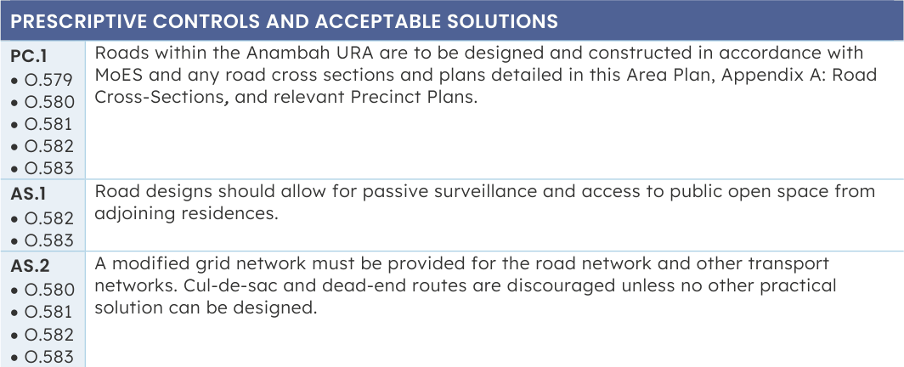

#### 10.4.17.4. Road Design

#### Objectives

O.579 To embellish particular roads within the urban release area with distinct design and typology to

optimise functions.

O.580 To ensure road design reflects the function of the road, the needs of the road user, with sound

engineering practice and connectivity to existing and future development.

O.581 To ensure that the design of the streets indicates their position in the street hierarchy, their function

and reflect the uses within the street in their character and detail.

O.582 To provide a permeable and interconnected street structure to offer a choice of routes and to

distribute traffic load through a number of connection points.

O.583 To provide a safe, continuous and appropriate level of pedestrian and cycleway access linking

residential development with schools, commercial areas, recreational areas, public transport and the wider community.

> [Picture on page 275: a map, saved as a picture (images/ch-10-00-special-precincts-locality-plans-and-urban-release-page-275-14.gif, 150 dpi); the street names and other small labels are on the picture.]
> Words printed on the picture (title and legend, copied from the PDF):
> solution can be designed.

#### PRESCRIPTIVE CONTROLS AND ACCEPTABLE SOLUTIONS

Roads within the Anambah URA are to be designed and constructed in accordance with MoES and any road cross sections and plans detailed in this Area Plan, Appendix A: Road Cross-Sections, and relevant Precinct Plans.

#### PC.1

Road designs should allow for passive surveillance and access to public open space from

#### AS.1

A modified grid network must be provided for the road network and other transport networks. Cul-de-sac and dead-end routes are discouraged unless no other practical

#### AS.2
