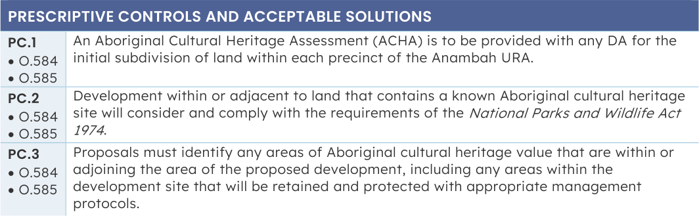

#### 10.4.17.5. Aboriginal Cultural Heritage

#### Objectives

O.584 To manage Aboriginal cultural heritage values, assisting in protecting sensitive Aboriginal landforms,

items, and places of heritage significance.

O.585 To ensure enduring heritage conservation outcomes.

> [Picture on page 275: a picture, saved as a picture (images/ch-10-00-special-precincts-locality-plans-and-urban-release-page-275-30.gif, 150 dpi).]
> Words printed on the picture (title and legend, copied from the PDF):
> • O.584
> • O.585
> • O.584
> • O.585
> • O.584
> • O.585
> protocols.

#### PRESCRIPTIVE CONTROLS AND ACCEPTABLE SOLUTIONS

An Aboriginal Cultural Heritage Assessment (ACHA) is to be provided with any DA for the initial subdivision of land within each precinct of the Anambah URA.

#### PC.1

Development within or adjacent to land that contains a known Aboriginal cultural heritage site will consider and comply with the requirements of the National Parks and Wildlife Act 1974.

#### PC.2

#### PC.3

Proposals must identify any areas of Aboriginal cultural heritage value that are within or adjoining the area of the proposed development, including any areas within the development site that will be retained and protected with appropriate management

#### Objectives

O.586 To provide landscaping appropriate to the nature and scale of development that enhances the local

character and streetscapes.

O.587 To support retention and regeneration of ecological corridors.

O.588 To assist in providing visual interest and suitable backdrops to the built form of the Urban Release

Area.

O.589 To provide a landscaped buffer along Anambah Road that softens the visual impact of development

and helps reduce traffic noise.

| PRESCRIPTIVE CONTROLS AND ACCEPTABLE SOLUTIONS |  |
|---|---|
| PC.1 • O.586 • O.587 • O.588 | Detailed landscape plans are to be submitted with the development application for initial subdivision of any site. The landscape plans must include, where applicable, details for all streets and public spaces, identifying appropriate street tree species and number, fencing details, landscape elements, water bodies and street furniture. |
| PC.2 • O.586 • O.587 • O.588 | Primary landscaping works will be required for all: • major intersections, including connections to Anambah Road, • areas of open space, • riparian corridors, • playing fields, • local parks, and • identified vegetation buffer areas within the relevant Precinct Plan. |
| AS.1 | Existing trees are to be retained wherever possible within open space/ riparian areas, or in the front setback of lots fronting streets. |
| • O.586 |  |
| • O.587 |  |
| • O.588 |  |
| PC.3 | Natural watercourses are to be protected and revegetated where appropriate to enhance the visual amenity, prevent soil erosion, and to protect the quality of receiving waters. |
| • O.586 |  |
| • O.587 |  |
| • O.588 |  |
| PC.4 • O.589 | A 10-metre-wide landscaped buffer must be provided wholly within the boundaries of lots adjoining Anambah Road starting from RL14.0m AHD at the south east boundary of the URA. Any fencing is to be of an open style rural fence located on the dwelling side of the landscape buffer. Details of the buffer must be shown in the landscape plan. |
| PC.5 | Street planting and planting within public spaces should prioritise locally endemic native species, where suitable, having regard to site conditions, infrastructure constraints, and public safety requirements. |
| • O.586 |  |
| • O.588 |  |
