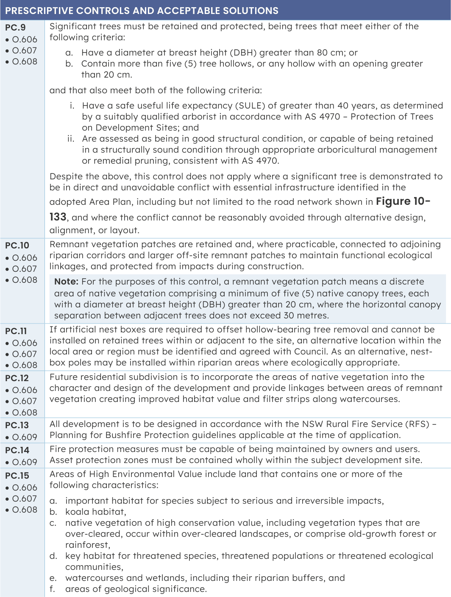

#### 10.4.17.8. Stormwater and Water Quality

#### Objectives

O.596 To protect and enhance the water quality and habitat value of downstream waterways.

O.597 To prevent erosion and sediment runoff during site preparation, construction, and ongoing use.

O.598 To integrate Water Sensitive Urban Design (WSUD) into open spaces and streetscapes.

O.599 To ensure there is no detrimental impact on downstream waterways, wetland environments, or

agricultural productivity as a result of new development.

O.600 To manage stormwater runoff at the precinct level so that flows outside any precinct remain at pre-

development levels.

O.601 To identify and manage existing natural trunk drainage paths.

O.602 To reduce potable water consumption, stormwater pollution and manage flow attenuation.

> [Picture on page 277: a picture, saved as a picture (images/ch-10-00-special-precincts-locality-plans-and-urban-release-page-277-16.gif, 150 dpi).]
> Words printed on the picture (title and legend, copied from the PDF):
> • O.596
> • O.597
> • O.598

#### PRESCRIPTIVE CONTROLS AND ACCEPTABLE SOLUTIONS

A Stormwater and Water Quality Report and Strategy is to be provided for each stormwater catchment and submitted with the first development application for subdivision for each precinct. The number and location of WSUD elements are to be

#### PC.1

| PRESCRIPTIVE CONTROLS AND ACCEPTABLE SOLUTIONS |  |
|---|---|
| • O.600 | assisted by modelling to develop the WSUD strategy for the site and be integrated with the overall design. |
| • O.601 |  |
| • O.602 |  |
| PC.2 • O.596 • O.597 • O.598 • O.599 | A Stormwater and Water Quality Report, including MUSIC modelling, must be submitted with Medium or Major subdivision applications to demonstrate water quality objectives are met. Note: Medium subdivisions are defined as the creation of 10 – 49 new lots, and/or where a new road is required. Major subdivisions are defined as the creation of 50 or more new lots. |
| PC.3 | Stormwater management facilities must be designed to enhance ecological values (e.g. native plantings), and where possible, utilise or improve existing water bodies. |
| • O.596 |  |
| • O.599 |  |
| PC.4 | The location of stormwater detention basins and water quality controls structures should, where practical, avoid riparian corridors, particularly areas identified as threatened ecological communities. |
| • O.598 |  |
| • O.599 |  |
| • O.600 |  |
| PC.5 | Stormwater runoff from each precinct must be managed so that flows outside the precinct do not exceed pre-development levels, as verified by appropriate modelling. |
| • O.597 |  |
| • O.598 |  |
| • O.599 |  |
| • O.600 |  |
| PC.6 | Gross Pollutant Traps (GPTs) must be integrated into the stormwater network and sized to accommodate the pollutant load. |
| • O.596 |  |
| • O.597 |  |
| • O.598 |  |
| • O.599 |  |
| • O.601 |  |
| PC.7 | All development must incorporate WSUD principles to demonstrate the site and catchment is achieving water quality targets. Private systems (e.g., bio-retention swales, vegetated swales, rain gardens). may be needed to supplement the public system where a site exceeds requirements including impervious coverage or pollutant loads (nutrient, etc) |
| • O.596 |  |
| • O.598 |  |
| • O.599 |  |
| AS.1 | Developments are encouraged to implement additional WSUD measures (e.g., stormwater harvesting, reuse schemes, green roofs) to reduce potable water demand and improve stormwater quality. |
| • O.598 |  |
| • O.601 |  |
| PC.8 | Erosion and sediment control plans are required to be submitted as part of subdivision and are to incorporate, where appropriate, measures like temporary sediment basins, vegetated buffer strips, and stabilised site access points to minimise runoff. |
| • O.597 |  |
| • O.599 |  |
| • O.600 |  |
| AS.2 • O.598 • O.600 • O.601 | Wherever possible, the existing riparian areas could form part of a stormwater and runoff drainage management system incorporating detention basins and/or wetlands to alleviate stormwater peaks and retain pollutants. Stormwater structures including basins, are to be positioned where the operational maintenance of the structure is not impeded by environmental constraints and plantings. |
| PC.9 | Basins must be positioned offline from 3rd order of higher waterways. |
| • O.598 |  |
| • O.600 |  |
| • O.601 |  |

#### Objectives

O.603 To manage the risk to human life, property, and essential services by ensuring development is

compatible with flood behaviour.

O.604 To ensure negligible flood impacts on adjoining property or infrastructure.

O.605 To ensure overland flow paths are appropriately identified and managed through comprehensive

flood modelling.

O.606 To conserve biological diversity and protect threatened species/ecological communities.

O.607 To ensure development is designed to avoid, minimise and manage impacts on land containing high

environmental values.

O.608 To ensure that site planning and design responds appropriately to areas of high environmental value

through layout, building location and design.

O.609 To ensure that development is designed to reduce the risk of bushfire to people and property.

| PRESCRIPTIVE CONTROLS AND ACCEPTABLE SOLUTIONS |  |
|---|---|
| PC.1 | Development must comply with the NSW Flood Risk Management Manual 2023. |
| • O.603 |  |
| • O.604 |  |
| • O.605 |  |
| PC.2 | Development must demonstrate that it does not result in an increase in flood levels on adjoining or surrounding land. |
| • O.603 |  |
| • O.604 |  |
| PC.3 | Internal roads are to be designed to provide flood free access to proposed allotments. |
| • O.603 |  |
| PC.4 | Each stage of development must demonstrate how flood free access up to and including the 1% AEP flood level will be provided. |
| • O.603 |  |
| PC.5 | An overland flow flood model is to be submitted for each precinct to identify and manage potential overland flow catchments. |
| • O.605 |  |
| PC.6 • O.603 • O.604 | Where cut and fill and the construction of roads is proposed in the 1% Annual Exceedance Probability (AEP) floodway or within flood storage areas, a flood impact risk assessment is required. This is to be prepared in accordance with LU01 - Flood Impact and Risk Assessment of the NSW Flood Risk Management Manual 2023. |
| AS.1 | Pedestrian and cycle pathways and open space may extend into the 1% AEP flood level, provided the safe access criteria contained in the NSW Flood Risk Management Manual 2023 are met and there is no impact on the flood behaviour. |
| • O.603 |  |
| • O.604 |  |
| PC.7 • O.606 • O.607 • O.608 | Where development results in direct or indirect impacts on Threatened Ecological Communities (TECs) listed under the Biodiversity Conservation Act 2016 or the Environment Protection and Biodiversity Conservation Act 1999, or habitat patches for threatened species listed under the same Acts, a Vegetation Management Plan (VMP) must be prepared and implemented to protect, manage, and improve biodiversity values. The VMP must be prepared by a suitably qualified ecologist or bush regenerator and implemented in a manner that effectively safeguards and enhances biodiversity values. Note: This control complements, but does not replace, obligations under the Biodiversity Offset Scheme (BOS), the BC Act, or the EPBC Act. |
| PC.8 • O.606 • O.607 • O.608 | Riparian corridors identified in an adopted Area Plan must be retained, protected, and restored in accordance with the indicative location and intent shown in the Area Plan, irrespective of stream order classification. Where a riparian assessment or stream order analysis identifies a watercourse as a first-order stream that would otherwise be exempt from restoration or setback requirements under State legislation, this does not remove the obligation to protect and restore the riparian corridor identified in the Area Plan. |

> [Picture on page 280: a map, saved as a picture (images/ch-10-00-special-precincts-locality-plans-and-urban-release-page-280-1.gif, 150 dpi); the street names and other small labels are on the picture.]
> Words printed on the picture (title and legend, copied from the PDF):
> than 20 cm.
> on Development Sites; and
> b. koala habitat,

#### PRESCRIPTIVE CONTROLS AND ACCEPTABLE SOLUTIONS

Significant trees must be retained and protected, being trees that meet either of the

#### PC.9

a. Have a diameter at breast height (DBH) greater than 80 cm; or

b. Contain more than five (5) tree hollows, or any hollow with an opening greater

and that also meet both of the following criteria:

i. Have a safe useful life expectancy (SULE) of greater than 40 years, as determined

by a suitably qualified arborist in accordance with AS 4970 – Protection of Trees

ii. Are assessed as being in good structural condition, or capable of being retained

in a structurally sound condition through appropriate arboricultural management or remedial pruning, consistent with AS 4970.

Despite the above, this control does not apply where a significant tree is demonstrated to be in direct and unavoidable conflict with essential infrastructure identified in the

#### adopted Area Plan, including but not limited to the road network shown in Figure 10-

133, and where the conflict cannot be reasonably avoided through alternative design,

alignment, or layout. Remnant vegetation patches are retained and, where practicable, connected to adjoining riparian corridors and larger off-site remnant patches to maintain functional ecological linkages, and protected from impacts during construction.

#### PC.10

Note: For the purposes of this control, a remnant vegetation patch means a discrete

area of native vegetation comprising a minimum of five (5) native canopy trees, each with a diameter at breast height (DBH) greater than 20 cm, where the horizontal canopy separation between adjacent trees does not exceed 30 metres. If artificial nest boxes are required to offset hollow-bearing tree removal and cannot be installed on retained trees within or adjacent to the site, an alternative location within the local area or region must be identified and agreed with Council. As an alternative, nest-box poles may be installed within riparian areas where ecologically appropriate.

#### PC.11

Future residential subdivision is to incorporate the areas of native vegetation into the character and design of the development and provide linkages between areas of remnant vegetation creating improved habitat value and filter strips along watercourses.

#### PC.12

All development is to be designed in accordance with the NSW Rural Fire Service (RFS) – Planning for Bushfire Protection guidelines applicable at the time of application.

#### PC.13

Fire protection measures must be capable of being maintained by owners and users. Asset protection zones must be contained wholly within the subject development site.

#### PC.14

Areas of High Environmental Value include land that contains one or more of the following characteristics:

#### PC.15

a. important habitat for species subject to serious and irreversible impacts,

c. native vegetation of high conservation value, including vegetation types that are

over-cleared, occur within over-cleared landscapes, or comprise old-growth forest or

d. key habitat for threatened species, threatened populations or threatened ecological

e. watercourses and wetlands, including their riparian buffers, and

f. areas of geological significance.

| PRESCRIPTIVE CONTROLS AND ACCEPTABLE SOLUTIONS |  |
|---|---|
| PC.16 | Avoided High Environmental Value (HEV) land is to be protected and enhanced in perpetuity. Appropriate mechanisms to secure these outcomes may include section 88B Instruments. |
| • O.606 |  |
| • O.607 |  |
| • O.608 |  |
| PC.17 | Where the development of a Vegetation Management Plan or Biodiversity Management Plan is required, the application must demonstrate how they have engaged with local Aboriginal knowledge holders to identify shared approaches that support the health and wellbeing of Country. |
| • O.606 |  |
| • O.607 |  |
| • O.608 |  |
| PC.18 | All development applications are required to assess for relevant prescribed impacts on biodiversity, as outlined in the Biodiversity Conservation Regulation 2017. This requirement applies irrespective of whether the Biodiversity Offset Scheme (BOS) is triggered. |
| • O.606 |  |
| • O.607 |  |
| • O.608 |  |
