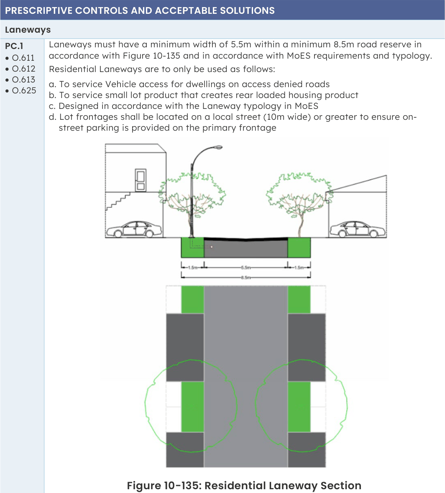
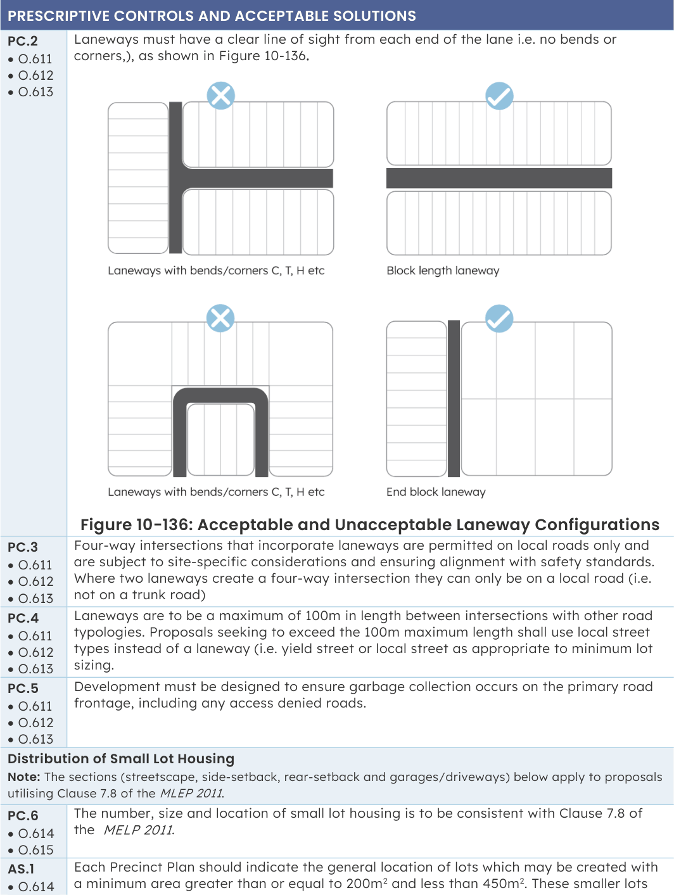

#### 10.4.17.11. Residential Densities

#### Objectives

O.611 To design laneways that enhance safety, reduce maintenance liabilities, and support positive

community behaviour through Crime Prevention Through Environmental Design (CPTED) principles.

O.612 To ensure laneway configurations facilitate efficient property access without compromising the

integrity of the overall road network.

O.613 To align laneway design with the broader road network criteria, promoting walkability and

connectivity within the AURA.

O.614 To ensure the equitable distribution of small lot housing proposals across the AURA precincts.

O.615 To ensure a mix of lot sizes and housing types.

O.616 To promote diverse and varied streetscapes through the integration of small lot housing.

O.617 To ensure that built form reflects the intended outcomes of permitting small lots as an important

part of the mix of lot sizes available for varied housing needs.

O.618 To maximise private open space, visual and acoustic privacy, views, natural ventilation, and solar

access for the subject site and adjoining properties through optimised setback configurations.

O.619 To provide opportunities for the planting of vegetation to enhance privacy and environmental

quality.

O.620 To reduce the visual impact of garages, carports, and sheds on the streetscape and improve

dwelling presentation.

O.621 To ensure garages do not dominate the streetscape, maintaining the aesthetic quality of the

neighbourhood.

O.622 To minimize the visual impact of driveways on the streetscape.

O.623 To provide practical and safe access and egress to dwellings.

O.624 To minimise the impact of driveways on on-streetcar parking and utilities.

O.625 To ensure laneways are only used to facilitate access to access denied road frontages on high order

roads, or to support vehicle access rear loaded small lot development.

> [Picture on page 282: a picture, saved as a picture (images/ch-10-00-special-precincts-locality-plans-and-urban-release-page-282-10.gif, 150 dpi).]
> Words printed on the picture (title and legend, copied from the PDF):
> • O.611
> • O.612
> • O.613
> • O.625

Figure 10-135: Residential Laneway Section

#### PRESCRIPTIVE CONTROLS AND ACCEPTABLE SOLUTIONS

#### Laneways

Laneways must have a minimum width of 5.5m within a minimum 8.5m road reserve in accordance with Figure 10-135 and in accordance with MoES requirements and typology. Residential Laneways are to only be used as follows:

#### PC.1

a. To service Vehicle access for dwellings on access denied roads

b. To service small lot product that creates rear loaded housing product

c. Designed in accordance with the Laneway typology in MoES

d. Lot frontages shall be located on a local street (10m wide) or greater to ensure on-

street parking is provided on the primary frontage

> [Picture on page 283: a map, saved as a picture (images/ch-10-00-special-precincts-locality-plans-and-urban-release-page-283-1.gif, 150 dpi); the street names and other small labels are on the picture.]
> Words printed on the picture (title and legend, copied from the PDF):
> Note: The sections (streetscape, side-setback, rear-setback and garages/driveways) below apply to proposals
> utilising Clause 7.8 of the MLEP 2011.
> the  MELP 2011.

Figure 10-136: Acceptable and Unacceptable Laneway Configurations

#### PRESCRIPTIVE CONTROLS AND ACCEPTABLE SOLUTIONS

Laneways must have a clear line of sight from each end of the lane i.e. no bends or corners,), as shown in Figure 10-136.

#### PC.2

Four-way intersections that incorporate laneways are permitted on local roads only and are subject to site-specific considerations and ensuring alignment with safety standards. Where two laneways create a four-way intersection they can only be on a local road (i.e. not on a trunk road)

#### PC.3

Laneways are to be a maximum of 100m in length between intersections with other road typologies. Proposals seeking to exceed the 100m maximum length shall use local street types instead of a laneway (i.e. yield street or local street as appropriate to minimum lot sizing.

#### PC.4

Development must be designed to ensure garbage collection occurs on the primary road frontage, including any access denied roads.

#### PC.5

#### Distribution of Small Lot Housing

The number, size and location of small lot housing is to be consistent with Clause 7.8 of

#### PC.6

Each Precinct Plan should indicate the general location of lots which may be created with a minimum area greater than or equal to 200m2 and less than 450m2. These smaller lots

#### AS.1

| PRESCRIPTIVE CONTROLS AND ACCEPTABLE SOLUTIONS |  |
|---|---|
| • O.615 | are to be located within areas of high amenity and 200m walking distance to commercial premises, recreation areas or community facilities and matched to the appropriate road types on a Precinct map. |
| Streetscape |  |
| PC.7 | Articulation of the front facades of small lot housing must be varied rather than uniform to enhance visual interest and encourage housing diversity. |
| • O.616 |  |
| • O.617 |  |
| AS.2 | Developments are encouraged to incorporate innovative facade treatments (e.g., varied materials, colours, and architectural features) to enhance streetscape diversity and reflect the character of small lot housing. |
| • O.616 |  |
| • O.617 |  |
| Side Setbacks |  |
| PC.8 | If the lot has a width, measured at the front building line, of at least 6m but not more than 8m, the building may be constructed to both side boundaries. |
| • O.618 |  |
| • O.619 |  |
| PC.9 | If the lot has a width, measured at the front building line, of more than 8m but not more than 12.5m, the building may be constructed to only one side boundary. |
| • O.618 |  |
| • O.619 |  |
| PC.10 | Where an existing boundary wall on a neighbouring lot adjoins the subject site, the new boundary wall must match the length of the existing boundary wall. |
| • O.618 |  |
| • O.619 |  |
| PC.11 | Where no adjoining boundary wall exists, the boundary wall must not exceed a maximum of 50 per cent of the lot length or a maximum length of 12 metres, whichever is lesser. |
| • O.618 |  |
| • O.619 |  |
| PC.12 • O.618 • O.619 | Walls built to the side boundary must not exceed a maximum height of 3.5 metres above existing ground level unless: a. They abut another higher existing or simultaneously constructed wall, in which case the wall must not exceed the boundary wall on the adjoining lot. b. They abut a side or rear lane, in which case the maximum height is 5.5m. |
| Rear Setbacks |  |
| PC.13 • O.618 | Structures built to the rear boundary must not exceed a maximum height of 3.5 metres above existing ground level unless: a. They abut another higher existing or simultaneously constructed structure, in which case the height must not exceed that of the adjoining structure. b. They abut a rear lane, in which case the maximum height is 5.5 metres. |
| PC.14 | Structures built to the rear boundary must be designed and constructed to allow for easy maintenance, including access for repairs and upkeep of drainage systems. |
| • O.618 |  |
| AS.3 • O.618 | Developments are encouraged to incorporate integrated landscaping (e.g. shared gardens, green walls) to enhance visual continuity and provide additional outdoor living spaces. |
| Garages and Driveways |  |
| PC.15 | Where a development is located on a site with rear laneway access, garages must be located fronting the rear lane with 1.0m minimum setback to garage doors. Driveway access from the primary road frontage will not be considered. |
| • O.620 |  |
| • O.621 |  |
| • O.622 |  |
| • O.623 |  |
| • O.624 |  |

| PRESCRIPTIVE CONTROLS AND ACCEPTABLE SOLUTIONS |  |
|---|---|
| PC.16 | Garage doors must be visually recessive through the use of materials, colours, overhangs, and similar design elements to reduce their visual impact on the streetscape. |
| • O.620 |  |
| • O.621 |  |
| • O.622 |  |
| • O.623 |  |
| • O.624 |  |
| PC.17 | Where the lot width is greater than 12m, dwellings may have a double garage on the primary street frontage provided they do not dominate the streetscape and are visually recessive and either in line or setback from the front building line. |
| • O.620 |  |
| • O.621 |  |
| • O.622 |  |
| • O.623 |  |
| • O.624 |  |
| PC.18 | Where the lot width is less than 12m, only single-width garages are permitted on the primary street frontage. |
| • O.620 |  |
| • O.621 |  |
| • O.622 |  |
| • O.623 |  |
| • O.624 |  |
| PC.19 | Garages and carports are to be designed to blend with the architectural style of the dwelling through the use of compatible materials and colours, thereby reducing their visual dominance on the streetscape. |
| • O.620 |  |
| • O.621 |  |
| • O.622 |  |
| • O.623 |  |
| • O.624 |  |
| PC.20 | The location of driveways must be determined with regard to the location of utilities infrastructure, safe and unobstructed kerbside space for waste bin placement, street tree planting, and to maximize the availability of on-street parking and in accordance with any MoESS requirements. |
| • O.620 |  |
| • O.621 |  |
| • O.622 |  |
| • O.623 |  |
| • O.624 |  |
