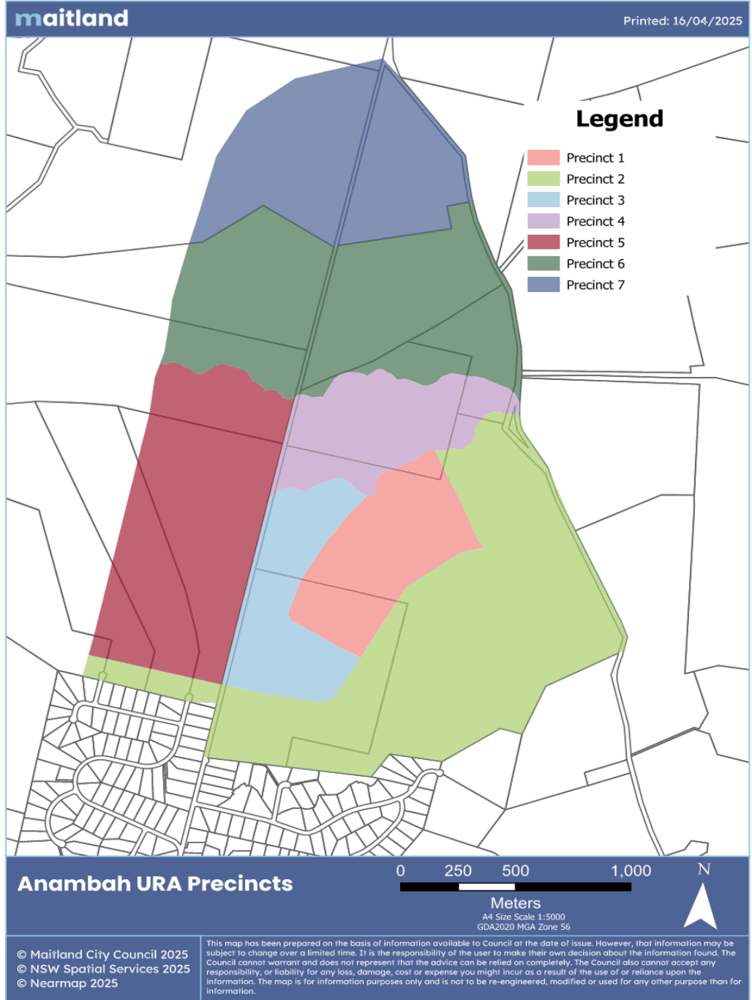
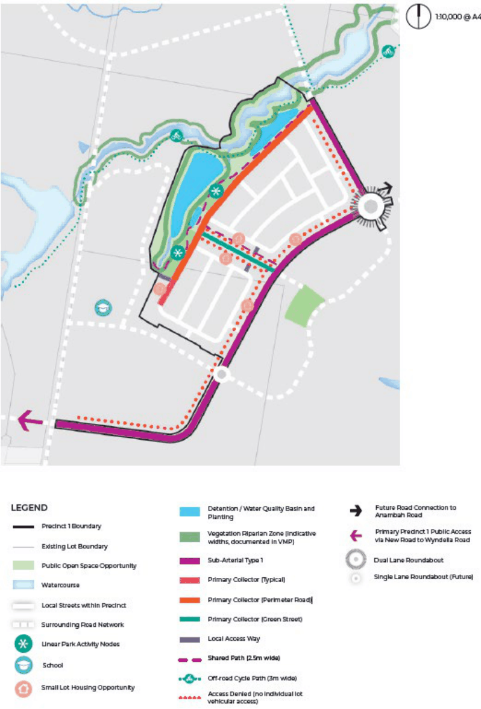
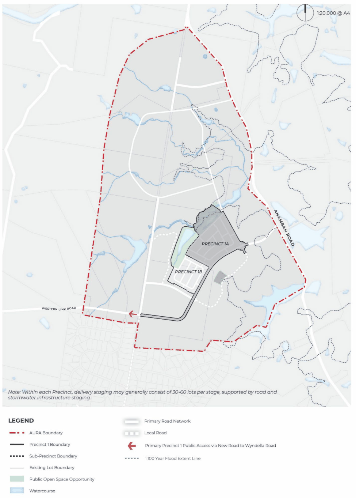

#### 10.4.17.12. Visual and Scenic Amenity

#### Objectives

O.626 To protect the scenic values of the landscape and environment.

O.627 Encouraging development to be unobtrusive and sympathetic to the surrounding rural setting.

O.628 To ensure that residents benefit from views to the surrounding landscape when using public streets

and open spaces.

| PRESCRIPTIVE CONTROLS AND ACCEPTABLE SOLUTIONS |  |
|---|---|
| PC.1 | Where practicable, vegetation is to be maintained and enhanced, particularly along ridgelines and gullies, so as to provide buffers and landscaped visual relief to subdivisions and housing development. |
| • O.626 |  |
| • O.627 |  |
| • O.628 |  |

### Precinct Plan Requirements - General

The Anambah Urban Release Area is characterised by a number of precincts or catchments informed by site attributes and constraints, infrastructure provisions, development outcomes and land ownership. Precinct Plans must be adopted by Council prior to determination of any development application for subdivision of land within that precinct.  The Precinct Plans shall be consistent with and relate to land areas included within specific stages as shown in the Staging Plan. The precincts and staging of development are closely linked to the requirements of major infrastructure providers such as Hunter Water Corporation in respect to water and sewer, road infrastructure provisions and upgrades, and extension and augmentation of power supply. Each Precinct Plan lodged by a Proponent must include:

a. A clear description and spatial layout of proposed land uses (e.g. residential, schools, recreation,

community facilities, centres, utilities),

b. A housing typology framework, supported by a fine-grain density plan demonstrating how a

diversity of housing types will be delivered,

c. Controls for key development sites, including flood fringe land, recreational areas (including any

proposed linear open space), and urban land adjoining rural or environmental zones, commercial and community hub,

d. Concept design for any centres or employment land, ensuring integration with surrounding uses

and transport links,

e. A visual character assessment, including measures for retaining/protecting significant landscape

features and native vegetation,

f. A tree canopy strategy consistent with the Maitland Environmental Sustainability Strategy 2030,

g. The road network and hierarchy (sub-arterial, collector, local roads) and connections to adjoining precincts, in accordance with the Transport Movement Hierarchy Plan in Figure 10-133,

h. Proposed routes or corridors for public transport, bicycles, and pedestrians,

i. A water cycle management plan addressing stormwater drainage, riparian corridors, and WSUD

opportunities,

j. The location of proposed Bushfire Asset Protection Zones (APZs), identified flood levels, and

emergency evacuation routes for flooding and bushfire.

k. The subdivision stages of development within each precinct

l. A landscaping concept plan for the protection and enhancement of riparian areas and remnant

vegetation, including visually prominent locations, and typical landscaping requirements for both the public domain and private land, particularly adjacent to the major roads and intersections, including a perimeter road network adjacent to flood prone lands, riparian corridors and rural interface.

> [Picture on page 287: a picture, saved as a picture (images/ch-10-00-special-precincts-locality-plans-and-urban-release-page-287-1.gif, 150 dpi).]

#### Figure 10-137: Anambah URA Precincts

### Development Requirements – Anambah URA Precinct 1

The following section is the Precinct Plan provisions referred to in the general provisions above that applies to Precinct 1. No specific requirements have been made for the following matters within the Anambah URA Precinct 1 as they are already adequately addressed by other relevant provisions within the MLEP 2011 and the MDCP 2011:

• Neighbourhood Commercial and Retail Uses

• Provision of Public Facilities and Services

> [Picture on page 288: a picture, saved as a picture (images/ch-10-00-special-precincts-locality-plans-and-urban-release-page-288-8.gif, 150 dpi).]

#### Figure 10-138: Anambah URA Precinct 1 - Overall Plan

> [Picture on page 289: a picture, saved as a picture (images/ch-10-00-special-precincts-locality-plans-and-urban-release-page-289-1.gif, 150 dpi).]

#### Figure 10-139: Anambah URA Precinct 1 Staging Plan
