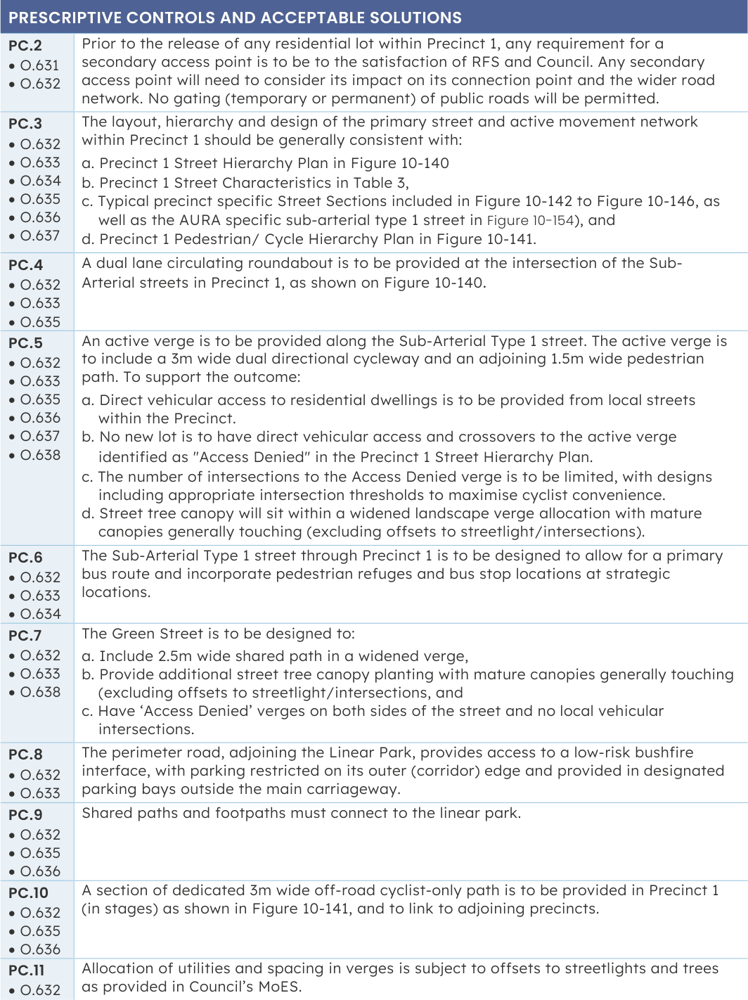
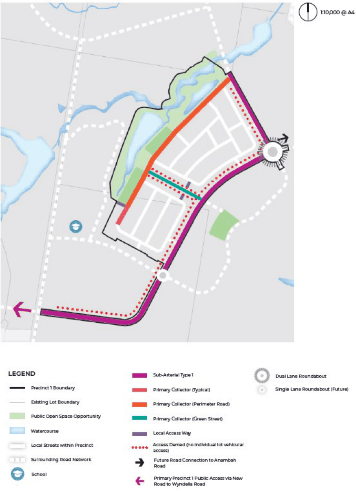
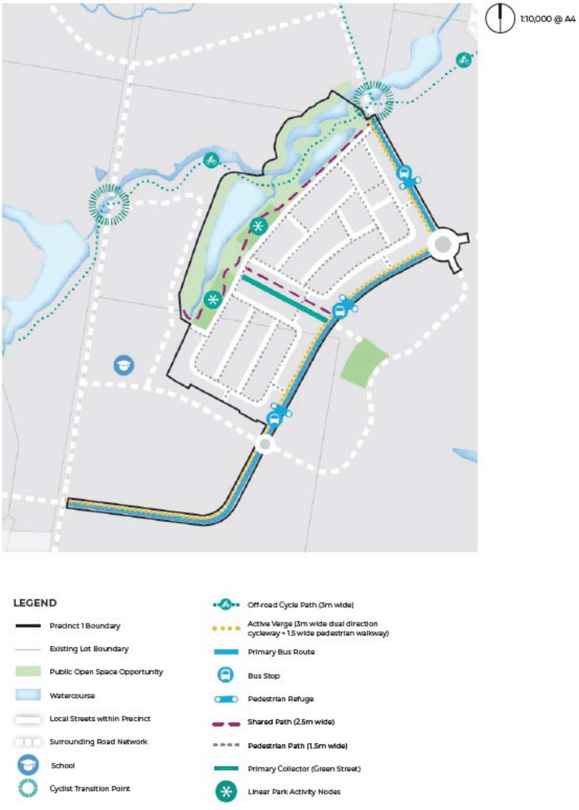
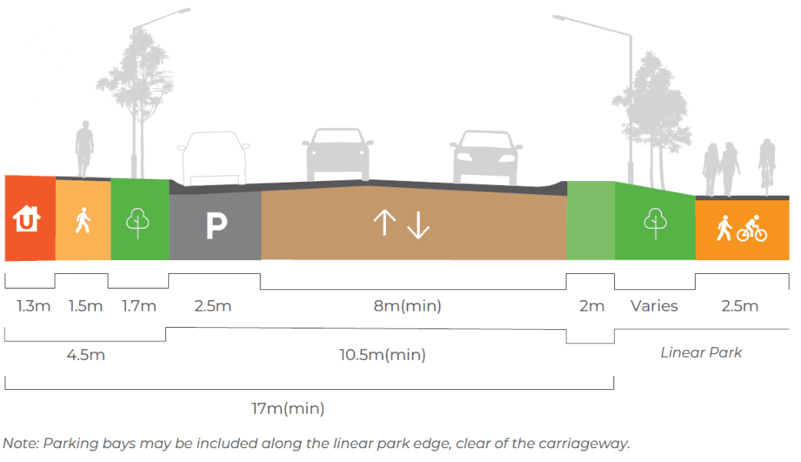
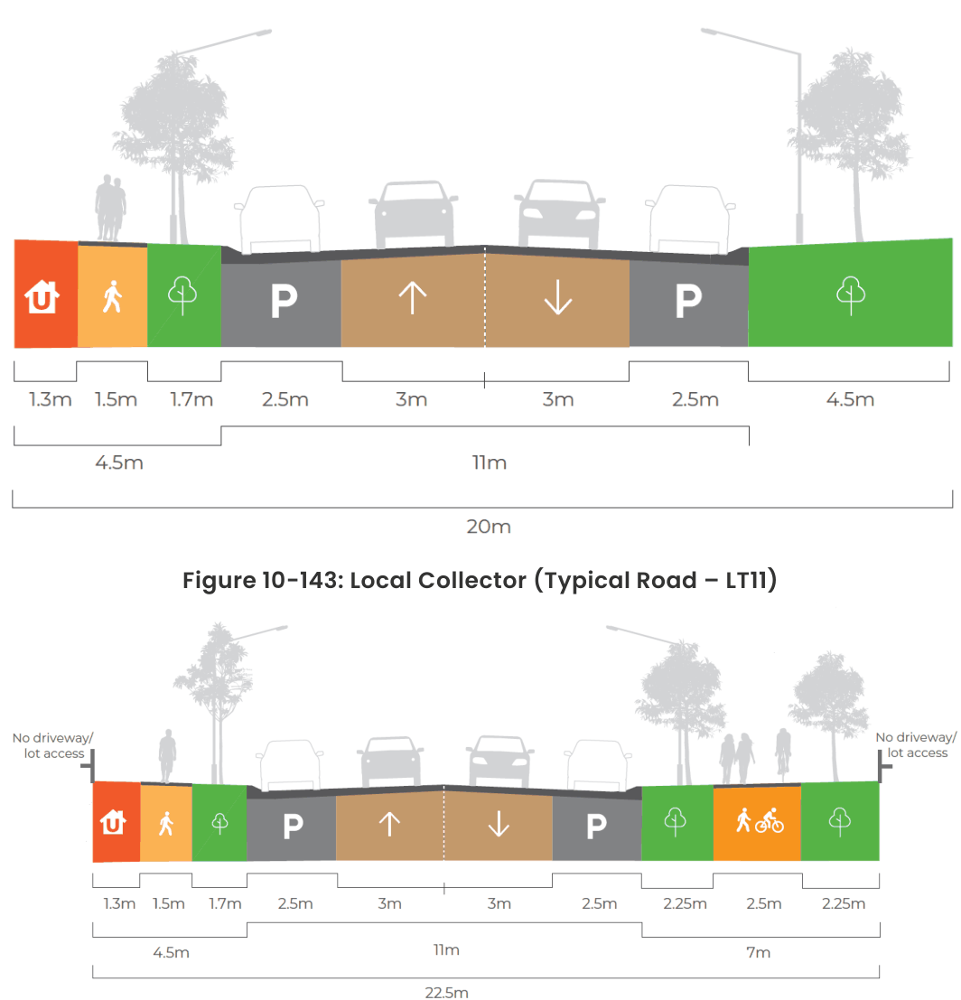
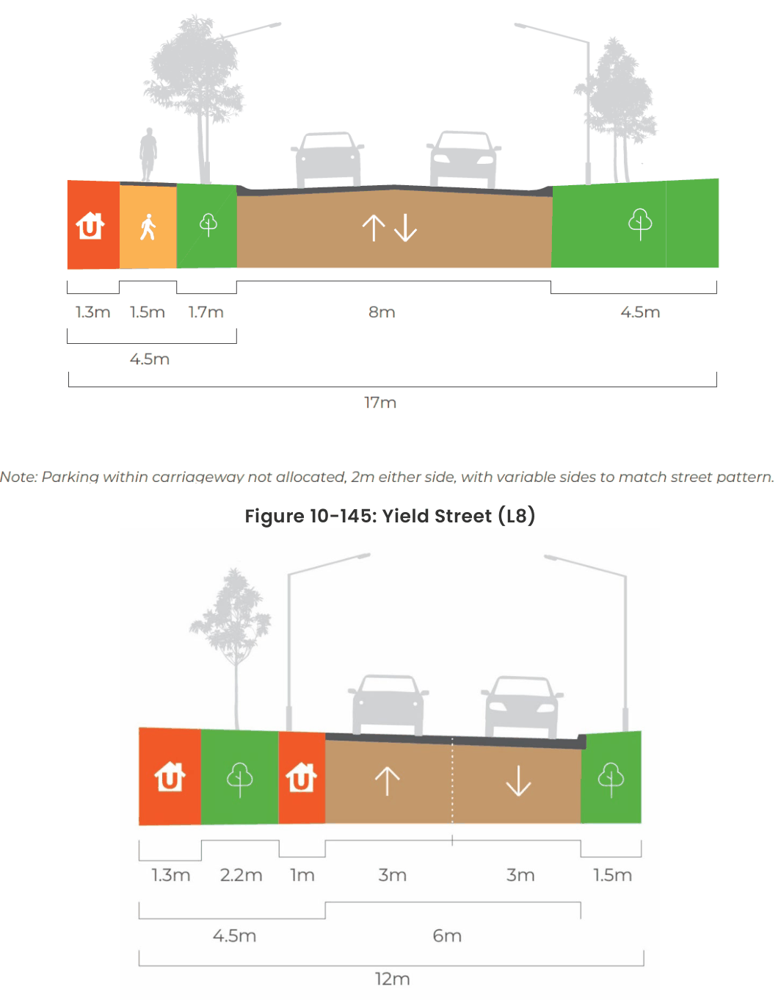

#### 10.4.17.14. Transport Movement Hierarchy and Road Design

#### Objectives

O.631 To provide permanent, safe and suitable new public road access to and from Precinct 1.

O.632 To achieve a simple and safe movement system within Precinct 1 for private vehicles, public

transport, pedestrians and cyclists.

O.633 To ensure road design reflects the function and hierarchy of the street, the needs of the road user,

with sound engineering practice and connectivity to existing and future development.

O.634 To ensure that the design of the streets indicates their position in the street hierarchy, their function

and reflect the uses within the street in their character and detail.

O.635 To provide a permeable and interconnected internal street structure to offer a choice of routes and

to distribute traffic load through a number of connection points, with road design to allow for passive surveillance and access to the linear park and corridor.

O.636 To provide a safe, continuous and appropriate level and mix of pedestrian and cycleway access and

connectivity to future development.

O.637 To provide an active verge to the sub-arterial road in Precinct 1 with future residential dwellings

addressing this street.

O.638 To provide a Green Street which links with a shared path and additional street tree canopy between

the linear park in Precinct 1 to future public open space to its south.

| PRESCRIPTIVE CONTROLS AND ACCEPTABLE SOLUTIONS |  |
|---|---|
| PC.1 • O.631 • O.632 • O.633 | Access to Precinct 1 is to be provided via either a new public road that connects west to Wyndella Road and its connection to the New England Highway, or connection with Anambah Road. Construction of the new road and dedication of it as a public road are required to be completed prior to registration of the 1200th residential lot. Connection with, and use of Anambah Road is to be supported by a Traffic Impact Assessment detailing the required road improvements in accordance with Council’s MoES, and timing and trigger points for upgrade of the intersection with the New England Hwy in consultation with Transport for NSW. Note: In accordance with Clause 7.9 of the MLEP 2011, development consent must not be granted unless the consent authority is satisfied that suitable vehicular access is available or that adequate arrangements have been made to make it available when required. |

> [Picture on page 291: a map, saved as a picture (images/ch-10-00-special-precincts-locality-plans-and-urban-release-page-291-1.gif, 150 dpi); the street names and other small labels are on the picture.]
> Words printed on the picture (title and legend, copied from the PDF):
> Arterial streets in Precinct 1, as shown on Figure 10-140.
> within the Precinct.

#### PRESCRIPTIVE CONTROLS AND ACCEPTABLE SOLUTIONS

#### PC.2

Prior to the release of any residential lot within Precinct 1, any requirement for a secondary access point is to be to the satisfaction of RFS and Council. Any secondary access point will need to consider its impact on its connection point and the wider road network. No gating (temporary or permanent) of public roads will be permitted. The layout, hierarchy and design of the primary street and active movement network within Precinct 1 should be generally consistent with:

a. Precinct 1 Street Hierarchy Plan in Figure 10-140

b. Precinct 1 Street Characteristics in Table 3,

c. Typical precinct specific Street Sections included in Figure 10-142 to Figure 10-146, as

#### PC.3

well as the AURA specific sub-arterial type 1 street in Figure 10-154), and

d. Precinct 1 Pedestrian/ Cycle Hierarchy Plan in Figure 10-141. A dual lane circulating roundabout is to be provided at the intersection of the Sub-

#### PC.4

An active verge is to be provided along the Sub-Arterial Type 1 street. The active verge is to include a 3m wide dual directional cycleway and an adjoining 1.5m wide pedestrian

path. To support the outcome:

a. Direct vehicular access to residential dwellings is to be provided from local streets

b. No new lot is to have direct vehicular access and crossovers to the active verge

#### PC.5

• O.638 identified as "Access Denied" in the Precinct 1 Street Hierarchy Plan.

c. The number of intersections to the Access Denied verge is to be limited, with designs

including appropriate intersection thresholds to maximise cyclist convenience.

d. Street tree canopy will sit within a widened landscape verge allocation with mature

canopies generally touching (excluding offsets to streetlight/intersections). The Sub-Arterial Type 1 street through Precinct 1 is to be designed to allow for a primary bus route and incorporate pedestrian refuges and bus stop locations at strategic

#### PC.6

The Green Street is to be designed to:

a. Include 2.5m wide shared path in a widened verge,

b. Provide additional street tree canopy planting with mature canopies generally touching

#### PC.7

• O.638 (excluding offsets to streetlight/intersections, and

c. Have ‘Access Denied’ verges on both sides of the street and no local vehicular

The perimeter road, adjoining the Linear Park, provides access to a low-risk bushfire interface, with parking restricted on its outer (corridor) edge and provided in designated parking bays outside the main carriageway.

#### PC.8

Shared paths and footpaths must connect to the linear park.

#### PC.9

A section of dedicated 3m wide off-road cyclist-only path is to be provided in Precinct 1 (in stages) as shown in Figure 10-141, and to link to adjoining precincts.

#### PC.10

Allocation of utilities and spacing in verges is subject to offsets to streetlights and trees as provided in Council’s MoES.

#### PC.11

> [Picture on page 292: a picture, saved as a picture (images/ch-10-00-special-precincts-locality-plans-and-urban-release-page-292-1.gif, 150 dpi).]

#### Figure 10-140: Anambah URA Precinct 1 Street Hierarchy Plan

> [Picture on page 293: a picture, saved as a picture (images/ch-10-00-special-precincts-locality-plans-and-urban-release-page-293-1.gif, 150 dpi).]

#### Figure 10-141: Anambah URA Precinct 1 Pedestrian & Cycle Hierarchy Plan

#### Table 3: Proposed Road Network Details

| ROAD | ROAD RESERVE | FOOTPATH WIDTH | CARRIAGEWAY AND | VERGE |
|---|---|---|---|---|
| NAME/TYPE | WIDTH |  | PARKING LANE |  |
| Local Collector (Typical Road – LT11) | 20m 1.5m pedestrian path 11m pavement 2 x 4.5m one side 2 x 3m travel lanes 2 x 2.5m parking lanes |  |  |  |
| Primary Collector (Perimeter Road) | 16m (minimum & 1.5m pedestrian path lot 10.5m pavement (min) 1 x 4.5m (lot side) variable where side 1 x 2.0m (perimeter indented parking 1 x 2.5m parking lane (lot side, other than provided) (2.5m shared path in side only) widened where adjoining linear park) indented parking bays provided) |  |  |  |
| Green Street | 22.5m 1.5m pedestrian path 11m pavement 1 x 4.5m one side 2 x 3m travel lanes 1 x 7m 2.5m shared path in 2 x 2.5m parking lanes widened verge |  |  |  |
| Yield Street (L8 – MoES) | 17m 1.5m pedestrian path 8m pavement 2 x 4.5m one side |  |  |  |
| Local Access Way | 12m n/a, 2.5m shared path 6m pavement 1 x 4.5m from end of accessway 3m carriageway both ways 1 x 1.5m pavement to street |  |  |  |

> [Picture on page 294: a picture, saved as a picture (images/ch-10-00-special-precincts-locality-plans-and-urban-release-page-294-3.gif, 150 dpi).]

#### Figure 10-142: Primary Collector (Perimeter Road)

> [Picture on page 295: a picture, saved as a picture (images/ch-10-00-special-precincts-locality-plans-and-urban-release-page-295-1.gif, 150 dpi).]

#### Figure 10-143: Local Collector (Typical Road – LT11)

#### Figure 10-144: Green Street

> [Picture on page 296: a picture, saved as a picture (images/ch-10-00-special-precincts-locality-plans-and-urban-release-page-296-1.gif, 150 dpi).]

#### Figure 10-145: Yield Street (L8)

#### Figure 10-146: Local Access Way
