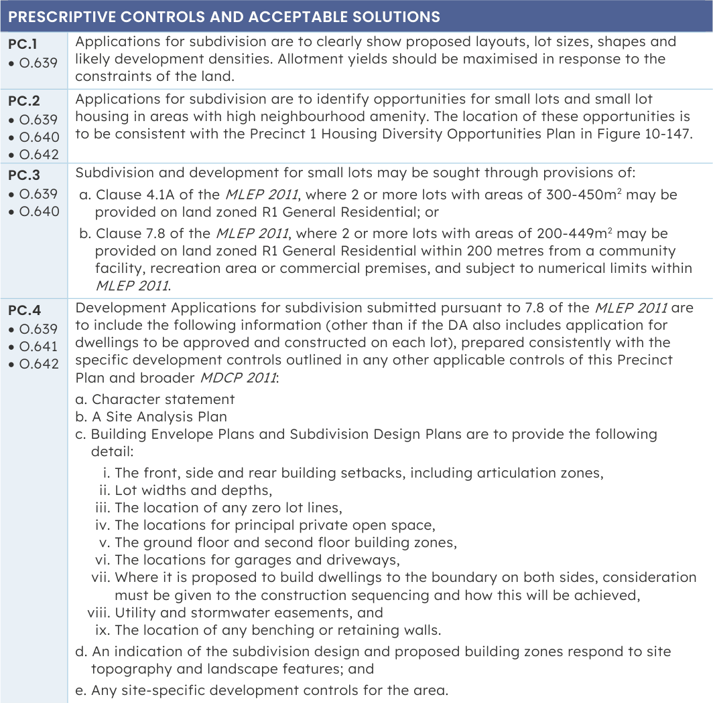
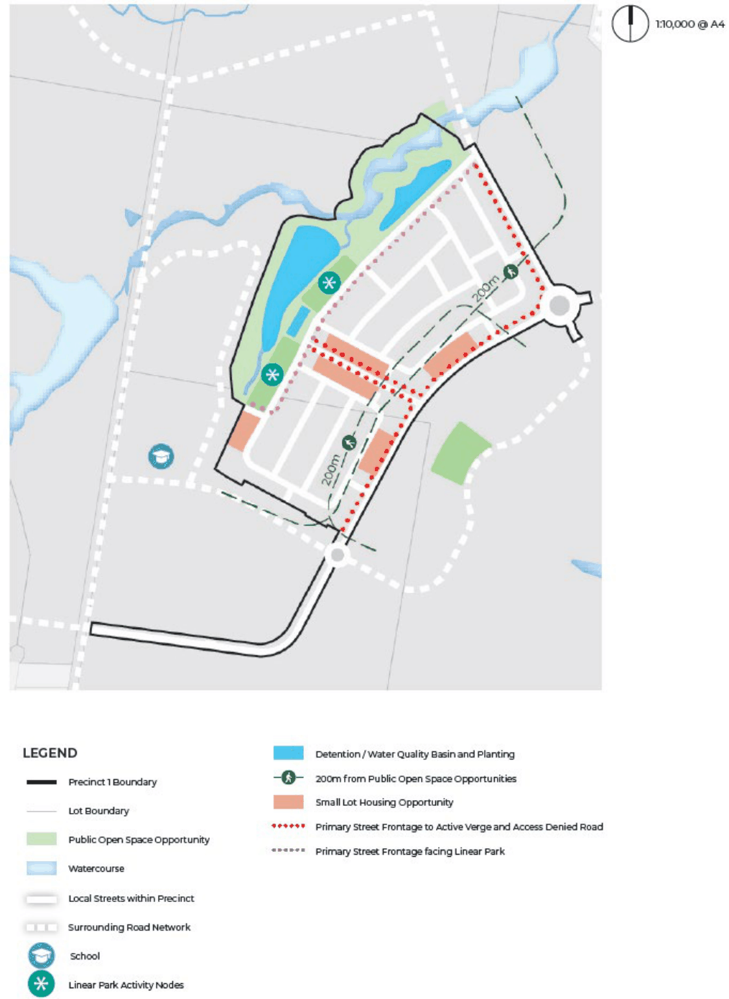
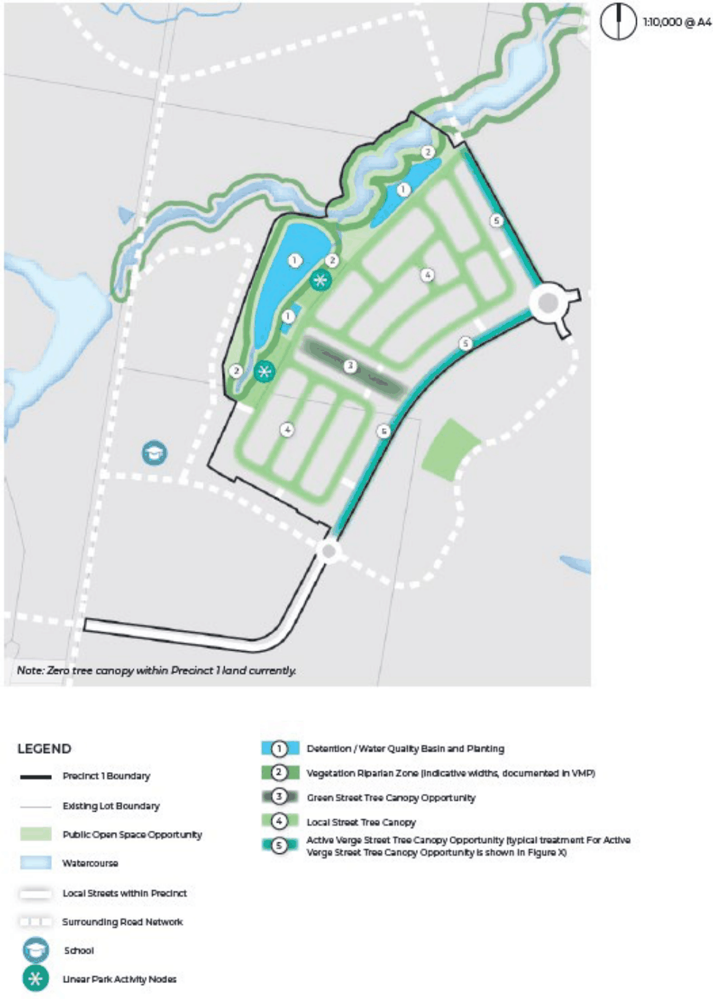
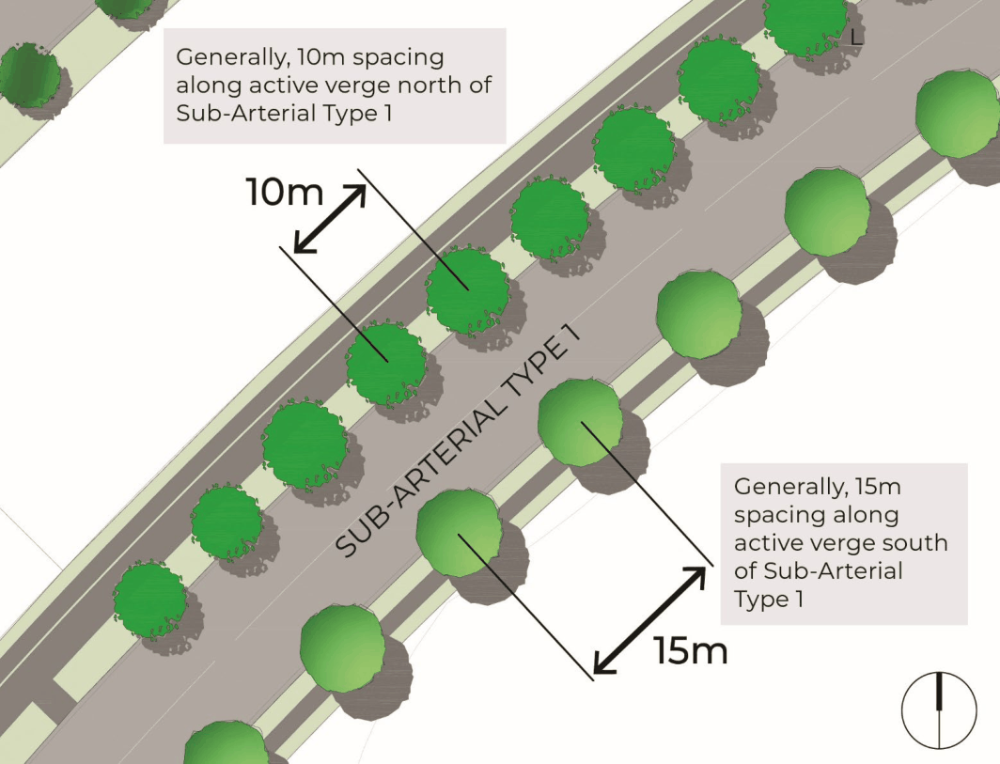

#### 10.4.17.15. Subdivision Design

#### Objectives

O.639 To create a Precinct with a distinct landscape and subdivision character that creates a sense of

identity, promotes housing diversity by identifying key development sites for future small lot housing and provides opportunities for dwelling presentation, passive surveillance and activity of streets and public areas.

O.640 To promote diverse and varied streetscapes through the integration of future small lot housing

opportunities in the Precinct.

O.641 To ensure that dwellings are of high quality and respond to the topography of the site.

O.642 To provide a range of public facilities in appropriate locations and in sequence with the land

development.

> [Picture on page 297: a picture, saved as a picture (images/ch-10-00-special-precincts-locality-plans-and-urban-release-page-297-12.gif, 150 dpi).]
> Words printed on the picture (title and legend, copied from the PDF):
> • O.639
> • O.639
> • O.640
> • O.642
> • O.639
> • O.640
> MLEP 2011.
> • O.639
> • O.641
> • O.642
> detail:

#### PRESCRIPTIVE CONTROLS AND ACCEPTABLE SOLUTIONS

#### PC.1

Applications for subdivision are to clearly show proposed layouts, lot sizes, shapes and likely development densities. Allotment yields should be maximised in response to the constraints of the land. Applications for subdivision are to identify opportunities for small lots and small lot housing in areas with high neighbourhood amenity. The location of these opportunities is to be consistent with the Precinct 1 Housing Diversity Opportunities Plan in Figure 10-147.

#### PC.2

Subdivision and development for small lots may be sought through provisions of:

a. Clause 4.1A of the MLEP 2011, where 2 or more lots with areas of 300-450m2 may be

provided on land zoned R1 General Residential; or

#### PC.3

b. Clause 7.8 of the MLEP 2011, where 2 or more lots with areas of 200-449m2 may be

provided on land zoned R1 General Residential within 200 metres from a community facility, recreation area or commercial premises, and subject to numerical limits within

#### PC.4

Development Applications for subdivision submitted pursuant to 7.8 of the MLEP 2011 are to include the following information (other than if the DA also includes application for dwellings to be approved and constructed on each lot), prepared consistently with the specific development controls outlined in any other applicable controls of this Precinct Plan and broader MDCP 2011:

a. Character statement

b. A Site Analysis Plan

c. Building Envelope Plans and Subdivision Design Plans are to provide the following

i. The front, side and rear building setbacks, including articulation zones,

ii. Lot widths and depths,

iii. The location of any zero lot lines,

iv. The locations for principal private open space,

v. The ground floor and second floor building zones,

vi. The locations for garages and driveways,

vii. Where it is proposed to build dwellings to the boundary on both sides, consideration

must be given to the construction sequencing and how this will be achieved,

viii. Utility and stormwater easements, and

ix. The location of any benching or retaining walls.

d. An indication of the subdivision design and proposed building zones respond to site

topography and landscape features; and

e. Any site-specific development controls for the area.

| PRESCRIPTIVE CONTROLS AND ACCEPTABLE SOLUTIONS Where PC.4 applies, the Subdivision Design Plan is to be included on the Section 88B instrument attached to the lot. development applications involving the construction of small-lot housing, lot may occur prior to the commencement of construction. The requirement to the approved dwelling is to be included on the S88B instrument attached to the Occupation Certificate of the dwelling is issued. is to balance cut and fill as far as practicable. Development include an Earthworks Plan, detailing: fill strategy, cut and/or fill including any area where fill depth exceeds 2m, changes to the landform. |
|---|
| PC.5 |
| • O.641 |
| PC.6 For • O.639 registration • O.641 construct lot until an |
| PC.7 Subdivision design • O.639 applications must • O.640 a. The proposed cut and • O.641 b. How the design manages and c. Justification for the proposed |

> [Picture on page 299: a picture, saved as a picture (images/ch-10-00-special-precincts-locality-plans-and-urban-release-page-299-1.gif, 150 dpi).]

#### Figure 10-147: Anambah URA Precinct 1 Housing Diversity Opportunities Plan

#### Objectives

O.643 To provide landscaping and public domain works that are appropriate to the scale and nature of

development, enhance local character, support establishment of tree canopy, and mitigate bushfire threat while promoting cooler, more comfortable microclimates

O.644 To protect and regenerate riparian corridors, through revegetation and sensitive landscape design

that complements the built form and public domain.

O.645 To create accessible corridors of public open space that integrate pedestrian and cycle networks,

enhance connectivity, and provide visual and recreational benefits.

| PRESCRIPTIVE CONTROLS AND ACCEPTABLE SOLUTIONS |  |
|---|---|
| PC.1 | Detailed landscape plans are to be submitted with subdivision Development Applications. |
| • O.643 |  |
| PC.2 • O.643 • O.644 | Landscape plans are to be generally consistent with Precinct 1 Landscaping and Tree Canopy Strategy in Figure 10-148 and must include details for all streets and public spaces that form part of the development application, including street verges, interfaces to riparian corridors and linear parks as listed in Figure 10-148 Precinct 1 Landscaping and Tree Canopy Strategy Plan as (1), (2), (3), (4), (5). |
| PC.3 | Development is to demonstrate a contribution toward the aim of 30% tree canopy in residential areas within the LGA. |
| • O.643 |  |
| PC.4 • O.643 | Street tree planting is to be carried out as part of subdivision design and road construction (where roads adjoin proposed lots in Precinct 1). Street trees are to be designed to: a. Provide shade on footpaths, shared paths and cycleways, and b. Soften streetscapes and provide a backdrop for future built form within the Precinct. Street tree planting of sub-arterial type 1 road, identified as (5) in Precinct 1 Landscape and Tree Canopy Strategy Plan, is to be generally consistent with Figure 10-149. |
| PC.5 • O.644 | Vegetated riparian zones shall be established and maintained around identified watercourses, in accordance with Riparian Vegetation Management Plan/s, consistent with relevant State Government Riparian Guidelines. |
| AS.1 • O.645 | Pedestrian and cycle linkages within Precinct 1, as illustrated in Figure 10-141, may be provided, including crossings of the drainage or riparian corridor, subject to consultation and agreement with Council. |

> [Picture on page 301: a picture, saved as a picture (images/ch-10-00-special-precincts-locality-plans-and-urban-release-page-301-1.gif, 150 dpi).]

#### Figure 10-148: Anambah URA Precinct 1 Landscaping and Tree Canopy Plan

> [Picture on page 302: a picture, saved as a picture (images/ch-10-00-special-precincts-locality-plans-and-urban-release-page-302-1.gif, 150 dpi).]

#### Figure 10-149: Street Tree Planting – Sub-Arterial Type 1
