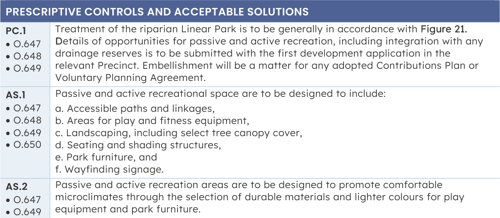
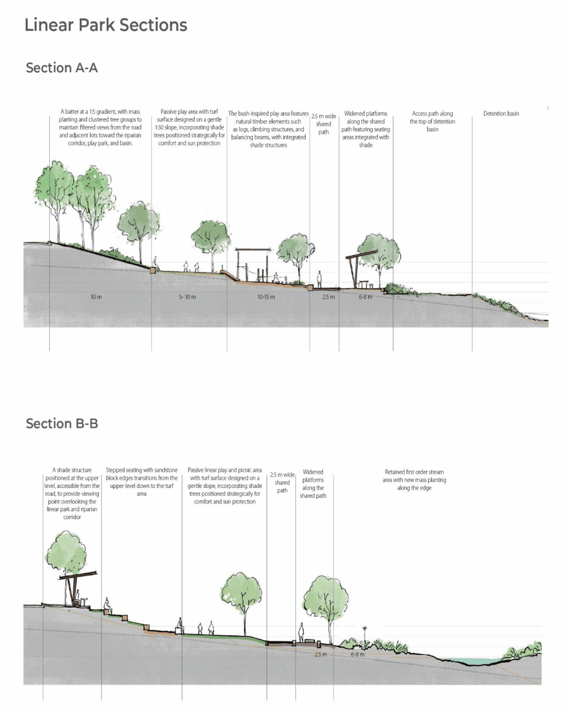
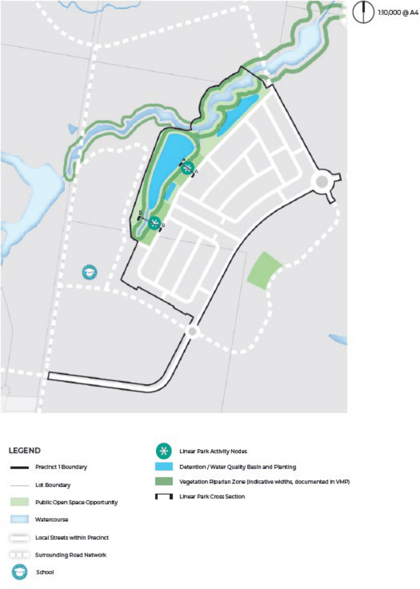

#### 10.4.17.17. Visual and Scenic Amenity

#### Objectives

O.646 To protect views to and from Anambah House.

| PRESCRIPTIVE CONTROLS AND ACCEPTABLE SOLUTIONS Residential development within 1.8km of Anambah House are to be limited to neutral roof colours that assist to blend development into the natural environment. The range of proposed for this area are to be included with development applications for subdivisions with relevant covenants placed on the titles of the lots created. vegetation planting along the western boundaries of Anambah House is to between the developer and owner of Anambah House. Outcomes of the vegetation are to include agreed species, timing of planting and Details are to be included in landscape plans for precinct 1 and 2 DA's. |
|---|
| PC.1 • O.646 colours residential |
| PC.2 Supplementary • O.646 be negotiated agreed supplementary maintenance schedule. and/or associated |

#### Objectives

O.647 To provide public open space land that meets the active and passive recreational needs of residents.

O.648 To provide an equitable distribution of public open space land and recreation opportunities.

O.649 To establish a linear park in Precinct 1 that includes the riparian corridor (where not part of the

drainage reserve) and provides connected, passive recreation opportunities integrated with the natural landscape and supported by usable, functional and safe nodes for good quality design and embellishment for passive and active recreation.

O.650 To create linkages between areas of passive and active recreation through an adequate pedestrian

and cycle network.

> [Picture on page 303: a picture, saved as a picture (images/ch-10-00-special-precincts-locality-plans-and-urban-release-page-303-10.gif, 150 dpi).]
> Words printed on the picture (title and legend, copied from the PDF):
> • O.647
> • O.648
> • O.649
> • O.647
> • O.648
> • O.649
> • O.650
> e. Park furniture, and
> equipment and park furniture.
> • O.647
> • O.649

#### PRESCRIPTIVE CONTROLS AND ACCEPTABLE SOLUTIONS

#### PC.1

Treatment of the riparian Linear Park is to be generally in accordance with Figure 21. Details of opportunities for passive and active recreation, including integration with any drainage reserves is to be submitted with the first development application in the relevant Precinct. Embellishment will be a matter for any adopted Contributions Plan or Voluntary Planning Agreement. Passive and active recreational space are to be designed to include:

#### AS.1

a. Accessible paths and linkages,

b. Areas for play and fitness equipment,

c. Landscaping, including select tree canopy cover,

d. Seating and shading structures,

f. Wayfinding signage. Passive and active recreation areas are to be designed to promote comfortable microclimates through the selection of durable materials and lighter colours for play

#### AS.2

> [Picture on page 304: a picture, saved as a picture (images/ch-10-00-special-precincts-locality-plans-and-urban-release-page-304-1.gif, 150 dpi).]

#### Figure 10-150: Indicative Linear Park Riparian Land Cross-Section

#### Objectives

O.651 To protect and enhance the water quality and habitat value of downstream waterways.

O.652 To prevent erosion and sediment run-off during site preparation, construction and the ongoing use.

O.653 To manage stormwater runoff at the precinct level so that flows outside any precinct remain at pre-

development flows.

O.654 To identify and manage existing natural trunk drainage paths.

| PRESCRIPTIVE CONTROLS AND ACCEPTABLE SOLUTIONS |  |
|---|---|
| PC.1 | The network of stormwater management areas in Precinct 1 is to be generally consistent with the Precinct 1 Open Space and Stormwater Management Plan in Figure 10-151 and integrated with the overall design of the Precinct. |
| • O.651 |  |
| • O.653 |  |
| • O.654 |  |
| AS.1 | Wherever possible, the existing and identified riparian areas should form part of a stormwater and runoff drainage management system incorporating detention basins and/or wetlands to alleviate stormwater peaks and retain pollutants. |
| • O.651 |  |
| • O.653 |  |
| • O.654 |  |
| PC.2 • O.651 • O.652 • O.653 • O.654 | Precinct 1B is to provide for the resizing and reshaping of the existing dam to provide control of water quantity for a wider catchment that includes it and future development within adjoining Precinct 3. Further detailed design is to be provided in a stormwater management plan submitted with the first DA proposing subdivision within Precinct 1B. The stormwater management plan must also outline details of any offline water quality treatment required for Precinct 1B. |
| PC.3 | Stormwater structures, including basins, are to be positioned where the operational maintenance of the structure is not impeded by environmental constraints and plantings. |
| • O.651 |  |
| • O.652 |  |
| • O.653 |  |

> [Picture on page 306: a picture, saved as a picture (images/ch-10-00-special-precincts-locality-plans-and-urban-release-page-306-1.gif, 150 dpi).]

#### Figure 10-151: Anambah URA Precinct 1 Open Space and Stormwater

#### Management
