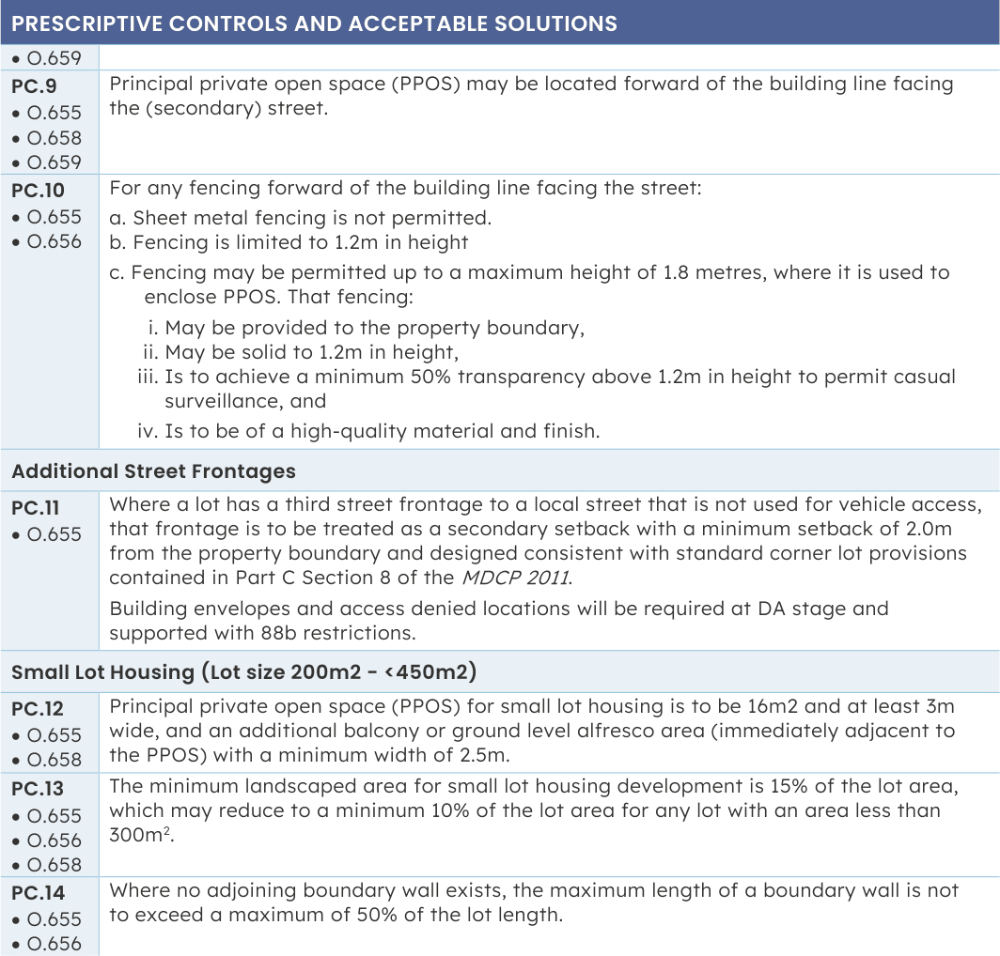
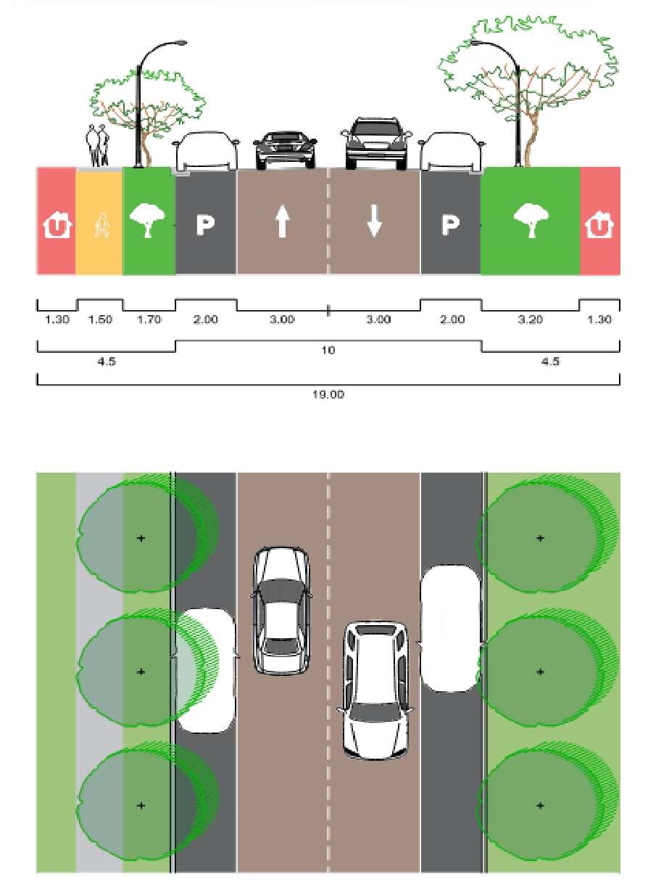
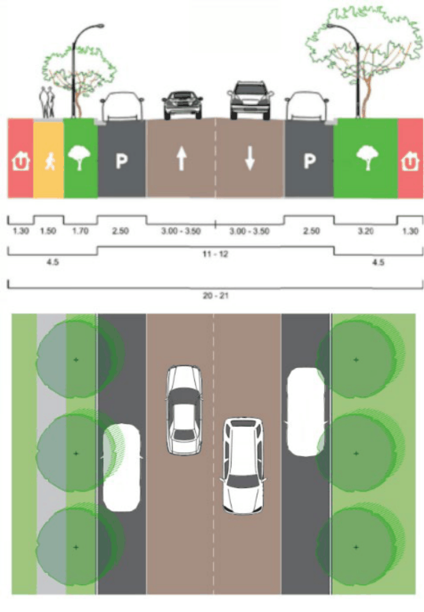
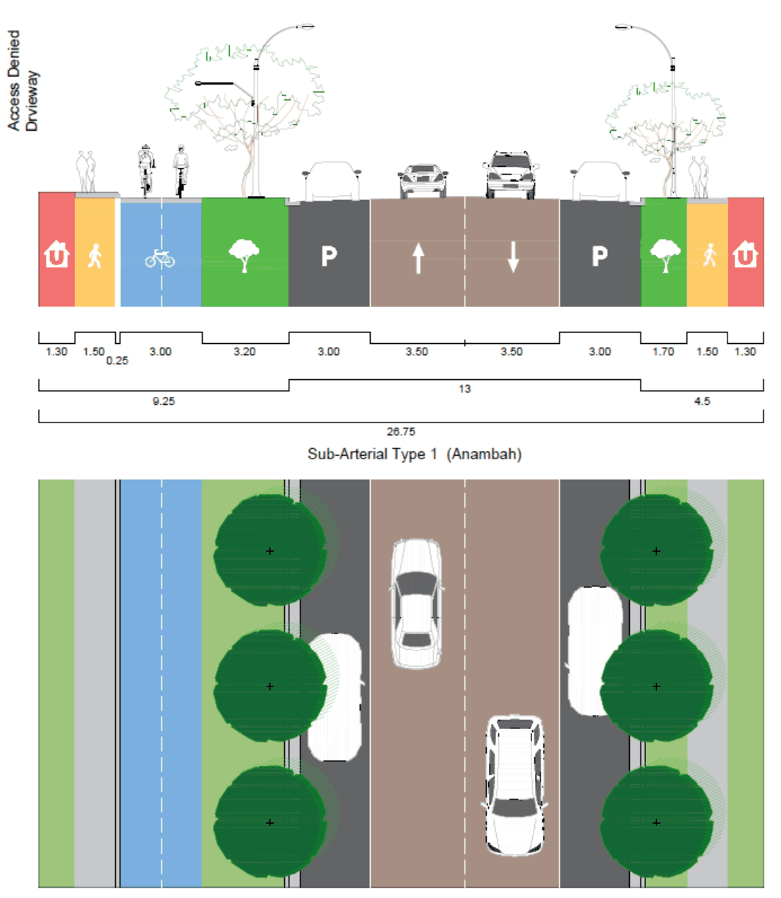
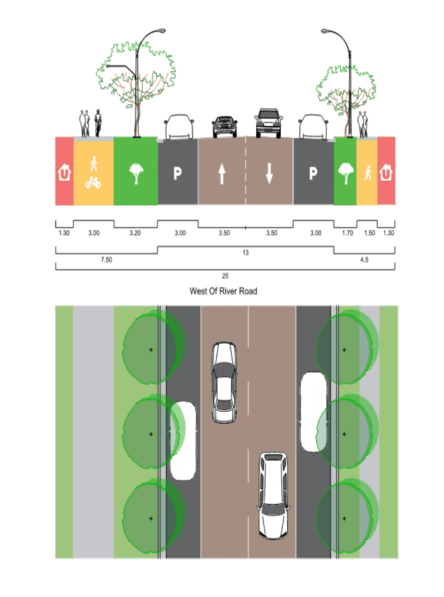

#### 10.4.17.20. Key Development Sites and Residential Densities

#### Objectives

O.655 To facilitate the efficient use of land that accommodates the Anambah Urban Release Area's

predicted population capacity.

O.656 To ensure that built form on parallel road lots and small lot housing lots present positively to all

street frontages.

O.657 To maintain the continuity and safety of parallel road lots by prohibiting vehicle access from access-

denied frontages.

O.658 To ensure sufficient landscaped areas and principal private open space is provided for parallel road

lots and small lot housing.

O.659 To provide safe access arrangements for parallel road lots and small lot housing.

| PRESCRIPTIVE CONTROLS AND ACCEPTABLE SOLUTIONS |  |
|---|---|
| Parallel Road Lots |  |
| Note: Parallel Road Lots are lots (of any size) where one frontage is to an access denied street |  |
| verge (primary frontage), with the other frontage/s to a parallel road / local street (secondary |  |
| frontage/s). These provisions do not apply to standard corner lots |  |
| Primary Frontages |  |
| PC.1 | No vehicular access is permitted to the access denied road. |
| • O.656 |  |
| • O.657 |  |
| PC.2 • O.655 | Dwellings must provide a positive and legible address through the incorporation of entry features, such as porticos, porches, balconies, decks, vehranda’s, bay windows, eaves and awning. Dwellings must provide at least one door with direct pedestrian access from the dwelling to the street and at least one habitable room window facing the street. |
| PC.3 • O.655 | A minimum street setback of 4.5m, with a 1.5m articulation zone forward of the 4.5m minimum setback for features listed in PC.2, for up to the full width of the front façade. Where a 4.5m setback is provided to the secondary frontage, the primary frontage street setback can be reduced to 3.0m. |
| PC.4 | At least 25% of the area forward of the building line is to be landscaped. |
| • O.658 |  |
| PC.5 | Principal private open space (PPOS) may be located forward of the 4.5m front building line. |
| • O.658 |  |
| PC.6 • O.655 | For any fencing forward of the front building line: a. Sheet metal fencing is not supported, b. Fencing is limited to 1.2m in height, c. Fencing forward of the front building line may be permitted up to a maximum height of 1.8 metres, where it is used to enclose PPOS. That fencing: i. Must not occupy more than 50% of the lot frontage, ii. Is to be setback a minimum 3.0m from the street boundary iii. Is to provide 50% transparency and be integrated with landscaping. |
| Secondary Frontages |  |
| PC.7 | Dwellings must provide a positive and legible alternate pedestrian access to the dwelling and at least one habitable room window facing the street. |
| • O.655 |  |
| • O.659 |  |
| PC.8 | A minimum street setback of 3.0m, unless for a garage. Garaging is to be setback a minimum 5.5m from the street frontage. |
| • O.655 |  |

> [Picture on page 308: a map, saved as a picture (images/ch-10-00-special-precincts-locality-plans-and-urban-release-page-308-1.gif, 150 dpi); the street names and other small labels are on the picture.]
> Words printed on the picture (title and legend, copied from the PDF):
> the (secondary) street.
> supported with 88b restrictions.

#### PRESCRIPTIVE CONTROLS AND ACCEPTABLE SOLUTIONS

Principal private open space (PPOS) may be located forward of the building line facing

#### PC.9

For any fencing forward of the building line facing the street:

#### PC.10

a. Sheet metal fencing is not permitted.

b. Fencing is limited to 1.2m in height

c. Fencing may be permitted up to a maximum height of 1.8 metres, where it is used to

enclose PPOS. That fencing:

i. May be provided to the property boundary,

ii. May be solid to 1.2m in height,

iii. Is to achieve a minimum 50% transparency above 1.2m in height to permit casual

iv. Is to be of a high-quality material and finish.

#### Additional Street Frontages PC.11

Where a lot has a third street frontage to a local street that is not used for vehicle access, that frontage is to be treated as a secondary setback with a minimum setback of 2.0m from the property boundary and designed consistent with standard corner lot provisions contained in Part C Section 8 of the MDCP 2011. Building envelopes and access denied locations will be required at DA stage and

#### Small Lot Housing (Lot size 200m2 - <450m2)

Principal private open space (PPOS) for small lot housing is to be 16m2 and at least 3m wide, and an additional balcony or ground level alfresco area (immediately adjacent to the PPOS) with a minimum width of 2.5m.

#### PC.12

The minimum landscaped area for small lot housing development is 15% of the lot area, which may reduce to a minimum 10% of the lot area for any lot with an area less than

#### PC.13

Where no adjoining boundary wall exists, the maximum length of a boundary wall is not to exceed a maximum of 50% of the lot length.

#### PC.14

### Appendix A: Road Cross-Sections

L10 – Local Street.  used for all small lot subdivision including development lots and partnering roads (minimum size) for residential laneways.

> [Picture on page 309: a picture, saved as a picture (images/ch-10-00-special-precincts-locality-plans-and-urban-release-page-309-4.gif, 150 dpi).]

#### Figure 10-152: L10 Local Street Typology

> [Picture on page 310: a picture, saved as a picture (images/ch-10-00-special-precincts-locality-plans-and-urban-release-page-310-1.gif, 150 dpi).]

#### Figure 10-153: LT11 Local Trunk Collector & T12 Local Distributor Typology

> [Picture on page 311: a picture, saved as a picture (images/ch-10-00-special-precincts-locality-plans-and-urban-release-page-311-1.gif, 150 dpi).]

#### Figure 10-154: Sub-Arterial Type 1 (Anambah)

> [Picture on page 312: a picture, saved as a picture (images/ch-10-00-special-precincts-locality-plans-and-urban-release-page-312-1.gif, 150 dpi).]

#### Figure 10-155: Sub-Arterial Road Type 2 – Anambah West of River Road

> [Picture on page 313, not reproduced as text; see the original PDF.]
> Words on this picture, read by OCR (may contain errors): m maitland CITY COUNCIL
