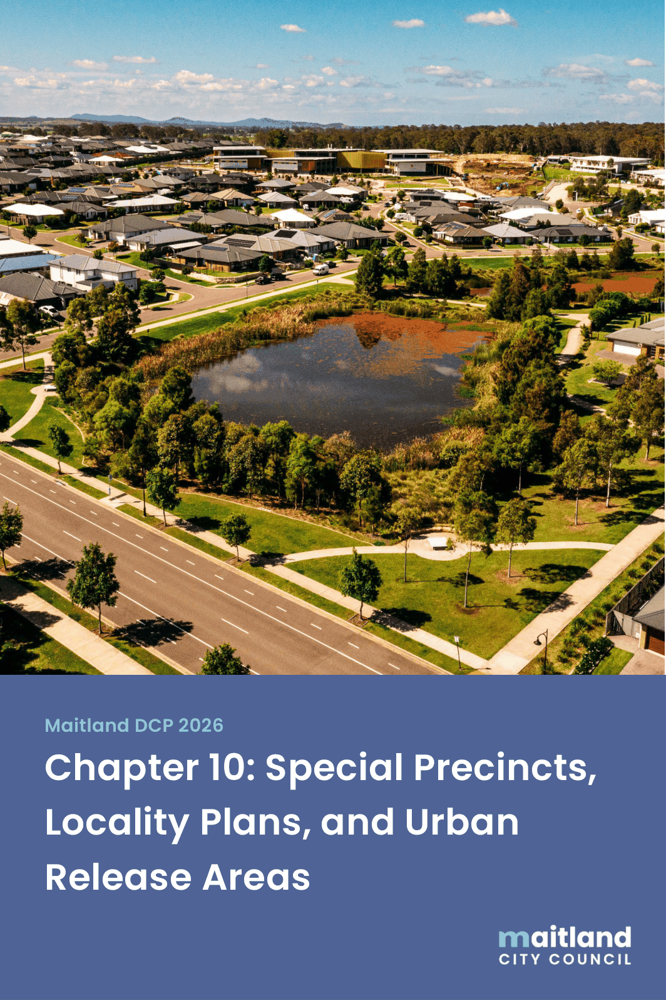

# Maitland Development Control Plan 2026 - Chapter 10 Special Precincts, Locality Plans, and Urban Release Areas

> This chapter is split into 203 section file(s), one per numbered heading, in the order they appear in the PDF.

Source PDF: [MDCP 2026 - Chapter 10 Special Precincts, Locality Plans, and Urban Release Areas.pdf](https://planfortomorrow.sharepoint.com/sites/Planfortomorrow/Shared%20Documents/00%20NSW-Planning-Resources/dcp/maitland-development-control-plan-2026/ch-10-00-special-precincts-locality-plans-and-urban-release/MDCP%202026%20-%20Chapter%2010%20Special%20Precincts%2C%20Locality%20Plans%2C%20and%20Urban%20Release%20Areas.pdf)

> [Picture on page 1: a picture, saved as a picture (images/ch-10-00-special-precincts-locality-plans-and-urban-release-page-1-1.gif, 150 dpi).]

### Maitland DCP 2026

## Chapter 10: Special Precincts,

### Locality Plans, and Urban

### Release Areas

Table of Contents – Chapter 10: Special Precincts, Locality Plans, and

### Urban Release Areas

10.1. Introduction .................................................................................................................................... 3 10.1.1. Application ................................................................................................................................................................ 3 10.1.2. Relationship to other Chapters .......................................................................................................................... 3 10.1.3. How to use this Chapter ....................................................................................................................................... 3 10.1.4. Intent of this Chapter ........................................................................................................................................... 4 10.2. Special Precincts .......................................................................................................................... 5 10.2.1. Airports ...................................................................................................................................................................... 5 10.3. Locality Plans .............................................................................................................................. 10 10.3.1. Ashtonfield South ................................................................................................................................................. 10 10.3.2. Bolwarra Heights.................................................................................................................................................. 12 10.3.3. West Bolwarra Heights ....................................................................................................................................... 14 10.3.4. Greta (Orient Street)........................................................................................................................................... 16 10.3.5. Louth Park (Waterforde Estate) ...................................................................................................................... 18 10.3.6. Thornton (Woodlands Estate) .......................................................................................................................... 20 10.3.7. Thornton (Radburn Estate) ............................................................................................................................... 23 10.3.8. Thornton (Hermitage Close) ............................................................................................................................. 25 10.4. Urban Release Areas ................................................................................................................ 27 10.4.1. General Requirements ........................................................................................................................................ 27 10.4.2. Aberglasslyn Urban Release Area .................................................................................................................. 29 10.4.3. Gillieston Heights Urban Release Area ........................................................................................................ 52 10.4.4. Largs Urban Release Area................................................................................................................................ 77 10.4.5. Thornton North Urban Release Area ............................................................................................................. 85 10.4.6. Anambah Road Urban Release Area .......................................................................................................... 151 10.4.7. Lochinvar Urban Release Area ...................................................................................................................... 157 10.4.8. Farley Urban Release Area ............................................................................................................................. 179 10.4.9. Anambah Urban Extension Site (Windella) ............................................................................................... 197 10.4.10. Glebe Paddock Urban Release Area ......................................................................................................... 201 10.4.11. Mount Harris Urban Release Area ............................................................................................................. 206 10.4.12. Mala Close Urban Release Area ................................................................................................................. 208 10.4.13. Anambah Road Urban Extension Site (106 Anambah Road) ............................................................ 210 10.4.14. Louth Park Urban Release Area ................................................................................................................. 212 10.4.15. Anambah Employment Area ........................................................................................................................ 241 10.4.16. Mount Vincent Urban Release Area........................................................................................................... 249 10.4.17. Anambah Urban Release Area .................................................................................................................... 266

<!-- sections -->
## Sections

1. [10.1.1 Application](001-10-1-1-application.md)
2. [10.1.2 Relationship to other Chapters](002-10-1-2-relationship-to-other-chapters.md)
3. [10.1.3 How to use this Chapter](003-10-1-3-how-to-use-this-chapter.md)
4. [10.1.4 Intent of this Chapter](004-10-1-4-intent-of-this-chapter.md)
5. [10.2 Special Precincts](005-10-2-special-precincts.md)
6. [10.2.1.1 Maitland Airport](006-10-2-1-1-maitland-airport.md)
7. [10.2.1.2 Williamtown Airport](007-10-2-1-2-williamtown-airport.md)
8. [10.3 Locality Plans](008-10-3-locality-plans.md)
9. [10.3.1 Ashtonfield South](009-10-3-1-ashtonfield-south.md)
10. [10.3.2 Bolwarra Heights](010-10-3-2-bolwarra-heights.md)
11. [10.3.3 West Bolwarra Heights](011-10-3-3-west-bolwarra-heights.md)
12. [10.3.4 Greta (Orient Street)](012-10-3-4-greta-orient-street.md)
13. [10.3.5 Louth Park (Waterforde Estate)](013-10-3-5-louth-park-waterforde-estate.md)
14. [10.3.6 Thornton (Woodlands Estate)](014-10-3-6-thornton-woodlands-estate.md)
15. [10.3.7 Thornton (Radburn Estate)](015-10-3-7-thornton-radburn-estate.md)
16. [10.3.8 Thornton (Hermitage Close)](016-10-3-8-thornton-hermitage-close.md)
17. [10.4.1.1 Preamble](017-10-4-1-1-preamble.md)
18. [10.4.1.2 Relationship with Maitland LEP 2011](018-10-4-1-2-relationship-with-maitland-lep-2011.md)
19. [10.4.1.3 Additional DCP Components](019-10-4-1-3-additional-dcp-components.md)
20. [10.4.2 Aberglasslyn Urban Release Area](020-10-4-2-aberglasslyn-urban-release-area.md)
21. [10.4.2.1 Staging Plan](021-10-4-2-1-staging-plan.md)
22. [10.4.2.2 Precinct Plans - General](022-10-4-2-2-precinct-plans-general.md)
23. [10.4.2.3 Transport Movement Hierarchy](023-10-4-2-3-transport-movement-hierarchy.md)
24. [10.4.2.4 Overall Landscaping Strategy](024-10-4-2-4-overall-landscaping-strategy.md)
25. [10.4.2.5 Passive and Active Recreation Areas](025-10-4-2-5-passive-and-active-recreation-areas.md)
26. [10.4.2.6 Stormwater and Water Quality](026-10-4-2-6-stormwater-and-water-quality.md)
27. [10.4.2.7 Amelioration of Natural and Environmental Hazards](027-10-4-2-7-amelioration-of-natural-and.md)
28. [10.4.2.8 Key Development Sites](028-10-4-2-8-key-development-sites.md)
29. [10.4.2.9 Residential Densities](029-10-4-2-9-residential-densities.md)
30. [10.4.2.10 Transport Movement Hierarchy](030-10-4-2-10-transport-movement-hierarchy.md)
31. [10.4.2.11 Overall Landscaping Strategy](031-10-4-2-11-overall-landscaping-strategy.md)
32. [10.4.2.12 Passive and Active Recreation Areas](032-10-4-2-12-passive-and-active-recreation-areas.md)
33. [10.4.2.13 Stormwater and Water Quality](033-10-4-2-13-stormwater-and-water-quality.md)
34. [10.4.2.14 Amelioration of Natural and Environmental Hazards](034-10-4-2-14-amelioration-of-natural-and.md)
35. [10.4.2.15 Key Development Sites](035-10-4-2-15-key-development-sites.md)
36. [10.4.2.16 Residential Densities](036-10-4-2-16-residential-densities.md)
37. [10.4.2.18 Overall Landscaping Strategy](037-10-4-2-18-overall-landscaping-strategy.md)
38. [10.4.2.19 Passive and Active Recreation Areas](038-10-4-2-19-passive-and-active-recreation-areas.md)
39. [10.4.2.20 Stormwater and Water Quality](039-10-4-2-20-stormwater-and-water-quality.md)
40. [10.4.2.22 Key Development Sites](040-10-4-2-22-key-development-sites.md)
41. [10.4.2.23 Residential Densities](041-10-4-2-23-residential-densities.md)
42. [10.4.2.25 Overall Landscaping Strategy](042-10-4-2-25-overall-landscaping-strategy.md)
43. [10.4.2.26 Passive and Active Recreation Areas](043-10-4-2-26-passive-and-active-recreation-areas.md)
44. [10.4.2.27 Stormwater and Water Quality](044-10-4-2-27-stormwater-and-water-quality.md)
45. [10.4.2.28 Amelioration of Natural and Environmental Hazards](045-10-4-2-28-amelioration-of-natural-and.md)
46. [10.4.3 Gillieston Heights Urban Release Area](046-10-4-3-gillieston-heights-urban-release-area.md)
47. [10.4.3.1 Staging Plan](047-10-4-3-1-staging-plan.md)
48. [10.4.3.2 Staging Plan](048-10-4-3-2-staging-plan.md)
49. [10.4.3.3 Transport Movement Hierarchy](049-10-4-3-3-transport-movement-hierarchy.md)
50. [10.4.3.5 Amelioration of Natural and Environmental Hazards](050-10-4-3-5-amelioration-of-natural-and.md)
51. [10.4.3.7 Neighbourhood Commercial and Retail Uses](051-10-4-3-7-neighbourhood-commercial-and-retail-uses.md)
52. [10.4.3.8 Staging Plan](052-10-4-3-8-staging-plan.md)
53. [10.4.3.9 Transport Movement Hierarchy](053-10-4-3-9-transport-movement-hierarchy.md)
54. [10.4.3.10 Overall Landscaping Strategy](054-10-4-3-10-overall-landscaping-strategy.md)
55. [10.4.3.11 Amelioration of Natural and Environmental Hazards](055-10-4-3-11-amelioration-of-natural-and.md)
56. [10.4.3.13 Staging Plan](056-10-4-3-13-staging-plan.md)
57. [10.4.3.16 Passive and Active Recreation Areas](057-10-4-3-16-passive-and-active-recreation-areas.md)
58. [10.4.3.17 Amelioration of Natural and Environmental Hazards](058-10-4-3-17-amelioration-of-natural-and.md)
59. [10.4.3.18 Key Development Sites](059-10-4-3-18-key-development-sites.md)
60. [10.4.3.19 Archaeological Significance](060-10-4-3-19-archaeological-significance.md)
61. [10.4.4 Largs Urban Release Area](061-10-4-4-largs-urban-release-area.md)
62. [10.4.4.1 Staging Plan](062-10-4-4-1-staging-plan.md)
63. [10.4.4.2 Transport Movement Hierarchy](063-10-4-4-2-transport-movement-hierarchy.md)
64. [10.4.4.3 Overall Landscaping Strategy](064-10-4-4-3-overall-landscaping-strategy.md)
65. [10.4.4.5 Amelioration of Natural and Environmental Hazards](065-10-4-4-5-amelioration-of-natural-and.md)
66. [10.4.5 Thornton North Urban Release Area](066-10-4-5-thornton-north-urban-release-area.md)
67. [10.4.5.1 Staging Plan](067-10-4-5-1-staging-plan.md)
68. [10.4.5.2 Transport Movement Hierarchy](068-10-4-5-2-transport-movement-hierarchy.md)
69. [10.4.5.3 Overall Landscaping Strategy](069-10-4-5-3-overall-landscaping-strategy.md)
70. [10.4.5.6 Amelioration of Natural and Environmental Hazards](070-10-4-5-6-amelioration-of-natural-and.md)
71. [10.4.5.7 Key Development Sites](071-10-4-5-7-key-development-sites.md)
72. [10.4.5.8 Staging Plan](072-10-4-5-8-staging-plan.md)
73. [10.4.5.9 Transport Movement Hierarchy](073-10-4-5-9-transport-movement-hierarchy.md)
74. [10.4.5.11 Passive and Active Recreation Areas](074-10-4-5-11-passive-and-active-recreation-areas.md)
75. [10.4.5.13 Key Development Sites](075-10-4-5-13-key-development-sites.md)
76. [10.4.5.14 Staging Plan](076-10-4-5-14-staging-plan.md)
77. [10.4.5.16 Overall Landscaping Strategy](077-10-4-5-16-overall-landscaping-strategy.md)
78. [10.4.5.17 Passive and Active Recreation Areas](078-10-4-5-17-passive-and-active-recreation-areas.md)
79. [10.4.5.18 Stormwater and Water Quality](079-10-4-5-18-stormwater-and-water-quality.md)
80. [10.4.5.21 Transport Movement Hierarchy](080-10-4-5-21-transport-movement-hierarchy.md)
81. [10.4.5.22 Overall Landscaping Strategy](081-10-4-5-22-overall-landscaping-strategy.md)
82. [10.4.5.23 Passive and Active Recreation Areas](082-10-4-5-23-passive-and-active-recreation-areas.md)
83. [10.4.5.24 Stormwater and Water Quality](083-10-4-5-24-stormwater-and-water-quality.md)
84. [10.4.5.27 Transport Movement Hierarchy](084-10-4-5-27-transport-movement-hierarchy.md)
85. [10.4.5.29 Passive and Active Recreation Areas](085-10-4-5-29-passive-and-active-recreation-areas.md)
86. [10.4.5.30 Stormwater and Water Quality](086-10-4-5-30-stormwater-and-water-quality.md)
87. [10.4.5.31 Key Development Sites](087-10-4-5-31-key-development-sites.md)
88. [10.4.5.33 Transport Movement Hierarchy](088-10-4-5-33-transport-movement-hierarchy.md)
89. [10.4.5.36 Stormwater and Water Quality](089-10-4-5-36-stormwater-and-water-quality.md)
90. [10.4.5.37 Amelioration of Natural and Environmental Hazards](090-10-4-5-37-amelioration-of-natural-and.md)
91. [10.4.5.38 Key Development Sites](091-10-4-5-38-key-development-sites.md)
92. [10.4.5.39 Residential Densities](092-10-4-5-39-residential-densities.md)
93. [10.4.5.40 Flora and Fauna](093-10-4-5-40-flora-and-fauna.md)
94. [10.4.5.41 Staging Plan](094-10-4-5-41-staging-plan.md)
95. [10.4.5.43 Overall Landscaping Strategy](095-10-4-5-43-overall-landscaping-strategy.md)
96. [10.4.5.44 Passive and Active Recreation Areas](096-10-4-5-44-passive-and-active-recreation-areas.md)
97. [10.4.5.45 Stormwater and Water Quality](097-10-4-5-45-stormwater-and-water-quality.md)
98. [10.4.5.46 Amelioration of Natural and Environmental Hazards](098-10-4-5-46-amelioration-of-natural-and.md)
99. [10.4.5.47 Key Development Sites](099-10-4-5-47-key-development-sites.md)
100. [C3 Environmental Management Zoned Land](100-c3-environmental-management-zoned-land.md)
101. [10.4.5.48 Staging Plan](101-10-4-5-48-staging-plan.md)
102. [10.4.5.49 Economic Impact Assessment](102-10-4-5-49-economic-impact-assessment.md)
103. [10.4.5.50 Transport Movement Hierarchy](103-10-4-5-50-transport-movement-hierarchy.md)
104. [10.4.5.51 Passive and Active Recreation Areas](104-10-4-5-51-passive-and-active-recreation-areas.md)
105. [10.4.5.52 Stormwater and Water Quality](105-10-4-5-52-stormwater-and-water-quality.md)
106. [10.4.5.54 Waste Management](106-10-4-5-54-waste-management.md)
107. [10.4.5.56 Transport Movement Hierarchy](107-10-4-5-56-transport-movement-hierarchy.md)
108. [10.4.5.58 Passive and Active Recreation Areas](108-10-4-5-58-passive-and-active-recreation-areas.md)
109. [10.4.5.59 Stormwater and Water Quality](109-10-4-5-59-stormwater-and-water-quality.md)
110. [10.4.5.60 Amelioration of Natural and Environmental Hazards](110-10-4-5-60-amelioration-of-natural-and.md)
111. [10.4.5.61 Key Development Sites](111-10-4-5-61-key-development-sites.md)
112. [C3 Environmental Management and Rural Landscape Zoned Land Objectives](112-c3-environmental-management-and-rural.md)
113. [10.4.5.62 Residential Densities](113-10-4-5-62-residential-densities.md)
114. [10.4.6 Anambah Road Urban Release Area](114-10-4-6-anambah-road-urban-release-area.md)
115. [10.4.6.1 Staging Plan](115-10-4-6-1-staging-plan.md)
116. [10.4.6.2 Overall Landscaping Strategy](116-10-4-6-2-overall-landscaping-strategy.md)
117. [10.4.6.4 Amelioration of Natural and Environmental Hazards](117-10-4-6-4-amelioration-of-natural-and.md)
118. [10.4.6.5 Provision of Public Facilities and Services](118-10-4-6-5-provision-of-public-facilities-and.md)
119. [10.4.7 Lochinvar Urban Release Area](119-10-4-7-lochinvar-urban-release-area.md)
120. [10.4.7.1 Staging Plan](120-10-4-7-1-staging-plan.md)
121. [10.4.7.2 Transport Movement Hierarchy](121-10-4-7-2-transport-movement-hierarchy.md)
122. [10.4.7.5 Stormwater and Water Quality](122-10-4-7-5-stormwater-and-water-quality.md)
123. [10.4.7.7 Heritage](123-10-4-7-7-heritage.md)
124. [10.4.7.8 Key Development Sites](124-10-4-7-8-key-development-sites.md)
125. [10.4.7.10 Provision of Public Facilities and Services](125-10-4-7-10-provision-of-public-facilities-and.md)
126. [10.4.8 Farley Urban Release Area](126-10-4-8-farley-urban-release-area.md)
127. [10.4.8.1 Staging Plan](127-10-4-8-1-staging-plan.md)
128. [10.4.8.2 Transport Movement Hierarchy](128-10-4-8-2-transport-movement-hierarchy.md)
129. [10.4.8.3 Overall Landscaping Strategy](129-10-4-8-3-overall-landscaping-strategy.md)
130. [10.4.8.4 Passive and Active Recreation Areas](130-10-4-8-4-passive-and-active-recreation-areas.md)
131. [10.4.8.8 Key Development Sites](131-10-4-8-8-key-development-sites.md)
132. [10.4.8.9 Neighbourhood Commercial and Retail Uses](132-10-4-8-9-neighbourhood-commercial-and-retail-uses.md)
133. [10.4.8.10 Provision of Public Facilities and Services](133-10-4-8-10-provision-of-public-facilities-and.md)
134. [10.4.9 Anambah Urban Extension Site (Windella)](134-10-4-9-anambah-urban-extension-site-windella.md)
135. [10.4.9.1 Staging Plan](135-10-4-9-1-staging-plan.md)
136. [10.4.9.2 Amelioration of Natural and Environmental Hazards](136-10-4-9-2-amelioration-of-natural-and.md)
137. [10.4.10 Glebe Paddock Urban Release Area](137-10-4-10-glebe-paddock-urban-release-area.md)
138. [10.4.10.1 Staging Plan](138-10-4-10-1-staging-plan.md)
139. [10.4.10.2 Overall Landscaping Strategy](139-10-4-10-2-overall-landscaping-strategy.md)
140. [10.4.10.3 Amelioration of Natural and Environmental Hazards](140-10-4-10-3-amelioration-of-natural-and.md)
141. [10.4.11 Mount Harris Urban Release Area](141-10-4-11-mount-harris-urban-release-area.md)
142. [10.4.11.1 Amelioration of Natural and Environmental Hazards](142-10-4-11-1-amelioration-of-natural-and.md)
143. [10.4.11.2 Key Development Sites](143-10-4-11-2-key-development-sites.md)
144. [10.4.12 Mala Close Urban Release Area](144-10-4-12-mala-close-urban-release-area.md)
145. [10.4.12.1 Amelioration of Natural and Environmental Hazards](145-10-4-12-1-amelioration-of-natural-and.md)
146. [10.4.13 Anambah Road Urban Extension Site (106 Anambah Road)](146-10-4-13-anambah-road-urban-extension-site-106.md)
147. [10.4.13.1 Staging Plan](147-10-4-13-1-staging-plan.md)
148. [10.4.13.2 Amelioration of Natural and Environmental Hazards](148-10-4-13-2-amelioration-of-natural-and.md)
149. [10.4.14 Louth Park Urban Release Area](149-10-4-14-louth-park-urban-release-area.md)
150. [10.4.14.1 Staging Plan](150-10-4-14-1-staging-plan.md)
151. [10.4.14.2 Precinct Plans](151-10-4-14-2-precinct-plans.md)
152. [10.4.14.3 Transport Movement Hierarchy](152-10-4-14-3-transport-movement-hierarchy.md)
153. [10.4.14.4 Overall Landscaping Strategy](153-10-4-14-4-overall-landscaping-strategy.md)
154. [10.4.14.5 Stormwater and Water Quality](154-10-4-14-5-stormwater-and-water-quality.md)
155. [10.4.14.7 Key Development Sites](155-10-4-14-7-key-development-sites.md)
156. [10.4.14.9 Transport Movement Hierarchy](156-10-4-14-9-transport-movement-hierarchy.md)
157. [10.4.14.10 Overall Landscaping Strategy](157-10-4-14-10-overall-landscaping-strategy.md)
158. [10.4.14.12 Amelioration of Natural and Environmental Hazards](158-10-4-14-12-amelioration-of-natural-and.md)
159. [10.4.14.13 Key Development Sites](159-10-4-14-13-key-development-sites.md)
160. [10.4.14.14 Archaeological Heritage](160-10-4-14-14-archaeological-heritage.md)
161. [10.4.14.16 Transport Movement Hierarchy](161-10-4-14-16-transport-movement-hierarchy.md)
162. [10.4.14.17 Overall Landscaping Strategy](162-10-4-14-17-overall-landscaping-strategy.md)
163. [10.4.14.19 Amelioration of Natural and Environmental Hazards](163-10-4-14-19-amelioration-of-natural-and.md)
164. [10.4.14.20 Key Development Sites](164-10-4-14-20-key-development-sites.md)
165. [10.4.14.21 Archaeological Heritage](165-10-4-14-21-archaeological-heritage.md)
166. [10.4.14.23 Transport Movement Hierarchy](166-10-4-14-23-transport-movement-hierarchy.md)
167. [10.4.14.25 Stormwater and Water Quality](167-10-4-14-25-stormwater-and-water-quality.md)
168. [10.4.14.28 Archaeological Heritage](168-10-4-14-28-archaeological-heritage.md)
169. [10.4.15 Anambah Employment Area](169-10-4-15-anambah-employment-area.md)
170. [10.4.15.1 Staging Plan](170-10-4-15-1-staging-plan.md)
171. [10.4.15.5 Amelioration of Natural and Environmental Hazards](171-10-4-15-5-amelioration-of-natural-and.md)
172. [10.4.15.6 Key Development Sites](172-10-4-15-6-key-development-sites.md)
173. [10.4.16 Mount Vincent Urban Release Area](173-10-4-16-mount-vincent-urban-release-area.md)
174. [10.4.16.1 Staging Plan](174-10-4-16-1-staging-plan.md)
175. [10.4.16.4 Passive and Active Recreation Areas](175-10-4-16-4-passive-and-active-recreation-areas.md)
176. [10.4.16.5 Stormwater and Water Quality Management](176-10-4-16-5-stormwater-and-water-quality-management.md)
177. [10.4.16.6 Aboriginal Heritage](177-10-4-16-6-aboriginal-heritage.md)
178. [10.4.16.7 Contamination](178-10-4-16-7-contamination.md)
179. [10.4.16.8 Mine Subsidence](179-10-4-16-8-mine-subsidence.md)
180. [10.4.16.9 Visual Impact and Local Interface](180-10-4-16-9-visual-impact-and-local-interface.md)
181. [10.4.16.10 Biodiversity](181-10-4-16-10-biodiversity.md)
182. [10.4.16.11 Flooding](182-10-4-16-11-flooding.md)
183. [10.4.16.12 Bushfire](183-10-4-16-12-bushfire.md)
184. [10.4.16.13 Acid Sulfate Soils](184-10-4-16-13-acid-sulfate-soils.md)
185. [10.4.16.14 Key Development Sites](185-10-4-16-14-key-development-sites.md)
186. [10.4.16.15 Residential Densities](186-10-4-16-15-residential-densities.md)
187. [10.4.16.16 Provision of Public Facilities and Services](187-10-4-16-16-provision-of-public-facilities-and.md)
188. [10.4.17 Anambah Urban Release Area](188-10-4-17-anambah-urban-release-area.md)
189. [10.4.17.1 Staging Plan](189-10-4-17-1-staging-plan.md)
190. [10.4.17.2 Subdivision Design](190-10-4-17-2-subdivision-design.md)
191. [10.4.17.3 Transport Movement Hierarchy](191-10-4-17-3-transport-movement-hierarchy.md)
192. [10.4.17.4 Road Design](192-10-4-17-4-road-design.md)
193. [10.4.17.5 Aboriginal Cultural Heritage](193-10-4-17-5-aboriginal-cultural-heritage.md)
194. [10.4.17.7 Passive and Active Recreation Areas](194-10-4-17-7-passive-and-active-recreation-areas.md)
195. [10.4.17.8 Stormwater and Water Quality](195-10-4-17-8-stormwater-and-water-quality.md)
196. [10.4.17.10 Key Development Sites](196-10-4-17-10-key-development-sites.md)
197. [10.4.17.11 Residential Densities](197-10-4-17-11-residential-densities.md)
198. [10.4.17.12 Visual and Scenic Amenity](198-10-4-17-12-visual-and-scenic-amenity.md)
199. [10.4.17.13 Staging Plan and Infrastructure Delivery](199-10-4-17-13-staging-plan-and-infrastructure-delivery.md)
200. [10.4.17.14 Transport Movement Hierarchy and Road Design](200-10-4-17-14-transport-movement-hierarchy-and-road.md)
201. [10.4.17.15 Subdivision Design](201-10-4-17-15-subdivision-design.md)
202. [10.4.17.17 Visual and Scenic Amenity](202-10-4-17-17-visual-and-scenic-amenity.md)
203. [10.4.17.20 Key Development Sites and Residential Densities](203-10-4-17-20-key-development-sites-and-residential.md)
