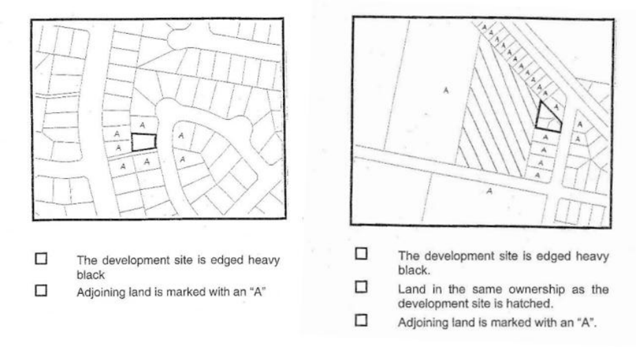
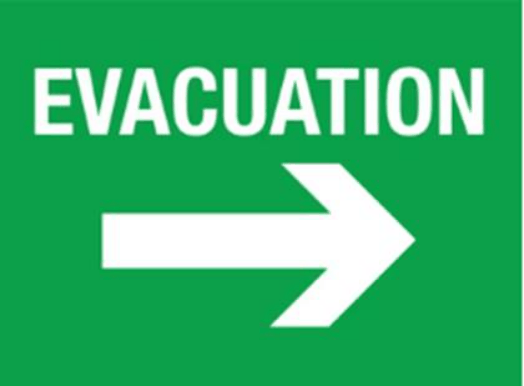
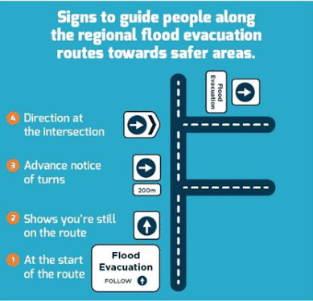
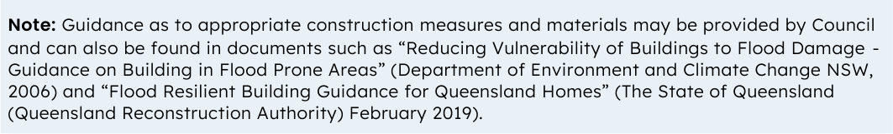

### Glossary Definitions #

1% Annual Exceedance Probability (AEP) Flood Event refers to a flood that has a 1% chance of occurring or being exceeded in any given year, based on statistical analysis of historical flood and rainfall data. This type of event is often called a "1 in 100 year flood", meaning that, on average, such a flood is expected to happen once every 100 years—though it can occur more or less frequently, refer to Average Recurrence Interval (ARI) in this Glossary. 2008 Australian Noise Exposure Concept (ANEC) means a map that forecasts aircraft noise levels around an airport, based on runway direction and flight paths. It represents the average noise exposure from an average day's aircraft movements over a twelve-month period. Higher contour numbers indicate higher levels of noise exposure for the area of land subject to aircraft noise related development controls. This is used for the Maitland Airport to identify and mitigate any potential impact on surrounding development from aircraft noise.

### A

Aboriginal Heritage Impact Permit (AHIP) is the statutory instrument that Heritage NSW issues under section 90 of the National Parks and Wildlife Act 1974 to manage harm or potential harm to Aboriginal objects and places. Aboriginal Object means any deposit, object or material evidence (not being a handicraft made for sale) relating to Aboriginal habitation of the area that comprises New South Wales, being habitation before or concurrent with (or both) the occupation of the area by persons of non- Aboriginal extraction. This includes Aboriginal remains. Aboriginal Place means any place declared to be an Aboriginal place under Section 84 of National Parks and Wildlife Act 1974, as amended. Acceptable Solutions are controls that have language more in line with that of the objectives of the DCP. Alternatively, they have content that provide a method to meeting the objectives while communicating that Council is open to other solutions that may be proposed. Acceptable Solutions are identified by the code ‘AS.’, which appears to the left of each solution. These Acceptable Solutions generally use language such as ‘should’, ‘may’, and ‘possible’. Access Driveways are the crossings over the nature strip that provide legal access to a site, and on which vehicles move between the external frontage of the road and the site boundary. Acid Sulfate Soils means actual or potential acid sulfate soils, as defined in the Acid Sulfate Soil Manual (1998) published by the Acid Sulfate Soils Management Advisory Committee. Active Street Frontage consists of a street frontage that enables direct visual and physical contact between the street and the interior of the building. Clearly defined entrances, windows and shop fronts are elements of the building façade that contribute to an active street frontage. Activity Centres are the local and regional hub for community activity. They are places providing a diverse mix of activities where people can socialise, shop, work, meet, relax and often live. Activity centres range in size, scale and development intensity from a neighbourhood centre, like Largs or Tenambit through to a major regional centre, like Central Maitland. Activity centres are usually well-

served by public transport, offering a highly accessible location for commercial, personal and retail services, community, entertainment and recreational facilities as well as a mix of housing options to attract for a diverse population. ‘Adjoining Land’ comprises -

a) Land identified in Map 1 as being land which shares a common boundary with the development site, or is separated only by a pathway, driveway, laneway or public road or,

b) Land identified in Map 2 as being the closest land that is not owned by the registered proprietor of the development site.

> [Picture on page 4: a picture, saved as a picture (images/glossary-page-4-9.gif, 150 dpi).]

#### Figure 1: Example of Adjoining Properties

Note: Council applies discretion in relation to sub-clause (b). For example, development within the State Rail Authority corridor would not require all those properties adjoining the corridor to be notified.

Adversely Impact means a negative effect that goes against desired conditions. Amenity means the degree of positive attributes and appeal of a place. Ancillary Structure is a group term that covers a variety of minor types of development that would ordinarily be associated with a dwelling. They generally have minimal environmental impact and cannot contain a habitable room. Many of these forms of development can be undertaken as Exempt Development or Complying Development under the State Environmental Planning Policy (Exempt and Complying Development Codes) 2008. These includes things such as swimming pools, sheds, fencing, and retaining walls. Annual Exceedance Probability (AEP) is the chance of a flood of a given or larger size occurring in any one year (for example, the 1% AEP flood event has a 1% chance of occurring every year; the 5% AEP flood event has a 5% chance of occurring every year). Arterial Road is characterised by the features detailed by the current version of the Maitland Manual of Engineering Standards.

Articulation means the change in the external alignment of walls, or other elements, that expresses the way that the parts of the building fit together. Asset Protection Zone (APZ) means a buffer zone between a bush fire hazard and buildings, which is managed progressively to minimise fuel loads and reduce potential radiant heat levels, flame, ember and smoke attack. The width of an APZ varies based upon a range of conditions, including slope and aspect.

Note: Asset Protection Zone has the same meaning as in NSW Rural Fire Service’s Planning for Bush Fire Protection 2019, or as amended.

Australian Height Datum (AHD) means the setting of the mean sea level as zero elevation. Mean sea level was determined by the Surveyor General from observations recorded by 30 tide gauges around the Australian continent for the period 1966-1968, and formally adopted in 1971. Australian Rainfall and Runoff Guidelines (ARR) is the national guideline document for the estimation of design flood characteristics in Australia. Australian Standard (AS:) is a published document, developed by Standards Australia, that outlines specifications, procedures, and guidelines to ensure the safety, quality, performance, and consistency of products, services, and systems within Australia. While voluntary in nature, many Australian Standards are incorporated into legislation or regulations, making compliance mandatory in certain cases, particularly in areas like work health and safety. Average Recurrence Interval (ARI) means the average period between the recurrence of a storm event of a given rainfall intensity. The ARI represents a statistical probability.

Note: For example, a 100-year ARI indicates an average of 100 years between exceedance of a given storm magnitude. The AEP (probability of such an event being exceeded in any

year) is therefore 1%.

Average Setback is utilised to determine front setbacks for new structures in established streetscapes. It is calculated by the average distance of the front setbacks of the nearest 2 buildings that have a boundary with the same parallel road and are located within 40 metres of the lot on which the building is erected.

### B

Balcony is an upper storey platform projecting from the wall of a building supported by posts or brackets and enclosed by a balustrade. A balcony can also be recessed into a building. Basement is a storey either below ground level, or no more than 1.2 metres above finished ground level. Battle-axe Lot means a lot of land behind another, with access from the street through a narrow drive known as a handle. The minimum area specified for battle-axe lots excludes the battle-axe access handle. Biodiversity has the same meaning as in the MLEP 2011. Biodiversity Corridors are connections across the landscape that link up areas of habitat. They support natural processes that occur in a healthy environment, including the movement of species to find resources like food, water and shelter. They also store carbon and enable conservation. Biodiversity Offsets are measures that benefit biodiversity by compensating for the adverse impacts elsewhere of an action, such as clearing for development. Buffer is a distinct separation between two developments or land-uses that require distance from one

#### another due to factors such as environmental concerns, or conflicts resulting from their proximity.

Building Envelope means a three-dimensional diagram drawn on a lot of a subdivision plan. It defines the limits for the siting and/or wall height of any dwellings and/or buildings/structures, private outdoor areas, driveways and/or garages/carports. Building Frontage is the façade of the building that faces the street. Building Height (or height of building) has the same meaning as in the MLEP 2011. Building Line or Setback has the same meaning as in the MLEP 2011. Burra Charter (The Australia ICOMOS Charter for Places of Cultural Significance) provides guidance for the conservation and management of places of cultural significance. It is based on the knowledge and experience of Australian ICOMOS (International Council on Monuments and Sites) members. Bush Fire Prone Land consists of land recorded and mapped by the NSW Rural Fire Service as having a heightened potential for bush fire or as being subject to bush fire attack. Bush Fire Risk is the chance of a bushfire igniting, spreading and causing damage to assets of value to the community and the environment. Risk is rated as being high, medium or low, and is related to the level of the potential threat of bushfire.

### C

Cantilevered is a projecting structure, such as a beam, that is supported at one end and carries a load at the other end along its length. Clearing Vegetation is defined as the destruction of a sufficient proportion of one or more strata (layers) within a stand or stands of native vegetation so as to result in the loss, or long-term modification, of the structure, composition and ecological function of a stand or stands. Collector Road is characterised by the features detailed by the current version of the Maitland Manual of Engineering Standards (MOES). Commercial Premises has the same meaning as in the MLEP 2011. Communal Open Space (COS) are areas of joint private use for the recreation and relaxation of residents. COS are under the control of a body corporate or similar organisation. Community Title Subdivision is the subdivision of land under the Community Land Development Act 1989 and the Community Land Management Act 1989. Compensatory Excavation means the excavation of material to offset the placement of fill, so that there is no net reduction in the flood storage capacity in a hydraulically linked part of the floodplain defined by a specified flood event.

Note: this means that the area of compensatory excavation must be available to accommodate flood waters during a specified flood event and, for example, cannot therefore be prematurely filled with ground water or local overland flows.

Compensatory Tree Planting is the planting of a tree to mitigate and offset for the removal of another tree. Connectivity relates to the number and quality of connections in a network. For example, in the movement network, it comprises streets, pedestrian/cycles paths/links and public buildings, or any type of open space that enables movement around or through an area.

Consent Authority are certain statutory authorities, by provision in their respective Acts, declared to be the consent authority for land within their control. This includes Council assessing development applications for development within land of their Local Government Area. Construction Certificate means a certificate to the effect that building work completed in accordance with specified plans and specifications or standards will comply with the requirements of the regulations.

Note: construction certificate has the same meaning as in the Environmental Planning and Assessment Act 1979 (EP&A Act).

Contaminated Land is land in, on or under which any substance at a concentration above the concentration at which the substance is normally present in, on or under (respectively) land in the same locality, being a presence that presents a risk of harm to human health or any other aspect of the environment.

Note: contaminated land has the same meaning as in Schedule 6 of the EP&A Act.

Controlled Activity means:

• the erection of a building or the carrying out of a work (within the meaning of the EP&A Act), OR

• the removal of material (whether or not extractive material) or vegetation from land, whether by way of excavation or otherwise, OR

• the deposition of material (whether or not extractive material) on land, whether by way of landfill operations or otherwise, OR

• the carrying out of any other activity that affects the quantity or flow of water in a water source.

Note: controlled activity has the same meaning as in the Water Management Act 2000.

Corner Lot means a lot that has a frontage to two roads that intersect. Crime Prevention Through Environmental Design (CPTED) is a multi-disciplinary approach to deterring criminal behaviour through environmental design by managing the built and natural environment. Refer to Appendix F: CPTED Guidelines. Crossfall is also known as cross-slope or camber, refers to the transverse slope of a road or other surface, typically at right angles to the direction of travel. It's designed to help drain water off the surface and is crucial for safety and road longevity. Cultural Significance (or Heritage Significance, or Significance of Places of Cultural Significance) is an item, object, place or landscape that holds historical, scientific, cultural, social, archaeological, architectural, natural or aesthetic value. Culvert is a structure that channels water past an obstacle or to a subterranean waterway, generally consisting of precast reinforced concrete. Curtilage means the geographical area that provides the physical context for an identified heritage property, and which contributes to its heritage significance.

Note: Land title boundaries and heritage curtilage do not necessarily coincide.

Cut is the removal of soil or rock, whether moved to another part of the same site or to another site

but does not include garden landscaping that does not significantly alter the shape, natural form or drainage of land.

### D

dB(A) means an expression of the relative loudness of sounds in air as perceived by the human ear. Declared Vegetation is any form of vegetation named under the definition of vegetation in this DCP, for the purposes of Section 2.9 of the State Environmental Planning Policy (Biodiversity and Conservation) 2021, or as amended. Deep Soil is an area of natural ground with relatively natural soil profiles within a development

site. Deep soil areas should be free of conflicts with building footings, infrastructure and services. Demolition includes demolishing or dismantling a structure or part of a structure that is either load bearing or related to the physical integrity of the structure. Demolition (Heritage) means to demolish or destroy a heritage item or a building, work, archaeological site, tree or place within a Heritage Conservation Area. It means to wholly or partly destroy, dismantle or deface the heritage item, or the building work, archaeological site, tree, or place. Design Vehicle means the vehicles for which a given development must make on-site provision for their circulation. Desire Lines are a path that represents the shortest and easiest navigated route between an origin and destination. Development has the same meaning as in the EP&A Act. Development Consent means consent under Part 4 of the EP&A Act to carry out development and includes, unless expressly excluded, a complying development certificate.

Note: Development consent has the same meaning as in the EP&A Act.

Development Type means the definition given to a proposed land-use under the Dictionary of the MLEP 2011. Drainage Reserve means a parcel of land set aside for drainage purposes. Drainage reserves usually contain either a drainage basin or an open drain. A drainage reserve is a type of overland flow path. Driveway is the vehicle access between the property boundary and the development. The driveway is generally on private property and is an extension of the access driveway. Dual Occupancy has the same meaning as in the MLEP 2011. Dwelling has the same meaning as in the MLEP 2011. Dwelling House has the same meaning as in the MLEP 2011.

### E

Earthworks has the same meaning as in the MLEP 2011. Easement is a legislative instrument that can either be for an individual or a company, known as a grantee, that has the right to use land for a particular purpose, or an easement can restrict how the

#### owner of the land, known as the granter, can use their property. Common easements include:

• Pathways and walkways

• For the supply of utilities

• Access roads

• The right to park a vehicle Ecological Communities are a group of different species (plants, animals, and other organisms) living in a specific area and interacting with each other and their environment. These communities are characterised by their unique habitat and the interdependencies between species. They are vital for ecosystem services, biodiversity, and the well-being of native species. Ecologically Sustainable Development (ESD) means using, conserving and enhancing the community's resources so that ecological processes, on which life depends, are maintained, and the total quality of life, now and in the future, can be increased. Ecosystem means a dynamic complex of plant, animal, fungal and microorganism communities and associated non-living environment, interacting as an ecological unit. Effective Warning Time is the time available after receiving advice of an impending flood and before the floodwaters prevent appropriate flood response actions being undertaken. The effective warning time is typically used to raise furniture, evacuate people, and transport their possessions. Effluent Treatment and Disposal Area, also known as a Land Application Area (LAA) or Effluent Dispersal Area (EDA), is a designated area where treated wastewater (effluent) from a wastewater treatment plant or on-site sewage management system is discharged. This area is carefully designed and managed to ensure safe and effective disposal of the treated water, often through methods like sub-surface irrigation, evapotranspiration beds, or surface irrigation. Electrical kiosk are small form transformers, that are compact and prefabricated, with protective housing. They are typically smaller than 8m2 in footprint. Within the Maitland LGA, under the Ausgrid classification standards, it typically refers to Ausgrid type descriptors L, K, and R. Electrical substation are larger electrical infrastructure, generally on their own dedicated lot. They typically involve exposed power lines, transformers, a switching yard, and other elements designed to generate, transmit, and distribute electricity. Emergency Wayfinding refers to the process of orienting oneself and navigating safely through a space, particularly during an emergency, to reach a designated exit or safety area. It involves the effective use of signage, visual cues, and environmental features to guide individuals, especially during stressful situations. Emergency wayfinding signage examples are provided below:

> [Picture on page 9: a picture, saved as a picture (images/glossary-page-9-32.gif, 150 dpi).]

> [Picture on page 9: a picture, saved as a picture (images/glossary-page-9-33.gif, 150 dpi).]

#### Figure 2: Emergency Wayfinding Signage

Endangered Ecological Communities, also known as threatened ecological communities (TECs), are naturally occurring groups of native plants, animals, and other organisms that interact in a unique habitat and are facing a high risk of collapse or extinction. They are classified as endangered, vulnerable, or critically endangered under laws like the Biodiversity Conservation Act 2016 (BC Act). Energy and Water Efficiency is any action that minimises energy use and/or water consumption through subdivision and building design. Environment means components of the earth, including:

• Land, air and water;

• Any layer of the atmosphere;

• Any organic or inorganic matter and any living organism;

• Human-made or modified structures or areas; and

• Includes interacting natural ecosystems. Environmental heritage has the same meaning as in the MLEP 2011. Environmental Planning Instrument (EPI) means an environmental planning instrument (including a SEPP or LEP but not including a DCP) made, or taken to have been made under Part 3 of the EP&A Act and in force.

Note: Environmental planning instrument has the same meaning as in the EP&A Act.

Environmental Significance means threatened species and communities, listed migratory species, wildlife corridors, wetlands or riparian corridors. Environmentally Sensitive Area means an area deemed to have significant environmental value by Council, including such areas as terrestrial biodiversity, riparian corridors or wildlife corridors. Essential Services means reference to the supply of water, the supply of electricity, the disposal and management of sewage, and the provision of telecommunications. Estimated Development Cost (EDC) estimates the cost of a proposed development and are used in planning for various purposes, including for determining development approval pathways, calculating assessment fees and for applying development application (DA) requirements. EDC estimates should capture the cost to carry out the development. This includes costs:

• To design and erect a building and associated infrastructure

• To carry out a work

• To carry out demolition of a building or work

• Associated with any fixed or mobile plant equipment. Evacuation is the transfer of people and or stock from areas where flooding is likely, either close to, or during a flood event. It is affected not only by effective warning time, but also the suitability of the road network, available infrastructure, and the number of people that must evacuate during floods. Exempt Development means development that is specified in an exempt development code that meets the standards specified for that development and that compiles with the requirements of exempt development under SEPP (Exempt and Complying Development Codes) 2008.

### F

Fabric means the variety of natural and human made materials (the ‘fabric’) used for buildings, structures and objects. In heritage contexts, "fabric" refers to the physical material of a place,

including all its components, fixtures, contents, and living elements like trees that have cultural heritage values. This could be visible, like in a building, or hidden, like in an archaeological site. Facadism means an architectural and construction practice where the façade of a building was designed or constructed separately to the rest of a building. More often it refers to the practice where only the face of a building is preserved with new buildings erected behind or around it. False Windows means windows that do not link a habitable room and therefore do not provide passive surveillance. Farm Experience Premises has the same meaning as in the MLEP 2011. Farm Gate Premises has the same meaning as in the MLEP 2011. Fill has the same meaning as in the MLEP 2011. Fill Pad also known as a flood mound, means a raised mound that is constructed from imported fill or material excavated from the development site, to accommodate a dwelling, rural building or agricultural activity (such as a stock refuge or storage of agricultural equipment) in a non-urban zone, to provide increased flood immunity for those uses.

Note: A fill pad is exclusive of any access driveway which is assessed separately.

Finished Floor Level (FFL) is the completed floor level of the premises following construction. Flood is relatively high stream flow which:

• Overtops the natural or artificial banks in any part of a stream, river, estuary, lake or dam, and/or

• Local overland flooding associated with major drainage before entering a watercourse and/or

• Coastal inundation resulting from super-elevated sea levels and/or waves overtopping coastline defences excluding tsunami. Flood Certificate means a Council prepared flood certificate not more than 12 months old. Flood Evacuation Strategy - The proposed strategy for the evacuation of areas within effective warning time during periods of flood as specified within any policy of Council, the Floodplain Risk Management Plan (FRMP), the relevant State Government disaster plan, the Maitland City Local Flood Plan or by advice received from the State Emergency Services (SES). Flood Fringe Area is the remaining land in the flood planning area after the floodway area and flood storage area have been defined. Flood Hazard means a source of potential harm or a situation with a potential to cause loss. Flood Liable Land is synonymous with flood prone land, being land susceptible to flooding by the probable maximum flood (PMF) event.

Note: The term flood liable land covers the whole of the floodplain, not just that part below the flood planning level.

Flood Planning Area is that part of the flood liable land within the Maitland LGA that is the 1% AEP flood event plus 0.5 metre freeboard. Flood Prone Land means land susceptible to inundation by the probable maximum flood (PMF).

Flood Resilient Construction are the combination of measures incorporated in the design and/or construction/alteration of individual buildings or structures subject to flooding, and the use of flood compatible materials for the reduction or elimination of flood damage.

> [Picture on page 12: a picture, saved as a picture (images/glossary-page-12-4.gif, 150 dpi).]

Note: Guidance as to appropriate construction measures and materials may be provided by Council and can also be found in documents such as “Reducing Vulnerability of Buildings to Flood Damage - Guidance on Building in Flood Prone Areas” (Department of Environment and Climate Change NSW,

2006\) and “Flood Resilient Building Guidance for Queensland Homes” (The State of Queensland (Queensland Reconstruction Authority) February 2019).

Flood Safe Access refers to ensuring safe and reliable routes for people to evacuate or be rescued during a flood event, typically within a defined flood planning area. This means the access routes should be free from floodwater, even during the most extreme flood scenarios, and not impede evacuation efforts. Flood Storage Areas are those parts of the floodplain that are important for the temporary storage of floodwaters during the passage of a flood. The loss of storage areas may increase the severity of flood impacts by reducing natural flood attenuation. These are indicated on the flood planning maps provided by Council’s online mapping system. Floodplain means an area of flat land adjacent to a river, creek, lake, estuary, dam or artificial channel which is subject to flooding during high rainfall periods. For flood planning purposes, this is an area of land that is subject to inundation by floods up to, and including the probable maximum flood event, that is flood prone land. Floodplain Risk Management Plan is developed from the floodplain risk management study and details how flood prone land within the study areas are to be managed. The primary aim of the Plan is to reduce the flood hazard and risk to people and property in the existing community and to ensure future development is controlled in a manner consistent with flood hazard now and in the future. The Plan consists of prioritised and costed measures for implementation. Floodplain Risk Management Study is a study of the risks across the floodplain and evaluates management options for both existing and proposed development. A floodplain risk management study needs to be developed in accordance with the principles and guidelines contained in the Flood Risk Management Manual. Floodway refers to land that is a pathway taken by major discharges of floodwaters, the partial obstruction of which would cause a significant redistribution of floodwaters, or a significant increase in flood levels. Floodways are often aligned with natural channels, are usually characterised by deep and relatively fast flowing water and have major damage potential. These are indicated on the flood planning maps provided by Council’s online mapping system. Floor Space Ratio of buildings on a site is the ratio of the gross floor area of all buildings within the site to the site area. Footway is a path or way for pedestrians and is generally referred to as a footpath. Freeboard means the height of finished floor level above the 1% AEP flood event level. It is used as a safety margin to compensate for uncertainties such as wave action, localised hydraulic behaviour (e.g. flow path blockages caused by natural and urban debris such as trees, ‘wheelie’ bins, cars, containers) and changes in rainfall patterns and ocean water levels as a result of the changing climate.

Front Property Boundary means the legal boundary of a parcel of land adjoining the primary road reserve frontage. Front Setback is the minimum distance from a lot’s frontage to which the outermost projection of a structure may be built. Frontage is a boundary of a lot that abuts a public or private road. Function Centre has the same meaning as in the MLEP 2011.

### G

Green and Blue Grid maps and shows how native vegetation, wetlands and waterways can link together throughout the Local Government Area to provide an interconnected network of green and blue spaces. When protected and enhanced, these spaces:

• Protect biodiversity and provide wildlife movement corridors

• Help the urban environment to cool

• Contribute to cleaner air and waterways

• Provide new opportunities for community recreation and

• Support improved physical, social and psychological health. The Green and Blue Grid map includes a hierarchy of ‘biodiversity corridors’, that is, connections across the landscape that link up areas of habitat. Greenfield means a site in a locality which has not been previously developed or used for other urban purposes. Gross Floor Area has the same meaning as in the MLEP 2011. Ground Level (existing) has the same meaning as in the MLEP 2011. Ground Level (finished) has the same meaning as in the MLEP 2011. Ground Level (mean) has the same meaning as in the MLEP 2011. Groundwater means the water located beneath the earth's surface in soil pore spaces and in the fractures of rock formations. A unit of rock or an unconsolidated deposit is called an aquifer when it can yield a usable quantity of water.

### H

Habitable Room as defined by the current National Construction Code means a room used for normal domestic activities, and -

a) includes a bedroom, living room, lounge room, music room, television room, kitchen, dining room, sewing room, study, playroom, family room, home theatre and sunroom; but -

b) excludes a bathroom, laundry, water closet, pantry, walk-in wardrobe, corridor, hallway, lobby, photographic darkroom, clothes-drying room, and other spaces of a specialised nature occupied neither frequently nor for extended periods. Habitat is the natural home or environment of a plant, animal, or other organism. It provides the organisms that live there with food, water, shelter and space to survive. Habitats consist of both biotic and abiotic factors. Biotic factors are living things. Abiotic factors are nonliving things. Heritage Conservation Area has the same meaning as in the MLEP 2011.

Heritage Impact Statement, also known as a Statement of Heritage Impact (SoHI), has the same meaning as in the MLEP 2011. Heritage Item has the same meaning as in the MLEP 2011. Hollow Bearing Tree Assessment means an assessment undertaken to uncover the quality and quantity of tree hollows present on a site. Home Business has the same meaning as in the MLEP 2011. Home Industry has the same meaning as in the MLEP 2011. Hydro Line Spatial Data contains mapped information about watercourses and waterbodies in NSW, Australia. It is based on the Spatial Services (Department of Finance, Services & Innovation) NSW Hydro Line dataset. The purpose of the Hydro Line spatial data is to determine the Strahler stream order of a stream. This information can help identify:

• Exemptions from water licences/approvals i.e. determine whether a watercourse is exempt from requiring a water licence or approval under the Water Management (General) Regulation 2018.

• Links for harvestable rights dams to identify suitable locations on a property for constructing harvestable rights dams.

### I

Identified Heritage Property means any place identified in a document held by Council which suggests that the place has heritage or cultural significance. It includes a heritage item, provisional heritage item, and any property identified in a plan or in a list within this document, or in the heritage guidelines. Impervious Area means the proportion of a site area covered by surfaces that water is unable to penetrate, such as concrete. Industry has the same meaning as in the MLEP 2011. Infill Development refers to development in areas already used for urban purposes. Specifically, the reuse of a site within the existing urban footprint for new housing, businesses or other urban development. Integrated Development means development (not being State Significant Development or Complying Development) that, in order for it to be carried out, requires development consent and the listing approvals under section 4.46 of the EP&A Act.

### L

Land Application Map has the same meaning as in the MLEP 2011. Land Use Types means the definitions of development as listed under MLEP 2011. Landscaped Area means a part of a site used for growing plants, grasses and trees, including lawns, but does not include any building, structure or hard paved area. Laneway means a quiet, narrow street aligned to the rear of residential or commercial properties for service access, paired with parallel residential streets that can be designed for safer and more continuous links for walking and cycling. Legibility in design means that the movement system provides a sense of direction and connection, and gives clear signals regarding the spatial layout and topography of an area.

Light Industry has the same meaning as in the MLEP 2011. Light Spill means light emitted by a lighting installation which falls outside the boundaries of the property on which the installation is sited. Living Area means a room used for normal communal domestic activities, and -

c) includes a living room, lounge room, music room, television room, kitchen, dining room, sewing room, study, playroom, family room, home theatre and sunroom; but -

d) excludes a bedroom, bathroom, laundry, water closet, pantry, walk-in wardrobe, corridor, hallway, lobby, photographic darkroom, clothes-drying room, and other spaces of a specialised nature occupied neither frequently nor for extended periods. Loading Dock is the area for loading and unloading of vehicles, generally incorporating a raised platform to facilitate operations. Loading and unloading can, however, take place from ground level. Local Environmental Plan (LEP) means the local environmental plan applying to the land to which this plan applies, being the Maitland Local Environmental Plan 2011 (MLEP 2011). Local Street means a local street as defined by the current version of the Maitland Manual of Engineering Standards. Locality Plan is a strategic document that outlines future development and infrastructure for a specific area. It sets the stage for growth by providing a framework for land use, transportation, and other aspects of the local environment. Lot is a parcel of land or space described in a land title. Within this plan, lot also means “a development lot” as defined by the Community Land Development Act (1989). Lot Width means the length of the perpendicular line between the side boundaries of a lot, as measured at the front boundary of the lot.

### M

Manoeuvring Area is the part of a service area, adjacent to service bays, required by service vehicles to manoeuvre into the bays or to a position beside a loading dock. Manual of Engineering Standards (MOES) refers to the Maitland Manual of Engineering Standards. The MOES is a suite of documents that provides engineering requirements for developments and subdivisions. Merit-based approach is the means of achieving an objective based on the desired outcome, rather than specific numerical standards. Minor/Major Drainage System is defined within Council’s MoES. Mixed Use Development has the same meaning as in the MLEP 2011. Multi Dwelling Housing has the same meaning as in the MLEP 2011.

### N

Native Vegetation means any of the following types of plants native to New South Wales:

• Trees (including any sapling or shrub or any scrub),

• Understorey plants,

• Groundcover (being any type of herbaceous vegetation), or

• Plants occurring in a wetland.

Natural Heritage means:

• Natural features consisting of physical and biological formations or groups of such

formations, which are of identifiable value from an aesthetic or scientific point of view,

• Geological and physiographical formations and delineated areas, which constitute the habitat of threatened species of animals and plants of identifiable value, from the point of view of science or conservation, or

• Natural sites or delineated natural areas of identifiable value from the point of view of science, conservation or natural beauty, regardless of evidence of human intervention. Neighbourhood is an urban area within a five-minute walk (400 metre) of a centre. Neighbourhoods are generally residential areas with a central activity node in the form of a centre. Nodes mean focal points, intersections or loci. Examples include train stations, neighbourhood centres, bus depots or intersections. Non-habitable Room means a room not defined as a habitable room under this Development Control Plan. Non-urban Area/Zone is a RU1 Primary Production, RU2 Rural Landscape, R5 Large Lot Residential,

C2 Environmental Conservation, C3 Environmental Management, C4 Environmental Living, or W2 Recreational Waterways zone as identified by the LEP. All other zones under the LEP are considered to be urban zones.

### O

Objectives are the broad metrics that proposed development is to achieve under this DCP. These are located at the start of each section and sub-section of a DCP Chapter, appearing under the title ‘Objectives’. Occupation Certificate means a certificate that authorises:

• The occupation and use of a new building in accordance with a development consent, or

• A change of building use for an existing building in accordance with a development consent.

Note: Occupation certificate has the same meaning as in the EP&A Act.

Offensive Noise has the same meaning as in the Protection of the Environment Operations Act 1997. On-site Parking refers to parking available directly at the destination or property, like within a residential area or at a business. For residents, it often means having parking spaces available on the property itself, while for businesses, it might include designated parking areas for employees and customers. On-site Stormwater Detention means a way of ensuring that land-use changes does not cause increased downstream flooding: both in the local drainage system immediately downstream and along the creeks and rivers further downstream. On-site detention usually consists of a discharge control pit, storage and collection network. For further detail refer to Council’s MOES. Open Space means either private open space or public open space. Outbuilding means an unattached building or structure that includes a bird aviary, cubby house and other play equipment, cabana, garden shed and greenhouse and the like. Outdoor Lighting any form of permanently installed exterior lighting and interior lighting systems that emits light impacts on the outdoor environment.

Overland Flow means water that flows down to a water course as opposed to flooding that is water that rises from a water source. Overland Flow Path are the areas of inundation by local runoff rather than inundation created by overbank flows discharging from a watercourse.

### P

Parking Aisles are the aisles used by cars to gain access to a parking space. Pest has the same meaning as in the Biosecurity Act 2015. Place means a site, area, land, landscape, building or other work, group of buildings or other works, and may include components, contents, spaces and views. Plant Nursery has the same meaning as in the MLEP 2011. Precinct Plan means a plan prepared to address the matters set out for specific land within the context of Part 6 (Urban release areas) of the MLEP 2011. Prescriptive Controls are requirements that an applicant is to address in order to achieve an outcome that is consistent with the relevant objectives for each section of this DCP. Primary Road Frontage is the road fronting a development from which access is gained via a driveway. Some developments will have more than one frontage road. Principal Private Open Space has the same definition as in State Environmental Planning Policy Exempt and Complying 2008. Privacy Screen is a visual barrier, typically a wall or structure, designed to limit the view between a property and an adjoining area, or between a habitable room and an adjoining lot. It's used to enhance privacy and prevent unwanted views, often while still allowing some light and air to pass through. Private Open Space has the same meaning as in the MLEP 2011. Probable Maximum Flood (PMF) refers to the largest flood that could conceivably occur at a particular location, usually estimated from probable maximum precipitation, and where applicable, snow melt, coupled with the worst flood producing catchment conditions. Public means a person who accesses a building or premises who are not owners or staff. Public Domain means land to be considered public property and would generally be understood to be streetscapes or public open space. Public Infrastructure means infrastructure, such as sewerage, electrical, water or similar that is under the ownership of a public authority, such as Council. Public Open Space means a social space that is generally open and accessible to people, including drainage reserves, public domain, parks and sportsgrounds. Public Road for the purposes of this plan is a road that is controlled by a public authority. Pump station are systems designed to transport liquids, such as water or wastewater, from one location to another. They are typically utilised in cases where gravity-fed systems are unable to be used.

### Q

Qualified Arborist means:

a. A person who holds the Australian Qualifications Framework Diploma in Horticulture (Arboriculture) or other qualifications to the satisfaction of Council (Level 5 or higher), and

b. Who has been registered with the Council as a qualified person for the proposes of the preparation of an arborist report. Qualified Professional is someone who possesses the necessary skills, knowledge, and experience to effectively perform a particular job or task. They are considered competent and trustworthy in their field, often having completed specific training, education, or professional certifications.

Note: A qualified professional can include (but not limited to) a qualified consultant, acoustic consultant, geotechnical engineer, heritage professional, access consultant, ecologist etc.

Qualified Professional Engineer means a practicing professional with accreditations received from a university recognised by Engineers Australia or equivalent international accreditation.

### R

Rail Line means infrastructure or area reserved for the purpose of rail transport, whether for goods or passengers. Recreation is the act of passive (e.g. walking, reading) or active (e.g. jogging, cycling) relaxation. Recreation takes place in locations that are designed for either unstructured (random) recreation or structured (sports, such as football) activities. Sport fields are designed for structured recreation but also allow passive activity. Likewise, parkland may be designed for passive activity but provides cycle paths for structured recreation. Recreation Area has the same definition as in the MLEP 2011. Recreation Facility (indoor) has the same definition as in the MLEP 2011. Recreation Facility (outdoor) has the same definition as in the MLEP 2011. Residential Accommodation has the same meaning as in the MLEP 2011. Residential Flat Building has the same meaning as in the MLEP 2011. Restricted Premises has the same meaning as in the MLEP 2011. Retail Premises has the same meaning as in the MLEP 2011. Riparian Corridor means a transition zone between the land (also known as the terrestrial environment) and the river or watercourse or aquatic environment. Riparian corridors perform a range of important environmental functions. Riparian Vegetation is vegetation that grows on water surfaces, below water surfaces, on waterway banks, and along the edges of waterways. Road Reserve means a legally described area within which facilities such as roads, footpaths, and associated features may be constructed for public travel. Road/Street Hierarchy refer to Council’s MOES. Roadside Stall has the same meaning as in the MLEP 2011. Run-off is rainwater that does not soak into the soil, but flows across surfaces, generally hard surfaces, to the nearest drain, water body or waterway. Rural Areas means the following land-use zones under the MLEP 2011:

• RU1 Primary Production

• RU2 Rural Landscape

### S

Scale of Subdivision is dependent on the size and complexity of a subdivision. The differing scales include:

• Minor Subdivision: The creation of 1 – 9 new lots, where no new roads are required.

• Medium Subdivision: The creation of 10 – 49 new lots, OR the creation of 1 – 9 new lots, where a new road is required.

• Major Subdivision: The creation of 50 or more new lots. Secondary Dwelling has the same meaning as in the MLEP 2011. Secondary Setback relates to a building situated on a corner lot that faces to two streets and therefore requires two setbacks. The secondary setback is provided to the non-primary street, being the street which carries less traffic load. Section 88B means section 88B of the Conveyancing Act 1919. Seniors Housing has the same meaning as in the MLEP 2011. Sensitive and Hazardous Development includes the following land uses (refer to MLEP 2011 Dictionary for definitions of each):

a. boarding houses

b. caravan parks

c. correctional centres

d. early education and care facilities

e. eco-tourist facilities

f. educational establishments

g. emergency services facilities

h. group homes

i. hazardous industries

j. hazardous storage establishments

k. hospitals

l. hostels

m. information and education facilities

n. respite day care centres

o. seniors housing

p. sewerage systems

q. tourist and visitor accommodation; and

r. water supply systems

Sensitive Receptors are places or individuals that are more susceptible to the adverse effects of environmental factors. This may include an area where significant flora and fauna species, vegetation communities, ecological and/or riparian corridors and other significant habitat are part of land in a residential zone. They may also be on the site of an education establishment, hospital, childcare facility, community facility and the like. Setback or Building Line has the same meaning as in the MLEP 2011. Setting means the area around a ‘place’, which may include the visual catchment. Sex Services Premises has the same meaning as in the MLEP 2011. Shared Pathway means a path designed to provide a travel area separate from motorised traffic for bicyclists, pedestrians, skaters, wheelchair users, joggers, and other users. Side Boundary means the property boundaries connected to the front property line. Sight Distance is the distance over which visibility occurs between a driver and an object, or between two drivers, at specific heights above the ground. Sight Line is a straight line of clear view between two objects over which a sight distance is measured.

Signage has the same meaning as in the MLEP 2011. Significant Trees Register means the Maitland Council’s Significant Tree Register. This Register is available from the Maitland City Council Website. Site Analysis means the preparatory step for developing a site analysis plan. The results of this analysis are illustrated by a site analysis plan submitted as part of a Statement of Environmental Effects. Refer to Appendix A & B Applications Requirements for further details. Site Area means the area contained within the boundaries of the site. Solar Access means the amount of the sun's energy available to a building. Specialised Retail Premises has the same meaning as in the MLEP 2011. Splay Corners means the corners of a road intersection. Statement of Environmental Effects (SEE) means a document that examines the potential environmental impact of a development and details how these impacts will be managed and mitigated. Stormwater is the run-off from rainfall events. Strahler Order Water Courses are channels of watercourses that are classified under the Strahler System. A 1st order water course has no other watercourses flowing into it, a 2 nd order has one watercourse flowing into it, and so on. Strata Title Subdivision is a type of subdivision made under the Strata Titles Act 1973. Streetscape is what is within view of a person, including buildings and natural forms, related to the street. Structure Plan is a plan that provides a comprehensive planning approach to the subdivision of

land. It identifies the road network, open space network, services, environmental issues, pedestrian/cyclist links, mix of land uses and approximate density yields, among other attributes. These are provided as part of an Urban Release Area under Chapter 10 of the DCP. Sub-Arterial Roads are roads that connect Arterial Roads to areas of development, carry traffic directly from one part of the city to another, and may also relieve traffic on arterial roads. Smooth and safe traffic flow is the main priority of these roads. In many instances, these roads travel through centres and should safely facilitate pedestrian and cycle movement. Subdivision means an area or lot of land being subdivided into smaller lots. Refer to scale of subdivisions in this Glossary. Subdivision Certificate means a certificate that authorises the registration of a plan of subdivision under Part 23 of the Conveyancing Act 1919.

Note: Subdivision certificate has the same meaning as in the EP&A Act.

Subdivision Works Certificate means a certificate to the effect that subdivision work completed in accordance with specified plans and specifications will comply with the requirements of the regulations.

Note: Subdivision works certificate has the same meaning as in the EP&A Act.

Swimming Pool has the same meaning as in the Swimming Pools Act 1992.

### T

Telecommunications Facility has the same meaning as in the MLEP 2011. Traffic Generating Development means development defined as traffic generating development under Schedule 3 of the State Environmental Planning Policy (Transport and Infrastructure) 2021. Transport Movement Hierarchy is to be provided for any subdivision that creates new roads. The hierarchy is to include:

• Major circulation routes and connections

• Proposed bus routes and its pedestrian connectivity

• On & off-road cycling and pedestrian networks

• Strategic access points

• Intersection hierarchy Treatment Train is a term describing a stormwater treatment in which various devices and methods are used in sequence to treat polluted run-off water from sites. Tree see definition of native vegetation under in Local Land Services Act 2013.

### U

Universal Accessible Design means design suitable for people of all ages and abilities, including people with a disability. Urban Design is a process that concentrates on the appearance of the built environment, how it works, including its relationship to the natural environment and human behaviour, and its ability to provide, safe, equitable, stimulating and enterprising environments for all people. Urban Release Area has the same meaning as in the MLEP 2011. Urban Areas/Zones are any land zones within the Maitland LGA that do not fall under the definition of a non-urban zone.

### V

Vegetated Riparian Area means the vegetated riparian zone that adjoins the channel comprising the bed and banks of the watercourse of a riparian corridor. Vegetation means a tree or other vegetation, whether or not it is native vegetation as defined under the State Environmental Planning Policy (Biodiversity and Conservation) 2021. Virgin Excavated Natural Material (VENM) has the same meaning as in the Protection of the Environment Operations Act 1997. Vistas means a view corridor to a distant view.

### W

Walkable Perimeter is the actual area served within a five-minute (400 metre) or 10-minute (800 metre) walking distance along a movement network. Waste has the same meaning as in the Protection of the Environment Operations Act 1997. Waste Storage and Recycling Area means a designated area or a combination of designated areas upon the site of a building for the housing of approved containers to store all waste material

(including recyclable material) likely to be generated by the building’s occupants. Water Catchment is an area that drains water to a common point. Watercourse has the same meaning as in the MLEP 2011. Waterway has the same meaning as in the MLEP 2011. Water Cycle Management means the handling of water and water resources in a manner that considers the whole of the hydrological process. This includes the quality and quantity of the resource from its various sources, and its use and transport in the natural and built environment. Sustainable Water Cycle Management incorporates the principles and practice of Water Smart and Water Sensitive Urban Design philosophies. Waterfront Land has the same meaning as in the Water Management Act 2000. Water Quality Targets are outlined in the MOES. Water Sensitive Urban Design (WSUD) is a design approach that is intended to:

• Enhance water quality in receiving waters,

• Reduce the risk of flood damage in developed areas,

• Reduce stormwater run-off volumes, peaks and velocity,

• Prevent erosion of waterways, slopes and banks,

• Protect riparian and littoral vegetation,

• Minimise water-borne pollutants,

• Improve efficiency in the use of water, and reduce reliance for imported mains water,

• Reduce sewer overflows in wet weather, and

• Promote scenic landscape and recreation values. Weeds means a plant that is a pest and has the same meaning as in the Biosecurity Act 2015. Wetland means a location identified as 'wetland' on the Wetlands Map under the MLEP 2011. Written Notice in relation to advising of a proposed development shall contain the following information:

• A description and address of the site

• The proposed use of the building and a description of the building

• The name of the applicant

• The time period within which written submissions may be made, and

• A notification plan.
