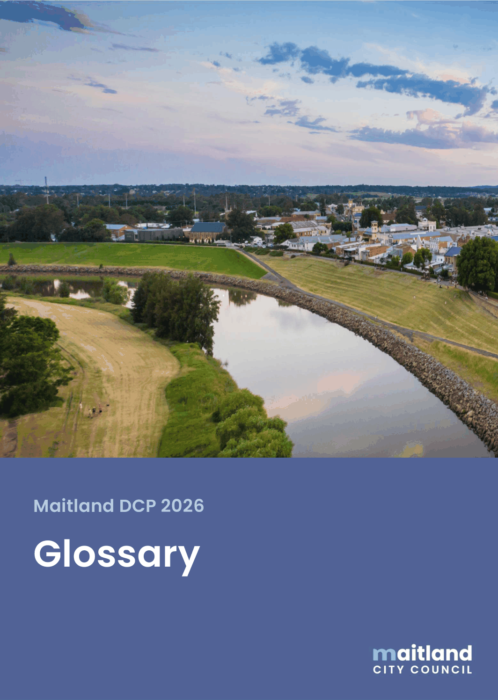

# Maitland Development Control Plan 2026 - Glossary

> This chapter is split into 4 section file(s), one per main heading, in the order they appear in the PDF.

Source PDF: [MDCP 2026 - Glossary.pdf](https://planfortomorrow.sharepoint.com/sites/Planfortomorrow/Shared%20Documents/00%20NSW-Planning-Resources/dcp/maitland-development-control-plan-2026/glossary/MDCP%202026%20-%20Glossary.pdf)

> [Picture on page 1: a picture, saved as a picture (images/glossary-page-1-1.gif, 150 dpi).]

<!-- sections -->
## Sections

1. [Maitland DCP 2026](01-maitland-dcp-2026.md)
2. [Disclaimer](02-disclaimer.md)
3. [Glossary Definitions](03-glossary-definitions.md)
4. [Acronyms](04-acronyms.md)
