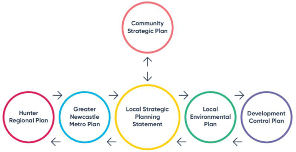

### 1.0 Preamble

Located on the traditional country of the Awabakal and Worimi peoples, City of Newcastle (CN) is Australia's seventh largest city and global gateway for northern NSW.

As the regional centre of the Hunter, CN is emerging as one of Australia's most dynamic and vibrant metropolitan cities. After its industrial heritage as a mining and steel city, it is evolving into a service, creative and knowledge

city. Significant investment has revitalised the city centre, boosted tertiary education, health and medical innovation, and has seen the emergence of a nationally significant defence and aerospace industry.

The Local Strategic Planning Statement (LSPS) sets the foundation to guide land use planning over the next 20 years.  The LSPS implements priorities from the Community Strategic Plan and brings together land use planning and development related actions. The LSPS also gives effect to the State Government strategic directions for the Hunter region, outlined in the Hunter Regional Plan and the Greater Newcastle Metropolitan Plan.

The LSPS outlines planning priorities to achieve the land use planning vision and inform decisions on changes to the planning regime in the Newcastle Local Environmental Plan 2012 (LEP 2012) and Newcastle Development Control Plan 2023 (DCP 2023). DCP 2023 reflects a vision for a smart, liveable and sustainable global city.

LEP 2012 contains the statutory framework for land use management (zoning and planning standards) in the local government area (LGA).  DCP 2023 supports LEP 2012 by providing design guidance to support good development outcomes. DCP 2023 will be applied with flexibility, and reasonable alternative solutions will be considered where they achieve overarching objectives. DCP 2023 provisions are not statutory requirements.

> [Picture on page 2: a picture, saved as a picture (images/section-a1-introduction-page-2-19.gif, 150 dpi).]
