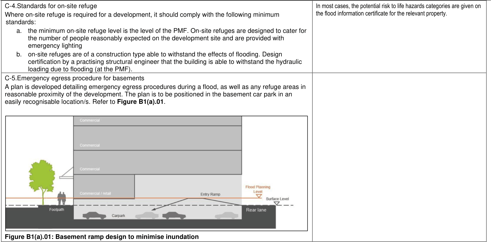

### 9.0 Management of risk to life

| Objectives 1. Only permit development or redevelopment where the full potential risk to life from flooding can be managed for all floods up to and including the PMF. |  |
|---|---|
| Controls (C) | Explanatory notes |
| C-1.Risk to life category L5 Risk to life hazards of L5 are generally unsuitable for any type of building construction and building is discouraged from these areas. Reliable safe escape to high ground is likely not possible and normal building construction would likely suffer structural failure from the force of floodwaters, so that any people seeking refuge in the building would likely perish. Where building is necessary, the structure is certified by a practising structural engineer to withstand the hydraulic loads (including debris) induced by the flood waters. |  |
| C-2.Islands The formation of islands in the floodplain during a flood is a potentially dangerous situation, especially when floods larger than the FPL totally inundate the island for an extended period. Development of such land is considered with great care. |  |
| C-3.On-site refuge On-site refuge is to be provided for all development where the life hazard category is L4 unless the proposed development is less than 40m from the perimeter of the PMF extent and the higher ground is accessible. | Refuge can be in the form of on-site refuge or convenient access to flood free ground. In general, it is not acceptable to rely on refuge provided by or on other development sites. In all cases where on site refuge is provided, it is to be both intrinsically accessible to all people on the site and an integrated part of the development (eg. a second storey with stair access). The route to the refuge is to be fail safe, plainly evident and self-directing. In most cases, life hazard categories are nominated on the flood information certificate for the relevant property. The life risk hazard category “L1” assumes people will respond to warnings and safely evacuate to the safety flood free high ground. Additional requirements may be necessary to manage personal safety in riverine flooding if there is evidence that a lack of response is likely, and this may lead to life threatening situations. |

> [Picture on page 11: a picture, saved as a picture (images/section-b1-a-flood-management-pre-2019-page-11-1.gif, 150 dpi).]
> Words printed on the picture (title and legend, copied from the PDF):
> In most cases, the potential risk to life hazards categories are given on
> the flood information certificate for the relevant property.

C-4.Standards for on-site refuge Where on-site refuge is required for a development, it should comply with the following minimum standards:

a. the minimum on-site refuge level is the level of the PMF. On-site refuges are designed to cater for the number of people reasonably expected on the development site and are provided with emergency lighting

b. on-site refuges are of a construction type able to withstand the effects of flooding. Design certification by a practising structural engineer that the building is able to withstand the hydraulic loading due to flooding (at the PMF).

C-5.Emergency egress procedure for basements A plan is developed detailing emergency egress procedures during a flood, as well as any refuge areas in reasonable proximity of the development. The plan is to be positioned in the basement car park in an easily recognisable location/s. Refer to Figure B1(a).01.

#### Figure B1(a).01: Basement ramp design to minimise inundation
