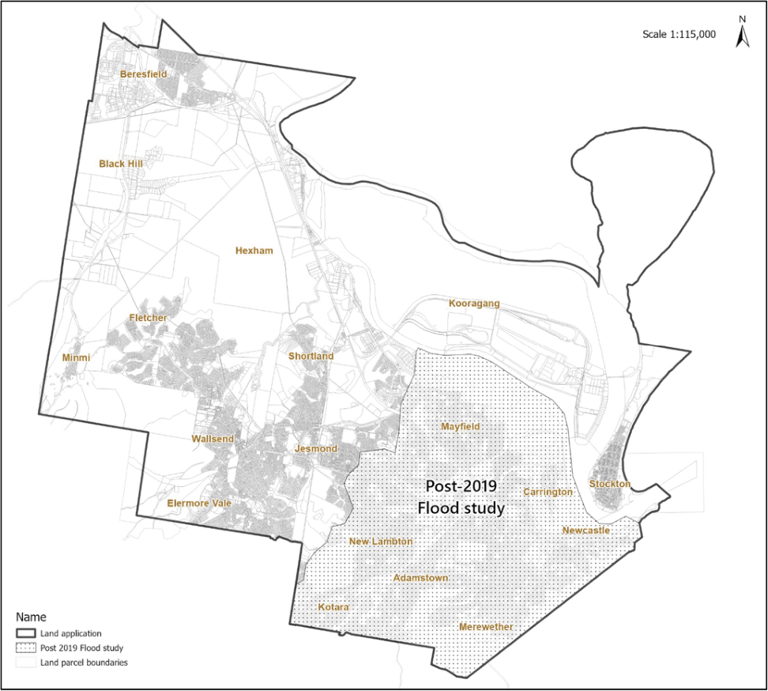

### 2.0 Application

This section applies to all development on flood prone (flood liable) land where flood mapping after the release of the 2019 Australian Rainfall and Runoff Guidelines (ARR 2019) is available, including:

Land that is flood prone due to flooding from the Throsby, Cottage or Styx creek catchments (refer Post 2019 Flood Study area), and All other flood prone land where flood studies are undertaken to inform development after the release of ARR 2019.

> [Picture on page 2: a picture, saved as a picture (images/section-b1-b-flood-management-page-2-14.gif, 150 dpi).]

#### Figure B1(b).01: Application map

Flood prone (flood liable) land is defined by the (NSW) Department of Planning and Environment's Flood risk management manual: the policy and manual for the management of flood liable land (2023), being “land susceptible to flooding by the Probable Maximum Flood (PMF) event”.

A flood information application form can be obtained from www.newcastle.nsw.gov.au or the Customer Contact Centre, 12 Stewart Avenue, Newcastle West NSW 2302.

This section applies to all development on flood prone land with the exception of minor additions to existing buildings.

Minor additions (refer to definitions) are allowable without further reference to the provisions of this section, provided that the flood risk is not unreasonably increased.

Tsunami and very minor nuisance flooding (such as the trapping of surface runoff in a road shoulder or against a building) are specifically excluded from the application of this section.
