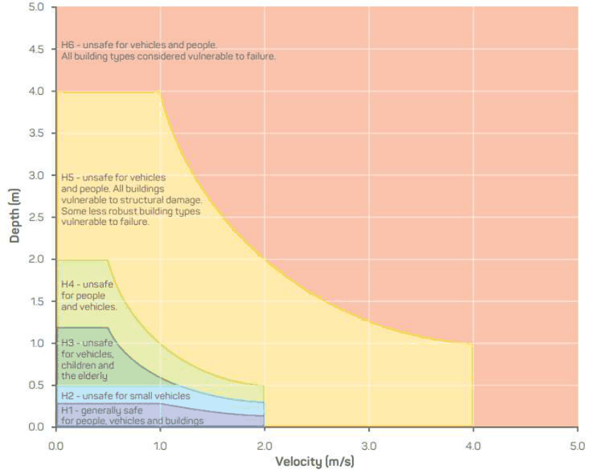

### 4.0 Definitions

A word or expression has the same meaning as it has in Newcastle Local Environmental Plan 2012 (LEP 2012) unless otherwise defined. Other words and expressions include: Annual exceedance probability (AEP) – is the probability that a flood of a given or larger magnitude will occur within a period of one year. Its reciprocal is equivalent to average recurrence interval (ARI). Basement garage – is a garage normally used to park vehicles with its floor below the street level. Flood fringe areas – means the remaining area of flood prone land not included in flood storage areas and floodways. Flood fringe areas can usually be developed without reference to how that development will affect the flood behaviour either upstream or downstream. Flood information certificate – is a certificate issued by City of Newcastle (CN) that provides information about the likelihood, extent or other characteristics of flooding known to affect a specified parcel of land. Flooding – is relatively high stream flow which overtops the natural or artificial banks in any part of a stream, river estuary, lake or dam, and/or local overland flooding associated with major drainage, and/or coastal inundation resulting from super-elevated sea levels and/or waves, excluding tsunami. Flooding may occur for a variety of reasons, either separately or in combination including: o river flooding - caused by a river or stream overtopping its banks onto a surrounding floodplain o urban flooding - caused by urban stormwater flows during an intense rainfall event, such as surface flows, surcharge from piped drainage systems or overflow from manmade stormwater channels o coastal inundation - caused by sea water inundation due to king tides, storm surge, barometric effects, shoreline recession, subsidence, the enhanced greenhouse effect or other causes

Flood liable land – also flood prone land is land susceptible to flooding by the PMF event on the basis of flood information held by CN. Note the term flood liable land covers the whole floodplain, not just that part below the flood planning area (FPL). Floodplain – is an area of land along the course of a river subject to periodic inundation due to the river overtopping its bank. It is commonly delineated by the area that would be flooded by an event with a given average recurrence interval. Flood planning area – the area of land below the FPL. Note development controls that mainly relate

to risk to property apply to the flood planning area, but other development controls mainly relating to risk to life and floodways and flood storages may apply to the remainder of flood liable (prone) land. Flood planning level (FPL) – is the level of the planning flood area plus an additional freeboard as advocated in the NSW Floodplain Development Manual. For purposes of this element, the planning flood is the 1% 2050 AEP flood, and the freeboard is generally 500mm. Flood prone land – is land that, on the basis of flood information held by CN, is estimated to be inundated by the probable maximum flood (PMF). Flood refuge – is an area free of flooding. It can be either higher ground or it could be in the form of an area of the building, either constructed specifically for the purpose or as an intrinsic part of the building. Flood storage area – is an area where flood water accumulates and the displacement of that floodwater will cause a significant redistribution of floodwaters, or a significant increase in flood levels, or a significant increase in flood frequency. Flood storage areas are often aligned with floodplains and usually characterised by deep and slow moving floodwater. Floodway – those areas of the floodplain where a significant discharge of water flows during floods; often aligned with naturally defined channels. Floodways are areas which, even if only partially blocked, would cause a significant redistribution of flood flow or increase in flood levels, which may in turn adversely affect other areas. Freeboard – is a margin applied to the estimation of flood levels to compensate for factors such as wave action, localised hydraulic behaviour, climatic change and modelling confidence. Hazard Category – Flood hazard classification is an assessment of how hazardous the physical conditions produced by a flood can be to people, cars, infrastructure and buildings if they were exposed to the flood event, independent of the population at risk. Consideration is given to hazard classification for a range of flood events including the planning flood and PMF to identify areas that require specific constraints and management. Hazard categories are defined in the Australian disaster resilience Handbook Collection, Guideline 7-3 Flood hazard – Supporting document for the implementation of Australian Disaster Resilience Handbook 7 Managing the Floodplain: A Guide to Best Practice in Flood Risk Management in Australia, 2017 (Australian Institute for Disaster Resilience). Table B1(b).01, Table B1(b).02, and Figure B1(b).01 above and replace Hydraulic Behaviour thresholds in studies undertaken since 2019.

| Hazard category | Description |
|---|---|
| H1 | Generally safe for people, vehicles and cars |
| H2 | Unsafe for small vehicles |
| H3 | Unsafe for vehicles, children and the elderly |
| H4 | Unsafe for vehicles and people |
| H5 | Unsafe for vehicles and people. All buildings vulnerable to structural damage. Some less robust building types vulnerable to failure |
| H6 | Unsafe for vehicles and people. All building types considered vulnerable to failure |

#### Table B1(b).01: Hazard categories

| Hazard category | Category limit m2/s | Maximum flood depth (D) m | Maximum flood velocity (V) m/s |
|---|---|---|---|
| H1 | D x V ≤ 0.3 | 0.3 | 2.0 |
| H2 | D x V ≤ 0.6 | 0.5 | 2.0 |
| H3 | D x V ≤ 0.6 | 1.2 | 2.0 |
| H4 | D x V ≤ 1.0 | 2.0 | 2.0 |
| H5 | D x V ≤ 4.0 | 4.0 | 4.0 |
| H6 | D x V > 4.0 | - | - |

#### Table B1(b).02: Hazard threshold classification limits

> [Picture on page 5: a picture, saved as a picture (images/section-b1-b-flood-management-page-5-1.gif, 150 dpi).]

#### Figure B1(b).02: Flood hazard vulnerability curves

Image courtesy of Australian Institute for Disaster Resilience and sourced from Australian disaster resilience Handbook Collection, Guideline 7-3 Flood hazard – Supporting document for the implementation of Australian Disaster Resilience Handbook 7 Managing the Floodplain: A Guide to Best Practice in Flood Risk Management in Australia, 2017.

Risk to Life – is a combination of hydraulic hazard category, warning time and escape path availability, applied to all floods, up to and including the PMF (as recommended in the ADIR 2017 guidelines for the management of personal safety). For simplicity, the Risk to Life categories set out below are only assessed for the PMF in the application of this section of Development Control Plan 2023 (DCP 2023), on the assumption that once the PMF is managed for personal safety, all other lesser floods will also be managed.

An L1 Risk to Life classification is applied when flood risk on the flood information certificate is defined as subject to Riverine and Ocean flooding. This lower risk classification is applied as there is sufficient time to remove people from the risk to their lives by means of formal community evacuation plans. This lower risk classification assumes people will respond to warnings and safely evacuate to the safety of flood free high ground.  Additional requirements may be necessary to manage personal safety in Riverine and Ocean flooding if there is evidence that a lack of response is likely, and this may lead to life threatening situations. The lower risk to life classification is not relevant to flash flooding scenarios such as the Wallsend Catchment.

Life Risk Threshold

|  |  | H1 | H2 | H3 | H4 | H5 | H6 |
|---|---|---|---|---|---|---|---|
| Flood Type | Riverine and Ocean | L1 |  |  |  |  |  |
|  | Flash | L2 | L2 | L3 | L4 | L5 | L6 |

#### Table B1(b).03: Risk to Life

Minor additions – (for the purpose of section B1 Flood Management) are the total proposed additions that fall below the following limits:

| Existing building area | Minor addition limit |
|---|---|
| < 250m2 | 50m2 |
| 250m2 – 750m2 | 20% of the existing building area |
| >750m2 | 150m2 |

#### Table B1(b).04: Existing Building Areas

Occupiable rooms – are rooms of buildings where people may be present in the normal use of the building. Planning flood – is the flood event from which the FPL is derived. It is expressed in terms of the probability of the event being exceeded, usually within any given year (see AEP). Probable maximum flood (PMF) – is the largest flood that could conceivably occur at a particular location. Probable maximum flood level – the flood level calculated to be the maximum which is likely to occur. Risk to Property – The risk to property is based on the hazard categories (H1-H6) determined for the Flood Planning event, and the associated risk to property as recommended in the ADIR 2017 guidelines. The six risk to property categories are P1-P6, these correlate directly with H1-H6 as follows:

| Risk to property | Hazard category | Description |
|---|---|---|
| P1 | H1 | Low Hazard to structures. Suitable for light construction (eg. timber frame, masonry and brick veneer). Safe for all vehicles |
| P2 | H2 | Low Hazard to structures. Suitable for light construction (eg. timber frame, masonry and brick veneer). Unsafe for small vehicles |
| P3 - P4 | H3 – H4 | Low Hazard to structures. Suitable for light construction (eg. timber frame, masonry and brick veneer). Unsafe for all vehicles |
| P5 – P6 | H5 – H6 | Extreme hazard to structures. Hydraulically unsuitable for normal building construction. Unsafe for all vehicles |

#### Table B1(b).05: Risk to Life

The distribution of P1-P6 is identical to the related H1-H6 (at the Flood Planning Event). Tsunami – means a series of ocean waves with very long wavelengths (typically hundreds of kilometres) caused by large-scale disturbances of the ocean, such as: - earthquakes - landslide - volcanic eruptions

- explosions - meteorites. Notes:  Tsunami are specifically excluded.
