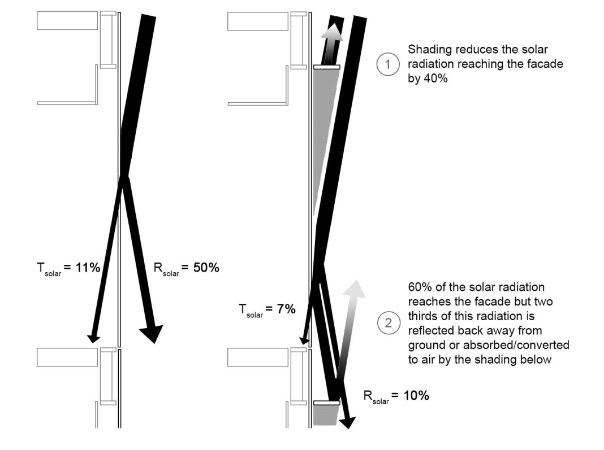

### 7.0 Cool facades within the Newcastle city centre, Wickham, Renewal Corridors and Local Centres

| Objectives 1. Reduce the contribution of development to urban heat reflected from facades in the Newcastle city centre, Wickham, Renewal corridors and Local centres 2. Minimise the reflection of solar heat downward from the building facade into private open space and/or the public domain. |  |  |
|---|---|---|
| Controls (C) | Acceptable solutions (AS) | Explanatory notes |
| These controls apply to the Newcastle city centre, Wickham, Renewal corridors and Local centres. They do not apply to heritage items and contributory buildings in heritage conservation areas, single dwellings, dual occupancies, secondary dwellings and multi- dwelling housing including ancillary development. C-1.The extent of the vertical facade of street walls or first 12 metres of facade as measured from the ground plane that comprise reflective surfaces must demonstrate a minimum percentage of shading as defined in Table B6.01. Table B6.01: Minimum percentage shading for the street wall or first 12 metres of facade as measured from the ground plane of a building Reflective surface ratio (RSR) <30% 30%-70% >=70% Minimum percentage shading (%) 0 (1.5RSR)-45 75 C-2.Calculation of RSR for each relevant facade must also be submitted with the DA. C-3.Shadows from existing buildings, structures and vegetation are not considered in the calculations. Refer to Table B6.02 for sun angles corresponding to shading reference times. C-4.Non-reflective surfaces on vertical facades are excluded from the calculations. | AS-1.Shading may be provided by: a. external feature shading with non- reflective surfaces reducing solar radiation reaching the facade and amount reflected back away from ground or absorbed converted by air b. intrinsic features of the building form such as reveals and returns c. shading from vegetation such as green walls that is consistent with the controls in section 8.0. | Reflective surfaces - are surfaces that directly reflect light and heat. For the purpose of this section they are defined as those surfaces that have specular normal reflection of greater than 5% and include glazing, glass faced spandrel panel, some metal finishes and high gloss finishes. Minimum percentage shading - Calculations will be on 21 December on the east facing facade at 10am, northeast and southeast facing facade at 11.30am, north facing facade at 1pm, northwest and southwest facing facade at 2.30pm and the west facing face at 4pm (as shown in Figure B6.01). Refer to Section E1 Built and Landscape Heritage. |

Newcastle Development Control Plan 2023

B6 Urban heat

Page 6 of 11

| Table B6.02: Shading sun angles Orientation of façade Time Sun angles East ± 22.5° 10:00 AEDT Sun elevation: 51° Sun Azimuth: 86° Northeast/Southeast 11:30 AEDT Sun elevation: 69° ± 22.5° Sun Azimuth: 66° North ± 22.5° 13:00 AEDT Sun elevation: 80° Sun Azimuth: 352° Northwest/Southwest 14:30 AEDT Sun elevation: 67° ± 22.5° Sun Azimuth: 290° West ± 22.5° 16:00 AEDT Sun elevation: 48° Sun Azimuth: 272° |  |
|---|---|
| C-5.Where it is demonstrated that shading cannot be achieved in accordance with the above controls, a maximum external solar reflectance as indicated in Table B6.03 is acceptable with greater emphasis on cooling of outdoor spaces. Table B6.03: Maximum solar reflectance of Reflective Surfaces Reflective surface ratio (RSR) <30% 30%-70% >=70% Minimum percentage shading (%) No max. 62.5-0.75RSR 10 | AS-1.Development takes all reasonable steps to reduce external solar reflectance downward from the building facade into private open space and/or the public domain. AS-2.Exceed landscaped and deep soil area requirements in C12 Open Space and landscaping. This includes retention of established trees and/or planting of large and medium size trees to reduce urban heat. |
| C-6.Where multiple reflective surfaces or convex geometry of reflective surfaces introduce the risk of focusing on solar reflections into public spaces a building must not exceed 1,000W/m2 in the public domain at any time. | AS-1.A reflectivity modelling report to qualify the extent of reflected solar heat radiation. |

Newcastle Development Control Plan 2023

B6 Urban heat

Page 7 of 11

> [Picture on page 8: a picture, saved as a picture (images/section-b6-urban-heat-page-8-1.gif, 150 dpi).]

Figure B6.01: How shading reduces solar reflectance. Image courtesy of WSROC Urban Heat Planning Toolkit, 2021

Newcastle Development Control Plan 2023

B6 Urban heat

Page 8 of 11
