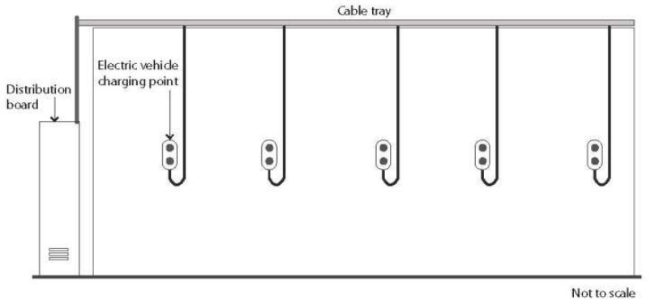
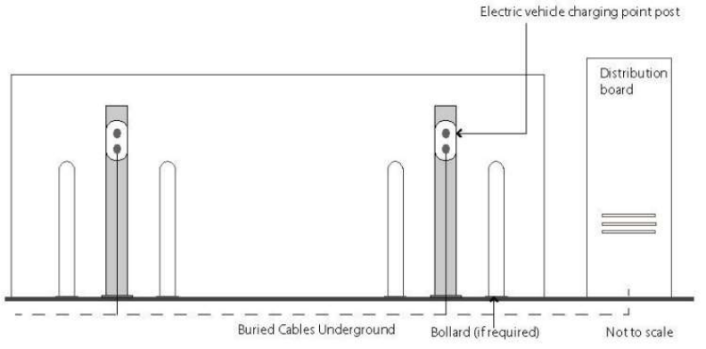

### 11.0 Electric car parking

| Objectives 1. Ensure development encourages and supports increased usage and demand for electric vehicles. |  |
|---|---|
| Controls (C) | Explanatory notes |
| C-1.The following controls apply to dwelling houses, semi-detached dwellings, secondary dwellings and dual occupancies, including alterations and additions with an estimated cost equal to or more than $200,000 that involves car parking: a. electric circuitry to accommodate ‘Level 2’ or higher standard electric vehicle charging points must be integrated to ensure future installation of an electric vehicle charging point to service at least one off-street parking space. This must include: i. ensuring adequate electrical capacity and infrastructure for a current or future electric vehicle charging point system ii. providing either buried cables underground or cable trays sufficient to accommodate electric circuitry to at least one off-street parking space b. electrical circuitry must, at a minimum, be capable of supporting a ‘Level 2’ slow—single phase, 7kW domestic charger or higher c. prior to construction certificate, a report is to be prepared by a suitably qualified and experienced person demonstrating how the development will be EV ready. This report should also include an electrical plan, specifications for any off-street car parking and any electric kiosk requirements. | In addition to EV ready, the installation of a ‘Level 2’ or higher standard electric vehicle charging point is encouraged for alterations and additions to dwelling houses, semi- detached dwellings and dual occupancies. Charging standards are defined by the NSW Electric and Hybrid Vehicle Plan, Future Transport 2056. Controls under this heading will lead to a development being EV ready). Being EV ready involves ensuring the installation of appropriate electrical circuitry to allow for future electric vehicle charging points, by pre-wiring. These controls do not require the installation of a charging point but are encouraged. |
| C-2.The following controls apply to all other development, including alterations and additions with an estimated cost equal to or more than $200,000, that involves car parking. This does not apply to development as specified C-1. a. electric circuitry to accommodate ‘Level 2’ or higher standard electric vehicle charging points must be integrated into all off-street car parking of residential and non-residential development to ensure that 100% of car spaces can install electric vehicle charging points in the future. This must include: i. ensuring adequate electrical capacity and infrastructure (cable size, distribution board size etc.) for the electric vehicle charging point system ii. providing either buried cables underground or cable trays sufficient to accommodate electric circuitry to each car space (see Figure C1.01) b. minimum electric circuitry for a ‘Level 2’ electric vehicle charging point, if provided, is required to be: i. privately available spaces: ‘Level 2’ slow – single phase with 7kW power or higher standard ii. shared spaces: ‘Level 2’ fast – three-phase with 11-22kW power or higher standard c. A DA is accompanied by a report prepared by a suitably qualified and experienced person (such as an electrical engineer) demonstrating how the development will be EV Ready. This report should also include an electrical plan, specifications for any off-street car parking and any electric kiosk requirements. |  |

Newcastle Development Control Plan 2023

C1 Traffic parking and access

Page 11 of 36

| C-3.The following controls apply to residential accommodation development that involves car parking, excluding dwelling houses, semi-detached dwellings, secondary dwellings or dual occupancies: a. provide EV Distribution Board(s) of sufficient size to allow connection of all EV Ready connections b. locate EV Distribution Board(s) so that no future EV Ready connection will require a cable of more than 50 metres from the parking bay to connect c. identify on the plans submitted with the DA, the future installation location of the cable trays from the EV Distribution Board to the car spaces allocated to each dwelling that are provided a Future EV connection, with confirmation of adequacy from a suitably qualified person (such as an electrical engineer). Spatial allowances are to be made for cables trays and EV Distribution Board(s) when designing in other services. |  |
|---|---|
| C-4.The following control applies to development that involves car parking, excluding dwelling houses, semi-detached dwellings, secondary dwellings or dual occupancies: a. development must provide 1 car parking space or 5% of all car parking spaces – whichever is greater - to have a ‘Level 2’ or higher standard electric vehicle charging point installed. A DA is accompanied by a report prepared by a suitably qualified and experienced person (such as an electrical engineer) demonstrating how the development will provide the specified electric vehicle charging point(s). This report should also include an electrical plan, specifications for any off-street car parking and any electric kiosk requirements. The total number of parking to be provided is rounded up to the nearest whole number. | Charging standards are defined by the NSW Electric and Hybrid Vehicle Plan, Future Transport 2056. |
| C-5.The following control applies to development that involves a service station: a. development must provide 4 car parking spaces or 30% of all car parking spaces - whichever is greater - to have a 'Level 3' (50kW - 350kW), or higher standard electric vehicle charging points installed. This must include: i. a report prepared by a suitably qualified and experienced person (such as an electrical engineer) demonstrating how the development will provide the specified electric vehicle charging points. This report should also include details on electrical capacity and infrastructure (cable size, distribution board size, load management, electric kiosk requirements etc.) for the electric vehicle charging points ii. vehicle charging points are buried cables underground to accommodate electric circuitry to each car space (see Figure C1.02). |  |

Newcastle Development Control Plan 2023

C1 Traffic parking and access

Page 12 of 36

> [Picture on page 13: a picture, saved as a picture (images/section-c1-traffic-parking-and-access-page-13-1.gif, 150 dpi).]

Figure C1.01: Electric vehicle charging points and electric circuitry provision in development with multiple car spaces using cable tray system

> [Picture on page 13: a picture, saved as a picture (images/section-c1-traffic-parking-and-access-page-13-3.gif, 150 dpi).]

Figure C1.02: Electric vehicle charging points and electric circuitry provision in development with multiple car spaces using buried underground cable system

Newcastle Development Control Plan 2023

C1 Traffic parking and access

Page 13 of 36
