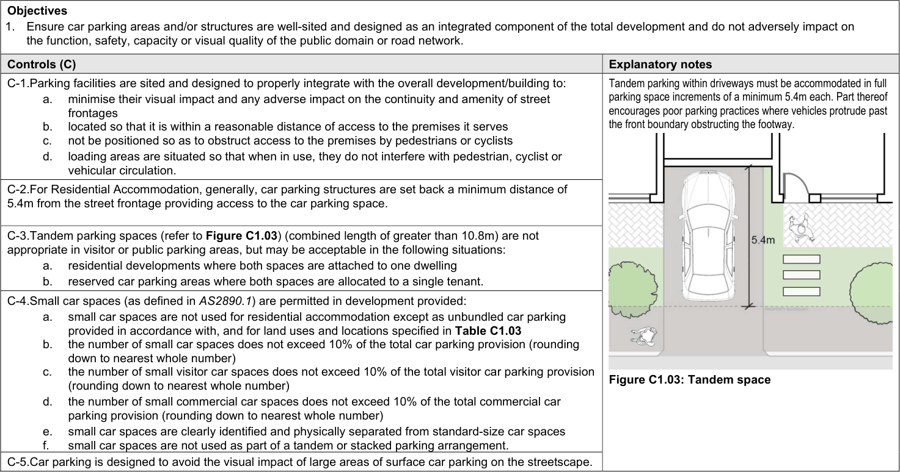

### 13.0 Design and layout of parking and access

> [Picture on page 15: a picture, saved as a picture (images/section-c1-traffic-parking-and-access-page-15-2.gif, 150 dpi).]
> Words printed on the picture (title and legend, copied from the PDF):
> frontages
> vehicular circulation.

#### Objectives

1\. Ensure car parking areas and/or structures are well-sited and designed as an integrated component of the total development and do not adversely impact on the function, safety, capacity or visual quality of the public domain or road network.

#### Controls (C)

#### Explanatory notes

C-1.Parking facilities are sited and designed to properly integrate with the overall development/building to: Tandem parking within driveways must be accommodated in full

parking space increments of a minimum 5.4m each. Part thereof encourages poor parking practices where vehicles protrude past the front boundary obstructing the footway.

a. minimise their visual impact and any adverse impact on the continuity and amenity of street

b. located so that it is within a reasonable distance of access to the premises it serves

c. not be positioned so as to obstruct access to the premises by pedestrians or cyclists

d. loading areas are situated so that when in use, they do not interfere with pedestrian, cyclist or

C-2.For Residential Accommodation, generally, car parking structures are set back a minimum distance of 5.4m from the street frontage providing access to the car parking space.

C-3.Tandem parking spaces (refer to Figure C1.03) (combined length of greater than 10.8m) are not appropriate in visitor or public parking areas, but may be acceptable in the following situations:

a. residential developments where both spaces are attached to one dwelling

b. reserved car parking areas where both spaces are allocated to a single tenant.

C-4.Small car spaces (as defined in AS2890.1) are permitted in development provided:

#### Figure C1.03: Tandem space

a. small car spaces are not used for residential accommodation except as unbundled car parking provided in accordance with, and for land uses and locations specified in Table C1.03

b. the number of small car spaces does not exceed 10% of the total car parking provision (rounding down to nearest whole number)

c. the number of small visitor car spaces does not exceed 10% of the total visitor car parking provision (rounding down to nearest whole number)

d. the number of small commercial car spaces does not exceed 10% of the total commercial car parking provision (rounding down to nearest whole number)

e. small car spaces are clearly identified and physically separated from standard-size car spaces

f. small car spaces are not used as part of a tandem or stacked parking arrangement.

C-5.Car parking is designed to avoid the visual impact of large areas of surface car parking on the streetscape.

Newcastle Development Control Plan 2023

C1 Traffic parking and access

Page 15 of 36
