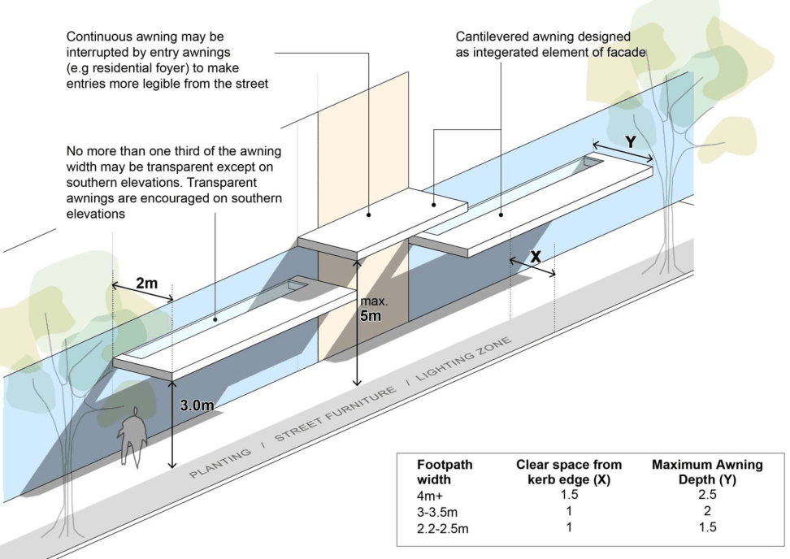

### 6.0 Street awnings over public roads

#### Objectives

1\. Enhance the pedestrian amenity of streets in commercial areas.

2\. Achieve shade and weather protection over public footpaths in commercial centres or other pedestrian-oriented locations.

3\. Ensure street awning designs are of a high architectural merit, are consistent with surrounding streetscape elements, reduce visual clutter and provide visual continuity to the streetscape.

4\. Encourage the conservation, restoration, reconstruction, or reinstatement of street awnings that are of heritage significance.

5\. Ensure street awning designs provide reasonable levels of natural and/or artificial lighting to footpaths and to ground floor spaces within buildings.

6\. Ensure that street awnings do not present any unacceptable risks to public safety.

7\. Ensure awnings, street trees and street infrastructure are coordinated in their design and that placement does not obstruct the public domain.

| Controls (C) | Acceptable solutions (AS) | Explanatory notes |
|---|---|---|
| C-1.Street frontage developments in commercial centres or other pedestrian- oriented locations to provide street awnings, subject to the following considerations: |  | Refer to Section E1 Built and Landscape Heritage. |
| a. compatibility with streetscape, architectural and heritage |  |  |
| considerations b. the volume of pedestrian traffic passing the site |  |  |
| c. the level of amenity that provision of street awnings would provide d. existing street awnings in the vicinity |  |  |
| e. compatibility with existing or potential future street trees f. compatibility with the scale and architecture of the building. |  |  |
| As is shown in Figure C10.01 below. |  |  |

Newcastle Development Control Plan 2023

C10 Street awnings and balconies

Page 4 of 13

C-2.The form and design of street awnings:

Refer to Section E1 Built and Landscape Heritage.

a. unifies the streetscape rather than being a response to the individual host building

b. does not interfere with street trees and street infrastructure

c. extends across the entire building frontage

d. are compatible with the host building and surrounding streetscape,

AS-1.Street awnings may include design articulation to modulate long awnings, identify entrances and provide architectural expression.

AS-2.The depth of an awning allows appropriate space for planting, street furniture and lighting.

having regard to architectural style, form, finish, heritage significance and provision of continuous weather protection

e. employs uncomplicated, regular forms with simple detailing and concealed conduits to reduce visual clutter

f. are of a suspended design

g. are of a traditional suspended design (with fascia) in existing commercial areas.

AS-3.Continuous awnings are provided to all active frontages. Breaks in awnings may be permitted for existing street trees.

AS-4.A post supported design may be used where necessary to achieve compatibility with existing post-supported street awnings in the immediate vicinity, or to conserve, reconstruct or reinstate an existing or former awning having heritage significance.

AS-5.A contemporary suspended design (typically without fascias and with exposed structural elements) may be used where the building form is contemporary.

Newcastle Development Control Plan 2023

C10 Street awnings and balconies

Page 5 of 13

> [Picture on page 6: a picture, saved as a picture (images/section-c10-street-awnings-and-balconies-page-6-1.gif, 150 dpi).]

#### Figure C10.01: Awnings diagram

Newcastle Development Control Plan 2023

C10 Street awnings and balconies

Page 6 of 13
