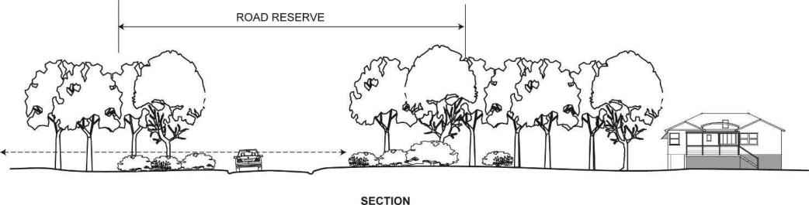
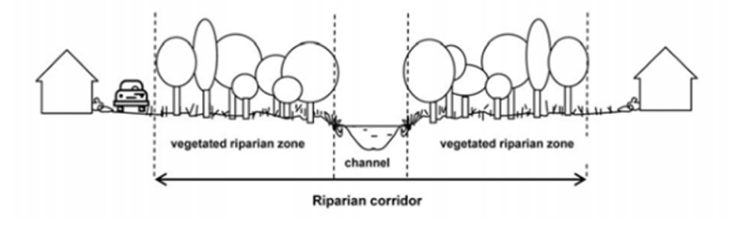
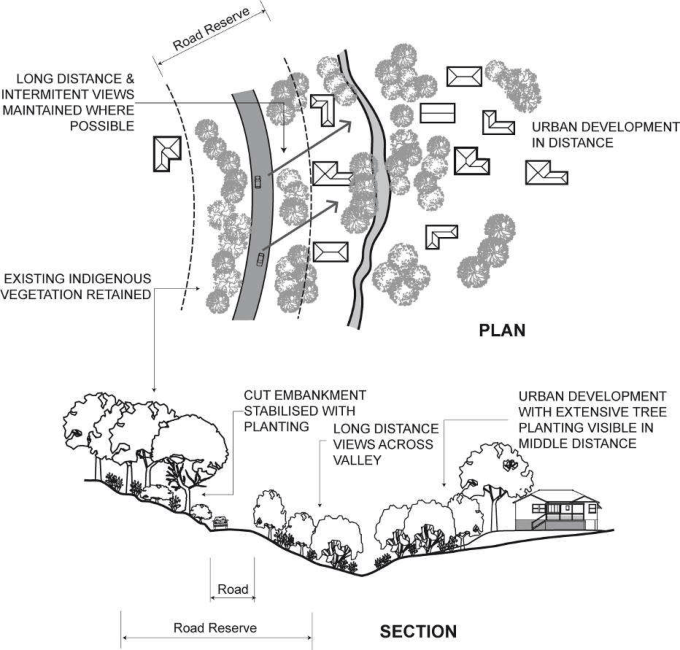

### 8.0 General controls

| Objectives 1. Provide appropriate areas on sites that enables soft landscape and deep soil planting that permits the retention and/or planting of trees and shrubs that will grow to a large or medium size. 2. Support protection and enhancement of existing significant landscape features, vegetation and habitat. 3. Minimise a proposal's impact on adjoining properties through landscaping. 4. Ensure consideration is given to the landscape character of the setting. |  |
|---|---|
| Controls (C) | Explanatory notes |
| C-1.Landscaping is in scale and context with the proposed development, street reserve width, other buildings, and landscape elements within the streetscape. | For example, it is not appropriate to plant a large tree in the front garden of a small terrace or to landscape a large industrial structure with ground covers. |
| C-2.Significant site vegetation and landscape features are incorporated in the landscape areas of a development and linked to local networks for open space and/or environmental lands where possible. |  |
| C-3.Adequate provision is made for planted buffer zones between major road and transport corridors and adjoining development as is shown in Figure C12.01 and Figure C12.02. |  |
| C-4.Vegetation management for the purposes of bushfire risk management or crime prevention through environmental design is accommodated within the site – not through the clearing, adjustment or management of vegetation on public land. | Vegetation management for private benefit cannot be imposed on adjacent public land. See Planning for Bushfire Protection (NSW Rural Fire Service 2019). |
| C-5.The location and design of on-site stormwater management controls and vegetated riparian zones in Figure C12.03 integrate with the design of landscaped plans. |  |
| C-6.Deep soil zones are optimised within a site by: a. the design of basement and sub-basement car parking to avoid site coverage conflicts with tree planting – both existing and proposed b. ensuring appropriate front and side setbacks are provided for tree planting c. the soil profile is free draining d. locating zones away from works, excavations, infrastructure, services and drainage pipes e. locating zones near deep soil zones of adjacent properties. | That basements are completely within the building footprint. Where this is not practical, the extent to which basements protrude from the footprint of the building above should be limited in extent, and their location should not impede the retention of existing vegetation (both within the site and on adjoining properties) and, the provision of new landscaping, including trees of an appropriate scale. |
| C-7.Landscape treatment within the front setback is substantial enough to enhance the appearance and integration of the development with the streetscape. |  |
| C-8.Landscape design responds to user requirements, considering maintenance, health and wellbeing, aesthetic quality and social and recreational needs. |  |

Newcastle Development Control Plan 2023

C12 Open space and landscaping

Page 7 of 23

| C-9.Landscape design enhances the amenity and energy efficiency of the development where possible by providing shade to the northerly and westerly elevations of buildings in summer and adequate solar access in winter. |  |
|---|---|
| C-10.Landscape areas address privacy issues between the development and adjoining dwellings. |  |
| C-11.Plant species selected are suitable for site conditions, using native species where possible, and local indigenous species when adjoining environmentally sensitive sites, such as waterways and bushland. Undesirable species are not selected for planting. | See Urban Forest Technical Manual and Appendix B Landscape Technical Manual. |
| C-12.Plant species are selected and located to avoid structures, services and paths. | See Urban Forest Technical Manual and Appendix B Landscape Technical Manual. |
| C-13.A vegetated buffer is provided to reduce noise, odour and visual amenity impacts to conflicting sensitive land uses. | Sensitive land uses include, but are not limited to residential development, seniors housing, schools, hospitals, child care facilities, recreation areas, place of worship, community facilities. |

> [Picture on page 8: a picture, saved as a picture (images/section-c12-open-space-and-landscaping-page-8-2.gif, 150 dpi).]

#### Figure C12.01: Landscape buffer along major road and transport corridors

Newcastle Development Control Plan 2023

C12 Open space and landscaping

Page 8 of 23

> [Picture on page 9: a picture, saved as a picture (images/section-c12-open-space-and-landscaping-page-9-1.gif, 150 dpi).]

#### Figure C12.03: Vegetated riparian buffers and corridors. Image care of NSW

Department of Planning and Environment, controlled activities – Guidelines for riparian corridors on waterfront land (nsw.gov.au)

> [Picture on page 9: a picture, saved as a picture (images/section-c12-open-space-and-landscaping-page-9-5.gif, 150 dpi).]

#### Figure.C12.02: Landscaping between roads and residential development

Newcastle Development Control Plan 2023

C12 Open space and landscaping

Page 9 of 23
