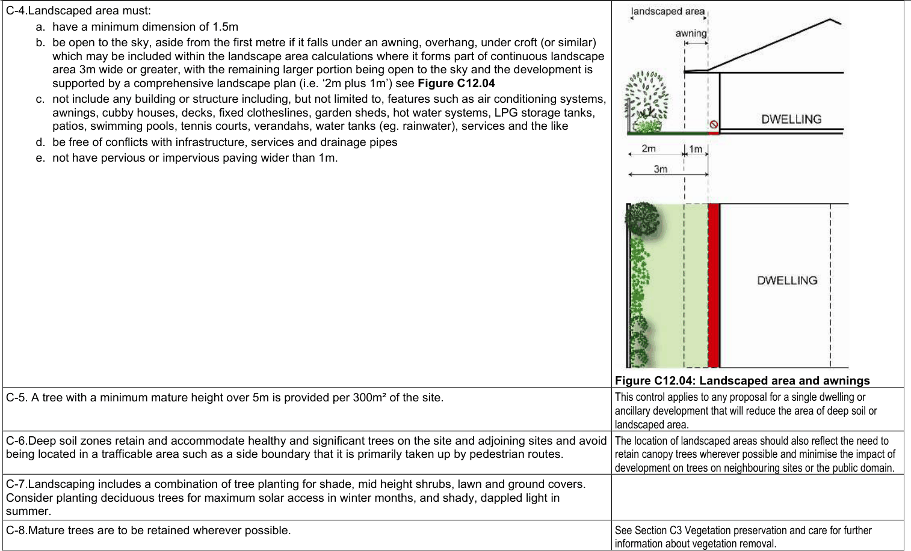

### 12.0 Single dwellings and ancillary development

#### Objectives

1\. Improve the amenity of developments and neighbourhoods through quality landscaping.

2\. Provide suitable areas for landscaped area and deep soil zones.

3\. Provide consolidated deep soil zones of adequate dimensions to accommodate the retention and/or planting of large and medium size trees.

4\. Retain the existing natural features of the site that contribute to the neighbourhood character.

5\. Ensure landscaping is climate responsive, supports biodiversity and amenity and reduces urban heat.

| Controls (C) |  | Explanatory notes |
|---|---|---|
| C-1.Development has | the following minimum landscape and deep soil areas: | The deep soil zone is measured as a component of the landscaped area. This is to be clearly marked on plans. |
| Lot size (m2) | Minimum landscape area (% site area) | Minimum deep soil zone (% of site area) |
| Less than 299 | 10% | 0% |
| 300 - 449 | 15% | 7% |
| 450 - 600 | 20% | 10% |
| 600 or more | 30% | 15% |
| C-2.Deep soil zones must have a minimum dimension of 3m. |  |  |
| C-3.A landscaped area is provided in addition to private open space. |  |  |

Newcastle Development Control Plan 2023

C12 Open space and landscaping

Page 15 of 23

> [Picture on page 16: a picture, saved as a picture (images/section-c12-open-space-and-landscaping-page-16-1.gif, 150 dpi).]
> Words printed on the picture (title and legend, copied from the PDF):
> C-4.Landscaped area must:

a. have a minimum dimension of 1.5m

b. be open to the sky, aside from the first metre if it falls under an awning, overhang, under croft (or similar) which may be included within the landscape area calculations where it forms part of continuous landscape area 3m wide or greater, with the remaining larger portion being open to the sky and the development is supported by a comprehensive landscape plan (i.e. ‘2m plus 1m’) see Figure C12.04

c. not include any building or structure including, but not limited to, features such as air conditioning systems, awnings, cubby houses, decks, fixed clotheslines, garden sheds, hot water systems, LPG storage tanks, patios, swimming pools, tennis courts, verandahs, water tanks (eg. rainwater), services and the like

d. be free of conflicts with infrastructure, services and drainage pipes

e. not have pervious or impervious paving wider than 1m.

|  | Figure C12.04: Landscaped area and awnings |
|---|---|
| C-5. A tree with a minimum mature height over 5m is provided per 300m² of the site. | This control applies to any proposal for a single dwelling or ancillary development that will reduce the area of deep soil or landscaped area. |
| C-6.Deep soil zones retain and accommodate healthy and significant trees on the site and adjoining sites and avoid being located in a trafficable area such as a side boundary that it is primarily taken up by pedestrian routes. | The location of landscaped areas should also reflect the need to retain canopy trees wherever possible and minimise the impact of development on trees on neighbouring sites or the public domain. |
| C-7.Landscaping includes a combination of tree planting for shade, mid height shrubs, lawn and ground covers. Consider planting deciduous trees for maximum solar access in winter months, and shady, dappled light in |  |
| summer. |  |
| C-8.Mature trees are to be retained wherever possible. | See Section C3 Vegetation preservation and care for further information about vegetation removal. |

Newcastle Development Control Plan 2023

C12 Open space and landscaping

Page 16 of 23

C-9.The following ancillary development, and any associated excavation has a setback of at least 3m from the base of the trunk of any declared tree on the lot:

a. carports and garages

b. detached studios

c. secondary dwellings

d. swimming pools.

Newcastle Development Control Plan 2023

See section C3 Vegetation preservation and care for further information on the definition of a declared tree.

C12 Open space and landscaping

Page 17 of 23
