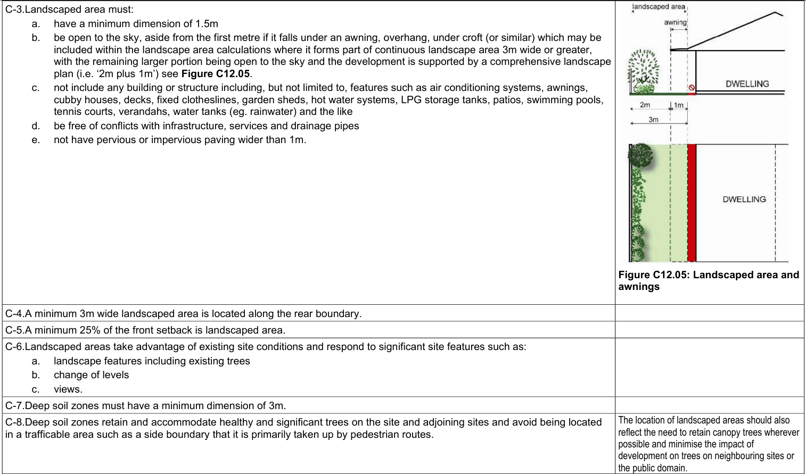

### 13.0 All other residential development

#### Objectives

1\. Ensure development integrates into established streetscapes and neighbourhoods.

2\. Ensure landscaped areas are of a useable size and proportions to add value and quality of life for occupants within a development in terms of privacy, outlook, views and recreational opportunities.

3\. Ensure landscaped areas are sized and located so that the amenity and privacy of adjoining dwellings is maintained.

4\. Preserve and retain existing established trees.

5\. Provide consolidated deep soil zones of adequate dimensions to accommodate the retention of established trees and/or planting of large and medium size trees.

6\. Retain the existing natural features of the site that contribute to the neighbourhood character.

7\. Ensure landscaping is climate responsive, supports biodiversity and amenity and reduces urban heat.

| (C) |  |  | Explanatory notes |
|---|---|---|---|
| C-1.Landscaped and deep soil areas Residential development type R2 zone | are provided as follows: Minimum landscape area (% site area) 30% | Minimum deep soil zone (% of site area) 15% | The achievement of minimum landscape area requirements takes precedence over excess site coverage or building to 100% or beyond the applicable maximum building envelope restrictions. |
| R3 zone | 25% | 12% |  |
| R4 and B4 zones | 20% | 10% |  |

#### Controls

The deep soil zone is measured as a component of the landscaped area. C-2.Landscaped area is provided in addition to private open space.

Newcastle Development Control Plan 2023

C12 Open space and landscaping

Page 18 of 23

> [Picture on page 19: a picture, saved as a picture (images/section-c12-open-space-and-landscaping-page-19-1.gif, 150 dpi).]
> Words printed on the picture (title and legend, copied from the PDF):
> C-3.Landscaped area must:
> c.

a. have a minimum dimension of 1.5m be open to the sky, aside from the first metre if it falls under an awning, overhang, under croft (or similar) which may be

b. included within the landscape area calculations where it forms part of continuous landscape area 3m wide or greater, with the remaining larger portion being open to the sky and the development is supported by a comprehensive landscape plan (i.e. ‘2m plus 1m’) see Figure C12.05. not include any building or structure including, but not limited to, features such as air conditioning systems, awnings, cubby houses, decks, fixed clotheslines, garden sheds, hot water systems, LPG storage tanks, patios, swimming pools, tennis courts, verandahs, water tanks (eg. rainwater) and the like

d. be free of conflicts with infrastructure, services and drainage pipes

e. not have pervious or impervious paving wider than 1m.

Figure C12.05: Landscaped area and awnings

C-4.A minimum 3m wide landscaped area is located along the rear boundary. C-5.A minimum 25% of the front setback is landscaped area. C-6.Landscaped areas take advantage of existing site conditions and respond to significant site features such as:

a. landscape features including existing trees

b. change of levels

c. views. C-7.Deep soil zones must have a minimum dimension of 3m. C-8.Deep soil zones retain and accommodate healthy and significant trees on the site and adjoining sites and avoid being located in a trafficable area such as a side boundary that it is primarily taken up by pedestrian routes.

The location of landscaped areas should also reflect the need to retain canopy trees wherever possible and minimise the impact of development on trees on neighbouring sites or the public domain.

Newcastle Development Control Plan 2023

C12 Open space and landscaping

Page 19 of 23

| C-9.Landscaping includes a combination of tree planting for shade, shrubs, lawn and ground covers. | Crime prevention through environmental design principles for surveillance recommend keeping shrubs low enough to facilitate sightlines and avoid creating concealment spaces. |
|---|---|
| C-10.Mature trees are to be retained wherever possible. | Where trees or native vegetation are proposed to be removed, see section C3 Vegetation preservation and care. |
| C-11. A minimum of one tree with a minimum mature height over 8m is to be provided per 400m² of the site. |  |
| C-12.Deciduous trees are planted for maximum solar access in winter months, and shady, dappled light in summer. |  |

Newcastle Development Control Plan 2023

C12 Open space and landscaping

Page 20 of 23
