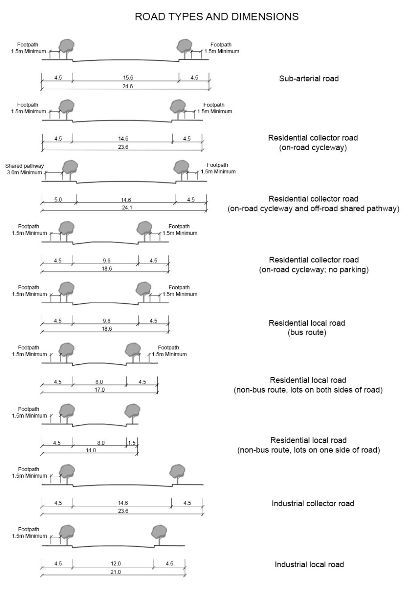

### 10.0 Pedestrian and cycle paths

| Objectives 1. Provide safe, activated, interesting, shaded and healthy streets with pedestrian, cycle and public transport movements prioritised. 2. Pedestrian, active transport, and public transport access is prioritised over private vehicles to promote healthy and active neighbourhoods. |  |  |
|---|---|---|
| Controls (C) | Acceptable solutions (AS) | Explanatory notes |
| C-1.Maximise opportunities for walking and cycling and where possible, provide bike paths physically separated from traffic. | AS-1.Dedicated cycle paths are provided in accordance with the relevant document/s and specifications currently adopted and under implementation by the CN. AS-2.Footpaths are provided for the full width of any site frontage to a road in accordance with Table C2.01, and Figure C2.01 including for infill development, with an exception to reduce the minimum width of footpaths to 1.2 metres where greater footpath widths prevents the potential for tree plantings as per the CN standard drawings. Where the proposed footpath will adjoin and connect into an existing or approved footpath on an adjoining site, the width of the proposed footpath is to transition from the existing footpath width. AS-3.Pedestrian and cycle paths comply with relevant Australian Standards, including AS1428 (Design for access and mobility), Austroads publications and road authority guidelines as appropriate. AS-4.Pedestrian and cycle paths: a. are located and designed to complement the environment and reduce conflict with motor vehicles and other road users. It is preferable that pedestrian and cycle paths are separated from the road b. provide a shorter route (in length) than the alternative car route, between activity nodes and recreation areas c. include hazard warning, tactile ground surface indicators (TGIs), directional and interpretive signage d. include support facilities such as bicycle parking, parking rails, access ramps, signage, seating, drinking water fountains e. minimise conflict with landscaping infrastructure such as street trees. | Relevant documents adopted and under implementation by the CN may include, but are not limited to, a plan, policy, guideline, map/s technical manual, standard drawing/s, publication or the like. When determining the requirement for footpaths, considerations by CN may include, but are not limited to the following: the development type, scale and density planned or likely intensification of an area adjoining or surrounding footpath infrastructure and surface treatments condition of any existing footpath and need for replacement CN forecasted infrastructure and asset projects or capital works programs topography of the road reserve along subject site frontage the presence of any utilities, services, assets, street trees, street furniture or the like. CN public domain plans and standard drawings for footpaths. |
| C-2.Pedestrian and cycle paths design provides for safe, shaded, attractive and convenient movement to and from the development. |  |  |

Newcastle Development Control Plan 2023

C2 Movement networks

Page 8 of 10

| Street Type | Maximum traffic volume | Maximum traffic speed | Design ESA | Road reserve (see note 1) | Carriage -way | Footway (verge) (see note 2) | Footpath/ shared pathway (see note 3) | Kerbing (see note 4) | Design considerations |
|---|---|---|---|---|---|---|---|---|---|
| Sub-arterial road | ≥5,000vpd | ≥60 km/h | 1 x 108 | 24.6m | 15.6m | 2 x 4.5m | 2 x 1.5m (min) | Upright | Standards for sub-arterial roads are subject to negotiation with CN and will be dependent on the type of development and speed environment. |
| Residential subdivision |  |  |  |  |  |  |  |  |  |
| Collector road (on-road cycleway) | ≥3,000vpd | 50km/h | 8 x 105 | 23.6m | 14.6m | 2 x 4.5m | 2 x 1.5m (min) | Upright | Carriageway width is based on 2 x 3.3m travel lanes and 2 x 4m parking/cycle lanes. |
| Collector road (on-road cycleway and off-road shared pathway) | ≥3,000vpd | 50km/h | 8 x 105 | 24.1m (min) | 14.6m | 1 x 5.0m 1 x 4.5m (min) | 1 x 3m (min) 1 x 1.5 (min) | Upright | Requirement for shared pathway both sides is subject to negotiation with CN. |
| Collector road (on-road cycleway; no parking) | ≥3,000vpd | 50km/h | 8 x 105 | 18.6m | 9.6m | 2 x 4.5m | 2 x 1.5m (min) | Upright | Carriageway width is based on 2 x 1.5m lanes and 2 x 3.3m travel lanes. |
| Local road (bus route) | 3,000vpd | 50km/h | 5 x 105 | 18.6m | 9.6m | 2 x 4.5m | 2 x 1.5m (min) | Upright | Carriageway width is based on 2 x 2.3m parking lanes (not marked) and 5m travel way. |
| Local road (non-bus route, lots on both sides of road) | 2,000vpd | 50km/h | 5 x 105 | 17.0m | 8.0m | 2 x 4.5m | 2 x 1.5m (min) | Upright |  |
| Local road (non-bus route, lots on one side of the road) | 2,000vpd | 50km/h | 5 x 105 | 14.0m | 8.0m | 1 x 4.5m 1 x 1.5m | 1 x 1.5m (min) | Upright | Wider footway is to be located on dwelling side of road. |
| Industrial subdivision |  |  |  |  |  |  |  |  |  |
| Collector road |  | 50km/h | 5 x 108 | 23.6m | 14.6m | 2 x 4.5m | 1 x 1.5m (min) | Upright | Carriageway width is based on 2 x 4m parking/cycle lanes and 2 x 3.3m travel lanes. |
| Local road |  | 50km/h | 5 x 108 | 21.0m | 12.0m | 2 x 4.5m | 1 x 1.5m (min) | Upright | Carriageway width is based on 2 x 2.5m parking lanes and 2 x 3.5m travel lanes (not marked). |

#### Table C2.01: Road types and dimensions

#### Notes:

Road reserve width does not include allowance for median.

1.

Footpath/shared pathway is to be set 1.8m from face of kerb.

2.

If shared pathway is required by CN, minimum width is 3m and footway containing shared pathway is to be increased to 5.0m, with corresponding increase in road reserve.  Requirement for shared pathway will be determined based on consideration of

3\. various factors including land use, nearby attractors, activity levels, network connectivity and whether the route is identified as an off-road shared pathway in the CN's Cycling Plan.

4\. Upright kerbing is required unless alternative, best practice WSUD treatments are agreed by CN

Newcastle Development Control Plan 2023

C2 Movement networks

Page 9 of 10

> [Picture on page 10: a picture, saved as a picture (images/section-c2-movement-networks-page-10-1.gif, 150 dpi).]

#### Figure C2.01: Cross sections of road types and dimensions

C2 Movement networks Page 10 of 10
