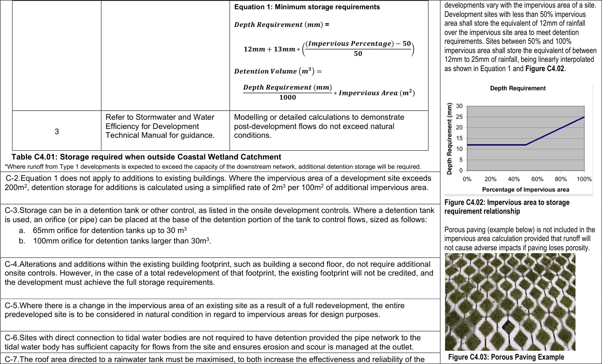
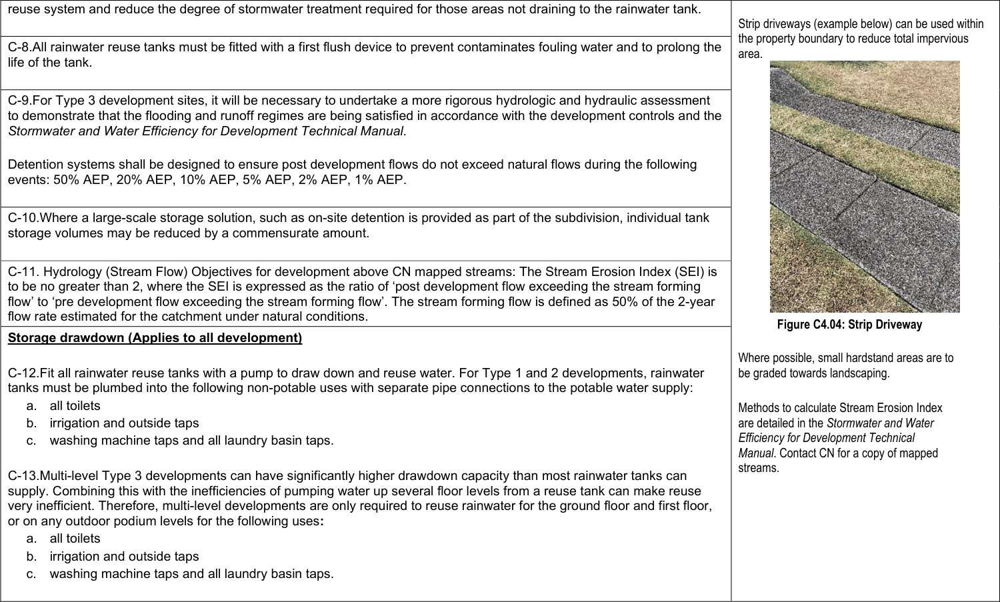
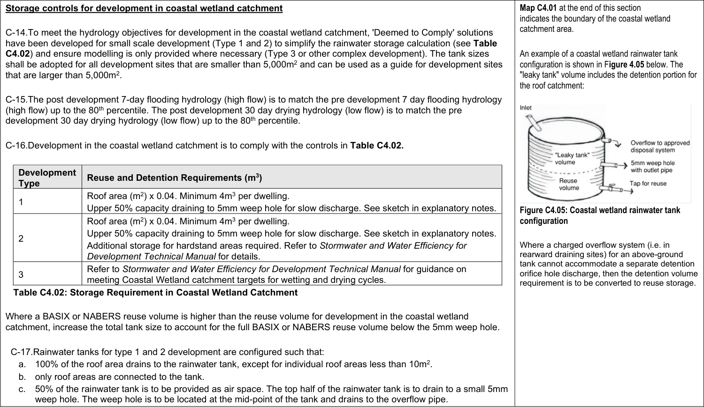

### 9.0 Water quantity

| Objectives 1. Maximise the reusability of stormwater through appropriate storage solutions. 2. Ensure that post development runoff matches the natural water runoff regime as closely as possible. 3. Establish stormwater management requirements for development in coastal wetland catchments and minimise impacts of stormwater run-off on coastal wetlands. |  |
|---|---|
| Controls (C) | Explanatory notes |
| Onsite storage can reduce stormwater runoff from development sites. Detention systems shall be included to ensure peak runoff flow rates from developments do not exceed natural conditions. In addition, rainwater runoff from clean surfaces like roofs can be stored and reused onsite through non-potable water uses to reduce demand on the potable water supply. Rainwater storage requirements are based on the development types in sub-section 7.0. 'Deemed to Comply' solutions are developed for small scale development (Type 1 and 2) to simplify the rainwater storage calculation (see Table C4.01) and ensure modelling is only provided where necessary (Type 3 or other complex development). C-1.Storage requirements are outlined in Table C4.01 for development outside the coastal wetland catchment. Storage requirements for development in the coastal wetland catchment are outlined in Table C4.02. Development type Reuse requirement Detention requirement If total impervious area onsite exceeds 200m2, provide 1 Apply BASIX 2m3 with 65mm outlet orifice or pipe. Sized in accordance with Equation 1 or Minimum 2m3, whichever is the greater. Reuse in accordance with BASIX Equation 1 outlines the calculation used to determine or NABERS where applicable. the detention storage requirement for all type 2 2 Otherwise, reuse sized at 1m3 per development. 100m2 roof catchment. Minimum 2m3. | Figure C4.01: Example of above-ground tank with reuse and detention portions Detention requirements for roof areas can be achieved in above-ground tanks (where possible) as shown in the sketch above. Rainwater for reuse is provided in the lower portion, while detention is provided in the upper portion. An orifice hole is cut into the tank at the bottom of the detention portion to act as a flow control. Where a charged overflow system (i.e. in rearward draining sites) for an above-ground tank cannot accommodate a separate detention orifice hole discharge, then the detention volume requirement is to be converted to reuse storage. Detention storage requirements for Type 2 |

Newcastle Development Control Plan 2023

C4 Stormwater

Page 11 of 23

________________________________________________________________________________________________________________________________________

> [Picture on page 12: a picture, saved as a picture (images/section-c4-stormwater-page-12-2.gif, 150 dpi).]
> Words printed on the picture (title and legend, copied from the PDF):
> 3
> Equation 1: Minimum storage requirements
> 𝑫𝒆𝒑𝒕𝒉 𝑹𝒆𝒒𝒖𝒊𝒓𝒆𝒎𝒆𝒏𝒕 (𝒎𝒎) =
> 𝟏𝟐𝒎𝒎+ 𝟏𝟑𝒎𝒎∗൬(𝑰𝒎𝒑𝒆𝒓𝒗𝒊𝒐𝒖𝒔 𝑷𝒆𝒓𝒄𝒆𝒏𝒕𝒂𝒈𝒆) −𝟓𝟎
> 𝟓𝟎
> ൰
> 𝑫𝒆𝒕𝒆𝒏𝒕𝒊𝒐𝒏 𝑽𝒐𝒍𝒖𝒎𝒆 ൫𝒎𝟑൯=
> 𝑫𝒆𝒑𝒕𝒉 𝑹𝒆𝒒𝒖𝒊𝒓𝒆𝒎𝒆𝒏𝒕 (𝒎𝒎)
> 𝟏𝟎𝟎𝟎
> ∗𝑰𝒎𝒑𝒆𝒓𝒗𝒊𝒐𝒖𝒔 𝑨𝒓𝒆𝒂 (𝒎𝟐)
> \*Where runoff from Type 1 developments is expected to exceed the capacity of the downstream network, additional detention storage will be required.

Refer to Stormwater and Water Efficiency for Development Technical Manual for guidance.

Modelling or detailed calculations to demonstrate post-development flows do not exceed natural conditions.

#### Table C4.01: Storage required when outside Coastal Wetland Catchment

developments vary with the impervious area of a site. Development sites with less than 50% impervious area shall store the equivalent of 12mm of rainfall over the impervious site area to meet detention requirements. Sites between 50% and 100% impervious area shall store the equivalent of between 12mm to 25mm of rainfall, being linearly interpolated as shown in Equation 1 and Figure C4.02.

C-2.Equation 1 does not apply to additions to existing buildings. Where the impervious area of a development site exceeds 200m2, detention storage for additions is calculated using a simplified rate of 2m3 per 100m2 of additional impervious area.

#### Figure C4.02: Impervious area to storage

C-3.Storage can be in a detention tank or other control, as listed in the onsite development controls. Where a detention tank requirement relationship is used, an orifice (or pipe) can be placed at the base of the detention portion of the tank to control flows, sized as follows:

Porous paving (example below) is not included in the impervious area calculation provided that runoff will not cause adverse impacts if paving loses porosity.

a. 65mm orifice for detention tanks up to 30 m3

b. 100mm orifice for detention tanks larger than 30m3.

C-4.Alterations and additions within the existing building footprint, such as building a second floor, do not require additional onsite controls. However, in the case of a total redevelopment of that footprint, the existing footprint will not be credited, and the development must achieve the full storage requirements.

C-5.Where there is a change in the impervious area of an existing site as a result of a full redevelopment, the entire predeveloped site is to be considered in natural condition in regard to impervious areas for design purposes.

C-6.Sites with direct connection to tidal water bodies are not required to have detention provided the pipe network to the tidal water body has sufficient capacity for flows from the site and ensures erosion and scour is managed at the outlet. C-7.The roof area directed to a rainwater tank must be maximised, to both increase the effectiveness and reliability of the

#### Figure C4.03: Porous Paving Example

Newcastle Development Control Plan 2023

C4 Stormwater

Page 12 of 23

________________________________________________________________________________________________________________________________________

> [Picture on page 13: a picture, saved as a picture (images/section-c4-stormwater-page-13-2.gif, 150 dpi).]

reuse system and reduce the degree of stormwater treatment required for those areas not draining to the rainwater tank.

Strip driveways (example below) can be used within the property boundary to reduce total impervious

C-8.All rainwater reuse tanks must be fitted with a first flush device to prevent contaminates fouling water and to prolong the

area.

life of the tank.

C-9.For Type 3 development sites, it will be necessary to undertake a more rigorous hydrologic and hydraulic assessment to demonstrate that the flooding and runoff regimes are being satisfied in accordance with the development controls and the Stormwater and Water Efficiency for Development Technical Manual.

Detention systems shall be designed to ensure post development flows do not exceed natural flows during the following events: 50% AEP, 20% AEP, 10% AEP, 5% AEP, 2% AEP, 1% AEP.

C-10.Where a large-scale storage solution, such as on-site detention is provided as part of the subdivision, individual tank storage volumes may be reduced by a commensurate amount.

C-11. Hydrology (Stream Flow) Objectives for development above CN mapped streams: The Stream Erosion Index (SEI) is to be no greater than 2, where the SEI is expressed as the ratio of ‘post development flow exceeding the stream forming flow’ to ‘pre development flow exceeding the stream forming flow’. The stream forming flow is defined as 50% of the 2-year flow rate estimated for the catchment under natural conditions.

#### Storage drawdown (Applies to all development)

#### Figure C4.04: Strip Driveway

Where possible, small hardstand areas are to

C-12.Fit all rainwater reuse tanks with a pump to draw down and reuse water. For Type 1 and 2 developments, rainwater be graded towards landscaping. tanks must be plumbed into the following non-potable uses with separate pipe connections to the potable water supply:

a. all toilets

b. irrigation and outside taps

c. washing machine taps and all laundry basin taps.

Methods to calculate Stream Erosion Index are detailed in the Stormwater and Water Efficiency for Development Technical Manual. Contact CN for a copy of mapped streams.

C-13.Multi-level Type 3 developments can have significantly higher drawdown capacity than most rainwater tanks can supply. Combining this with the inefficiencies of pumping water up several floor levels from a reuse tank can make reuse very inefficient. Therefore, multi-level developments are only required to reuse rainwater for the ground floor and first floor, or on any outdoor podium levels for the following uses:

a. all toilets

b. irrigation and outside taps

c. washing machine taps and all laundry basin taps.

Newcastle Development Control Plan 2023

C4 Stormwater

Page 13 of 23

________________________________________________________________________________________________________________________________________

> [Picture on page 14: a picture, saved as a picture (images/section-c4-stormwater-page-14-2.gif, 150 dpi).]
> Words printed on the picture (title and legend, copied from the PDF):
> Where a charged overflow system (i.e. in
> rearward draining sites) for an above-ground
> tank cannot accommodate a separate detention
> orifice hole discharge, then the detention volume
> requirement is to be converted to reuse storage.

Map C4.01 at the end of this section indicates the boundary of the coastal wetland

#### Storage controls for development in coastal wetland catchment

C-14.To meet the hydrology objectives for development in the coastal wetland catchment, 'Deemed to Comply' solutions

catchment area.

have been developed for small scale development (Type 1 and 2) to simplify the rainwater storage calculation (see Table C4.02) and ensure modelling is only provided where necessary (Type 3 or other complex development). The tank sizes An example of a coastal wetland rainwater tank shall be adopted for all development sites that are smaller than 5,000m2 and can be used as a guide for development sites configuration is shown in Figure 4.05 below. The

"leaky tank" volume includes the detention portion for the roof catchment:

that are larger than 5,000m2.

C-15.The post development 7-day flooding hydrology (high flow) is to match the pre development 7 day flooding hydrology (high flow) up to the 80th percentile. The post development 30 day drying hydrology (low flow) is to match the pre development 30 day drying hydrology (low flow) up to the 80th percentile.

C-16.Development in the coastal wetland catchment is to comply with the controls in Table C4.02.

| Development Type | Reuse and Detention Requirements (m3) |
|---|---|
| 1 | Roof area (m2) x 0.04. Minimum 4m3 per dwelling. Upper 50% capacity draining to 5mm weep hole for slow discharge. See sketch in explanatory notes. |
| 2 | Roof area (m2) x 0.04. Minimum 4m3 per dwelling. Upper 50% capacity draining to 5mm weep hole for slow discharge. See sketch in explanatory notes. Additional storage for hardstand areas required. Refer to Stormwater and Water Efficiency for Development Technical Manual for details. |
| 3 | Refer to Stormwater and Water Efficiency for Development Technical Manual for guidance on meeting Coastal Wetland catchment targets for wetting and drying cycles. |

#### Figure C4.05: Coastal wetland rainwater tank configuration

#### Table C4.02: Storage Requirement in Coastal Wetland Catchment

Where a BASIX or NABERS reuse volume is higher than the reuse volume for development in the coastal wetland catchment, increase the total tank size to account for the full BASIX or NABERS reuse volume below the 5mm weep hole.

C-17.Rainwater tanks for type 1 and 2 development are configured such that:

a. 100% of the roof area drains to the rainwater tank, except for individual roof areas less than 10m2.

b. only roof areas are connected to the tank.

c. 50% of the rainwater tank is to be provided as air space. The top half of the rainwater tank is to drain to a small 5mm weep hole. The weep hole is to be located at the mid-point of the tank and drains to the overflow pipe.

Newcastle Development Control Plan 2023

C4 Stormwater

Page 14 of 23

________________________________________________________________________________________________________________________________________
