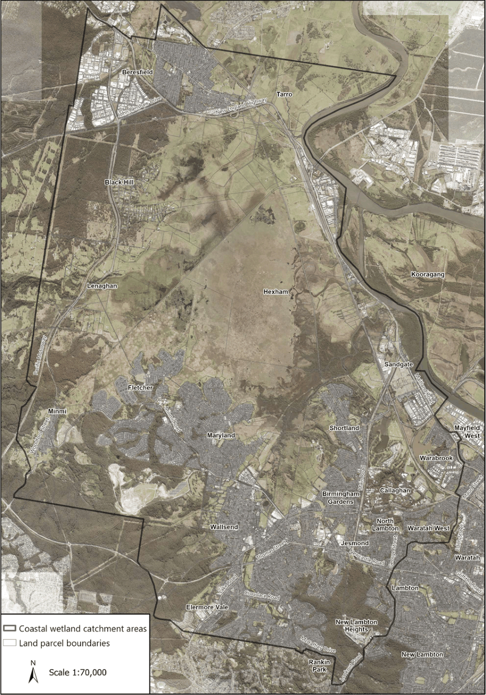

### 13.0 Existing drainage systems, easements and waterfront land

#### Objectives

1\. Ensure appropriate easements are provided over drainage systems on private properties.

2\. Ensure easements are unimpeded by development for maintenance purposes and high flow overland flow paths.

3\. Ensure development containing or adjacent to waterfront land maintains or rehabilitates the environmental values and drainage functions of riparian corridors.

4\. Ensure discharge points to waterways and/or waterway crossings do not increase the risk of erosion, blockage or flooding both onsite and offsite.

#### Controls (C)

#### Explanatory notes

C-1. Where the development site's drainage system serves other lands, that system is to be protected by an easement in favour of the beneficiary of the drainage system to permit the continued use of the drain. A drainage easement gives the beneficiary the right to maintain the pipes contained in the easement. Where necessary, upstream lots are to be given a legal right to drain through a development site.

C-2. Where an existing drainage system across the site is retained, the proposed development is not to obstruct access to the existing system. The development is to be designed to be structurally independent and not degrade the structural integrity of the drainage system.

C-3. Where an existing drainage line runs under a proposed building, the drainage line and any associated easement may be diverted around the building subject to approval. Designs showing proposed alterations to the easement must demonstrate the following:

a. creates no negative impact on existing hydraulics

The Stormwater and Water Efficiency for Development Technical Manual provides additional information on existing drainage systems and stormwater easements.

Extinguishing or creating easements shall be carried out in accordance with the Conveyancing Act 1919.

b. includes provision of overland flow paths

c. addresses access requirements for maintenance

d. minimises asset creation i.e., total length of drainage infrastructure/number of pits

e. consistent with riparian corridor guidelines and offsetting

f. redundant easements are to be extinguished and new easements are to be created. New easements will be subject to the minimum width requirements as set out in Table C4.05. Discrete lengths of the easement may be reduced to accommodate existing structures pending CN approval.

Newcastle Development Control Plan 2023

C4 Stormwater

Page 21 of 23

________________________________________________________________________________________________________________________________________

Pipe internal diameter (D) (mm) or other as detailed

Drainage easement width

<225 private pipes only

1.5m

225-300 private pipes only

2m

225-900

3m

900>

4m

twin pipes

2D + distance between pipes + 2.4m

culvert(s)

Extent of base slab(s) + 2.4m

overland flow path function

Pipe/culvert Drainage easement width; or 1% AEP design surface flow width in full drainage blockage scenario,

whichever is greater

open channels

Overall width of channel structure + 2.4m, or width of 1% AEP design flow, whichever is greater

#### Table C4.05: Minimum easement widths

C-4. CN mapped first order streams require assessment for their riparian corridor function. Type 2 and 3 development is to be designed to protect CN mapped streams and achieve the stream erosion index (SEI) targets set in sub-section 9.0.

C-5. Development discharging to waterways or is carried out on waterfront land is to meet the Water Management Act 2000 requirements and the NSW Government guidelines for riparian corridors on waterfront land.

C-6. Development on sites which contain, or are adjacent to waterways, shall provide plans which meet sub-section 7.0. The provision of vegetated riparian zones and development offsets from the top of bank is preferred, in accordance with relevant guidelines and legislation, and to provide local waterway stability, drainage function, and riparian corridor values.

C-7. Where development within riparian zones, including waterway crossings are deemed necessary the following must be complied with:

a. designs for proposed waterway crossings and adjustments are to be meet the provisions set out in sub-section 7.0.

b. the waterway crossing design must demonstrate that no adverse flood impacts will result for the site and neighbouring properties (in

CN's Stormwater and Water Efficiency for Development Technical Manual, includes riparian zone definitions and offsetting guidance as set out in the NSW Government Guidelines for riparian corridors on waterfront

land.

terms of depth, velocity and flood hazard) for the 10% AEP, 1% AEP and 1% AEP in 2050 events. Pending the sensitivity of the site and drainage context, calculated water levels for more frequent storms may be required

c. the waterway crossing design must demonstrate how onsite and offsite erosion and blockage risks will be addressed. They must consider and indicate the nature and extent of measures to manage velocity scour and mass failure risks to bed and bank within the site and include riparian native revegetation in any surface stabilisation and landscaping solutions.

Newcastle Development Control Plan 2023

C4 Stormwater

Page 22 of 23

_______________________________________________

> [Picture on page 23: a picture, saved as a picture (images/section-c4-stormwater-page-23-2.gif, 150 dpi).]

#### Map C4.01: Coastal wetland catchment areas
