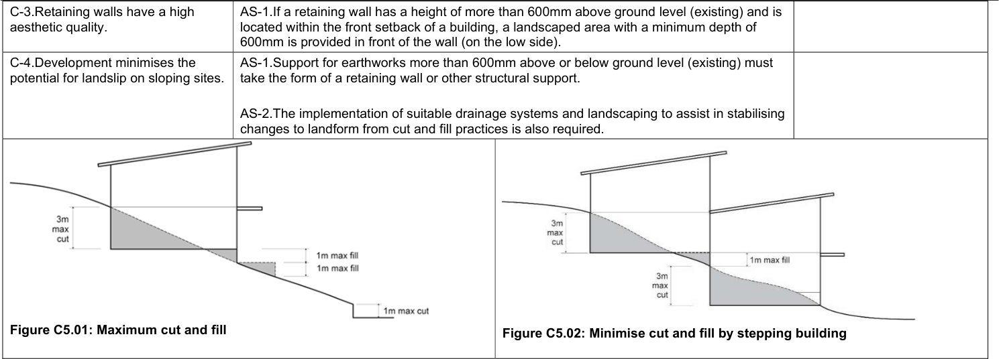

### 8.0 Earthworks (land reshaping)

| Objectives 1. Encourage site responsive development and protect the amenity of adjoining land. 2. Avoid excessive earthworks and minimise changes to the natural landform. 3. Limit the extent of retaining walls, excavation and fill within development projects for aesthetic, character, engineering and geotechnical reasons. 4. Avoid slab on ground construction where the gradient and characteristics of the site would require major excavation or filling. |  |  |
|---|---|---|
| Controls (C) | Acceptable solutions (AS) | Explanatory notes |
| C-1.Development is designed to: a. protect the amenity of adjoining land from unreasonable impacts as a result of cut and fill b. avoid excessive earthworks to minimise changes to the natural landform c. encourage site layout and building design that is appropriate to the site conditions, including the use of split level, pier foundations or suspended floor house design. | AS-1.Development is consistent with Figure C5.01 and Figure C5.02. AS-2.Development minimises the amount of cut and fill required, with maximum acceptable: a. cut of 3m within the building envelope b. fill within building envelope of 1m c. cut external to building envelope of 1m d. fill external of building envelope of 1m e. variation to (a), (b), (c) or (d) above will require justification, design and certification by a Structural Engineer. AS-3.Buildings are designed to relate to the existing topography with minimal excavation or fill and the height of foundations kept to a minimum. AS-4.No cut or fill takes place within easements. AS-5.If fill is to be used it is VENM. AS-6.Storm water / surface water runoff as a result of earthworks is not to be redirected or concentrated onto adjoining properties so as to cause a nuisance | The topography and existing land form of the site are important to the character of an area. Where the site has a sloped topography, building design should be characterised by a split level approach where floor levels are stepped to follow the topography of the land. Large areas of cut and fill should be avoided so that the finished ground floor level can be close to existing ground level. Under the Protection of the Environmental Operations Act 1997, if landfill contains material other than VENM, a certificate may be needed before using it as fill. Further information can be found on the NSW EPA website. |
| C-2.Owners of retaining walls have clear ownership and maintenance obligations. | AS-1.Retaining walls are located clear of lot boundaries to ensure clear ownership and maintenance obligations for owners. AS-2.Retaining wall subsoil drainage is accommodated entirely within the property(ies). |  |

Newcastle Development Control Plan 2023

C5 Soil management

Page 10 of 11

> [Picture on page 11: a picture, saved as a picture (images/section-c5-soil-management-page-11-1.gif, 150 dpi).]

C-3.Retaining walls have a high aesthetic quality.

AS-1.If a retaining wall has a height of more than 600mm above ground  level (existing) and is located within the front setback of a building, a landscaped area with a minimum depth of 600mm is provided in front of the wall (on the low side).

C-4.Development minimises the potential for landslip on sloping sites.

AS-1.Support for earthworks more than 600mm above or below ground level (existing) must take the form of a retaining wall or other structural support.

AS-2.The implementation of suitable drainage systems and landscaping to assist in stabilising changes to landform from cut and fill practices is also required.

#### Figure C5.01: Maximum cut and fill

#### Figure C5.02: Minimise cut and fill by stepping building

Newcastle Development Control Plan 2023

C5 Soil management

Page 11 of 11
