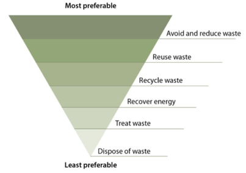

### 1.0 Introduction

Waste can be a resource or a problem depending on how we produce, consume, store and dispose of resources. This process needs to consider all stages of a development, from construction to ongoing use and demolition.

A set of priorities for the efficient use of resources is set by the 'waste hierarchy'. This underpins the objectives of the Waste Avoidance and Resource Recovery Act 2001 and prioritises initially avoiding and reducing waste generation over disposing of waste, see Figure C6.01 below.

> [Picture on page 2: a picture, saved as a picture (images/section-c6-waste-management-page-2-8.gif, 150 dpi).]

#### Figure C6.01: The waste hierarchy, NSW Environment Protection Authority (EPA)

Innovative and alternate waste management systems for development applications which deliver sound planning and environmental outcomes for the development and the broader community are supported. The applicant is encouraged to consider City of Newcastle’s (CN) Our Sustainable Waste Strategy (2022) and discuss the potential for partnerships, collaboration, education, and innovative solutions, before, during, and post- building works, with CN's Waste Management Team and during the pre-development application service.

#### Waste collection

The following table is a general guide to the waste collection systems. Further details are presented in the subsections below.

|  | Bin type | Operation | Residential | Non-residential |
|---|---|---|---|---|
| Kerbside collection | Council provided 'wheelie' bins | Conducted by collection vehicle on the street. It is the resident's, business owner's or strata's responsibility to move the bins to and from the street. | Most common. Used for single dwellings and some multi dwelling housing. | For properties with less than 5 tenancies. |
| Collect- and-return | Council provided 'wheelie' bins or communal waste bins | The collection vehicle parks at the property frontage, and the council operators enter the property and retrieve the bins for collection from the presentation point. A presentation point is the area where bins can be collected by operators near the street entry. In some situations, this is separate to the communal waste storage area. | When the site conditions do not allow for kerbside collection or on- site collection. Generally, for properties with between 5 and 50 dwellings. | Properties with 5 or more tenancies, but less than 13,200 litres of general waste. Or as discussed with CN. |
| On-site collection | Communal waste bins | The collection vehicle enters the site to collect the waste. | For an apartment building with more than 50 dwellings or as agreed with CN. | Properties producing more than 13,200 litres of general waste. |

_________________________________________________________________________________________
