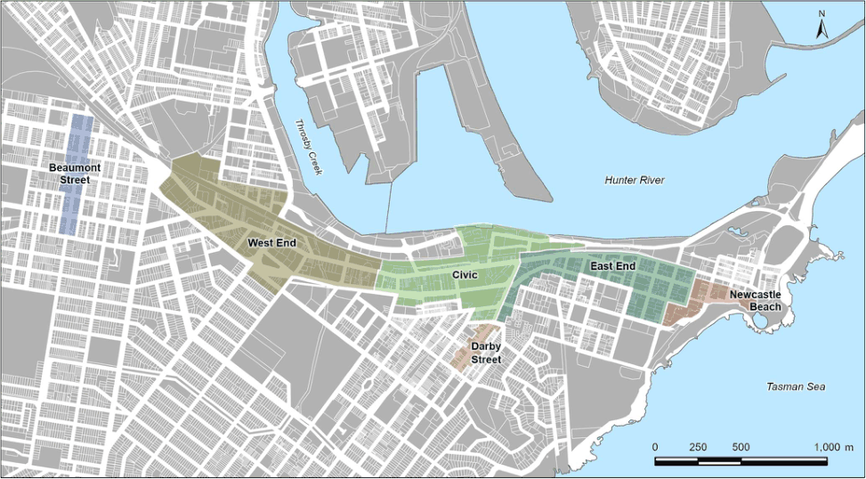

### 1.0 Introduction

Advertising and signage that is well designed, positioned and detailed plays an important role in supporting local businesses and assisting residents and visitors find their way around our city. Signage generally refers to a business or building identification sign, where advertising is commercial signage, generally for a third party that does not have a tenancy in the property.

Signage and advertising should be compatible with its locality. As such, this section promotes development of this nature to respect characteristics of buildings, vistas and streetscapes while maintaining a high level of safety and amenity for residents, pedestrians and road users.

The impact of advertising and signage to heritage items and heritage conservation areas is also recognised as an important consideration. Identified advertising and signage precincts are commercial areas within heritage conservation areas that have been planned for to ensure signage proposed is considerate and complementary to the surrounding area.

> [Picture on page 2: a picture, saved as a picture (images/section-c9-advertising-and-signage-page-2-13.gif, 150 dpi).]

#### Map C9.01: Advertising and signage precincts across Newcastle LGA

All development should meet the general criteria, and any applicable criteria for each specific signage type and/or identified precinct where relevant. It must consider relevant provisions within State Environmental Planning Policy (Industry and Employment) 2021 and the Transport Corridor Outdoor Advertising and Signage Guidelines.

Unless specified as exempt development under an environmental planning instrument, such as Newcastle Local Environmental Plan 2012 (LEP 2012) or a State environmental planning policy, all signage requires development consent. Signage placed or installed within the road reserve may require separate approval under the Roads Act 1993.
